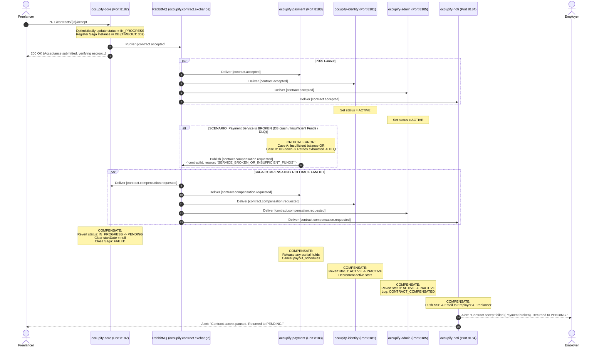

# Distributed Transaction Plan: User Accept & Reject Contract (Saga Architecture)

> **Bounded Context Focus:** `occupify-core` (Marketplace)  
> **Target Document:** `occupify-core/doc/user_accept_contract.md`  
> **Scope:** User Accept Contract & User Reject Contract with Complete Saga Failure & Compensation Handling  
> **Ecosystem Participants (5 Services):**
> 1. `occupify-core` (Port `8182` - Contract Lifecycle Owner, Outbox Publisher & Saga Watchdog)
> 2. `occupify-payment` (Port `8183` - Wallet Escrow & Payout Scheduler - *Pivot Step*)
> 3. `occupify-identity` (Port `8181` - User Profiles, Replicated Contracts with `ACTIVE`/`INACTIVE`)
> 4. `occupify-noti` (Port `8184` - SSE Alert & Email Delivery to Employer)
> 5. `occupify-administration` (Port `8185` - Platform Audit Logs, Replicated Contracts with `ACTIVE`/`INACTIVE`)

---

## 1. Executive Summary & Saga Design

Contract negotiation across 5 microservices requires an **Event-Driven Saga Choreography with Automated Compensation**. When any participating service is **broken, offline, crashes, or fails business checks**, the system must guarantee that partial writes are completely **rolled back (compensated)** across all databases, leaving no corrupted or half-active states.

```
                             [ Employer Creates Contract ]
                                          |
                                   (Status: PENDING)
                                          |
                        +-----------------+-----------------+
                        |                                   |
             [ Freelancer ACCEPTS ]               [ Freelancer REJECTS ]
                        |                                   |
              contract.accepted                    contract.rejected
                        |                                   |
         Fans out to ALL 4 Queues:            Fans out to ALL 4 Queues:
         • payment: Hold Escrow & Arm Sched   • payment: Release Hold & Stop Sched
         • identity: Status = ACTIVE          • identity: Status = INACTIVE
         • admin: Status = ACTIVE             • admin: Status = INACTIVE
         • noti: Notify Employer              • noti: Notify Employer
                        |
       +----------------+----------------+
       |                                 |
[ Everything OK ]               [ A Service is BROKEN? ]
       |                                 |
Transaction Settled           TRIGGER SAGA COMPENSATION
                                         |
                            contract.compensation.requested
                                         |
                           +-------------+-------------+
                           |                           |
                  Core rolls back to PENDING   Identity & Admin roll to INACTIVE
                  Payment releases any hold    Noti alerts both parties of failure
```

---

## 2. Cross-Service Contract State & Enum Mapping

The table below defines both forward states and compensated rollback states:

| Lifecycle Action | `occupify-core` (`ContractStatus`) | `occupify-payment` (`ContractStatus`) | `occupify-identity` (`status`) | `occupify-administration` (`status`) | `occupify-noti` Event Code |
| :--- | :--- | :--- | :--- | :--- | :--- |
| **Initial State (Offer)** | `PENDING` | `PENDING` | `PENDING` | `PENDING` | `CONTRACT_OFFER_SENT` |
| **User Accepts (Optimistic)** | `IN_PROGRESS` | `IN_PROGRESS` *(Escrow Held & Sched ACTIVE)* | **`ACTIVE`** | **`ACTIVE`** | `CONTRACT_ACCEPTED_EMPLOYER` |
| **Service Broken (Compensated)** | **`PENDING`** *(Reverted)* | **`CANCELLED`** / Released | **`INACTIVE`** *(Reverted)* | **`INACTIVE`** *(Reverted)* | `CONTRACT_ACCEPTANCE_FAILED` |
| **User Rejects** | `CANCELLED` | `CANCELLED` *(Sched CANCELLED)* | **`INACTIVE`** | **`INACTIVE`** | `CONTRACT_REJECTED_EMPLOYER` |

---

## 3. RabbitMQ Exchange & Multi-Queue Routing

### 3.1. Topic Exchange Topology

All events publish to: **`occupify.contract.exchange`** (`TopicExchange`).

```
                                [ occupify.contract.exchange ] (TopicExchange)
                                                |
               +--------------------+-----------+-----------+--------------------+
               |                    |                       |                    |
        contract.accepted    contract.accepted       contract.accepted    contract.accepted
        contract.rejected    contract.rejected       contract.rejected    contract.rejected
        contract.compensation.* contract.compensation.* contract.compensation.* contract.compensation.*
               |                    |                       |                    |
               v                    v                       v                    v
      occupify.payment      occupify.identity       occupify.admin        occupify.noti
      .contract.queue       .contract.queue         .contract.queue       .contract.queue
```

### 3.2. Routing Keys & Responsibilities

| Routing Key | Published By | Consumers | Action Taken |
| :--- | :--- | :--- | :--- |
| `contract.accepted` | `occupify-core` | `payment` | Lock Escrow in Employer wallet; arm Payout Scheduler; set status `IN_PROGRESS` |
| | | `identity` | Store replicated contract with status **`ACTIVE`**; increment active engagements |
| | | `admin` | Store replicated contract with status **`ACTIVE`**; write audit log `CONTRACT_ACCEPTED` |
| | | `noti` | Send real-time SSE push & email to **Employer** (*"Freelancer accepted contract"*) |
| `contract.compensation.requested` | `payment` / DLQ Handler / Core Watchdog | `core` | **COMPENSATE:** Revert contract status from `IN_PROGRESS` back to **`PENDING`** |
| | | `payment` | **COMPENSATE:** Unlock any reserved wallet balance; cancel payout schedules |
| | | `identity` | **COMPENSATE:** Revert replicated contract status back to **`INACTIVE`** |
| | | `admin` | **COMPENSATE:** Revert status to **`INACTIVE`**; write failure audit log |
| | | `noti` | **COMPENSATE:** Alert Employer & Freelancer (*"Contract acceptance failed; returned to PENDING"*) |
| `contract.rejected` | `occupify-core` | `payment` | Release preliminary reservation; stop Payout Scheduler; set status `CANCELLED` |
| | | `identity` | Update replicated contract to **`INACTIVE`** |
| | | `admin` | Update replicated contract to **`INACTIVE`**; write audit log `CONTRACT_REJECTED` |
| | | `noti` | Send real-time SSE push & email to **Employer** (*"Freelancer rejected contract"*) |

---

## 4. How Broken Services Are Detected & How Compensation Works

When a service breaks, the failure falls into one of three technical categories. Here is exactly how each case is detected, who triggers the rollback, and how each service executes compensation.

### 4.1. The 3 Failure Triggers

```
                         How a Failure is Detected
                                    |
     +------------------------------+------------------------------+
     |                                                             |
[Trigger 1: Explicit Business/DB Error]             [Trigger 2: Silent Crash / DLQ Exhaustion]
Payment catches Insufficient Funds,                 Consumer crashes, DB down, or code bug.
Pessimistic Lock Timeout, or SQL Exception.         Message retried 3 times, lands in DLQ.
     |                                                             |
     v                                                             v
Payment immediately publishes:                      DLQ Handler Consumer detects poison msg,
contract.compensation.requested                     publishes: contract.compensation.requested
     |                                                             |
     +------------------------------+------------------------------+
                                    |
                    [Trigger 3: Hard Network Partition / Node Hang]
                    Service completely hangs; never responds.
                    Saga Watchdog Timer in Core (30s) trips, publishes:
                    contract.compensation.requested
```

1. **Trigger 1 (Handled / Business Error in Payment)**:
   - When `occupify-payment` checks the wallet balance and finds `available_balance < budget`, or encounters a database lock timeout:
   - Payment immediately catches the exception and publishes `contract.compensation.requested` with `{ contractId, reason: "INSUFFICIENT_FUNDS" }`.
2. **Trigger 2 (Unhandled Crash $\rightarrow$ Dead Letter Queue Handler)**:
   - If `occupify-payment` or any critical consumer throws an unhandled exception (e.g. JVM crash, database connection pool exhausted, network drop):
   - RabbitMQ retries the message 3 times with exponential backoff (1s, 5s, 15s).
   - When all retries fail, RabbitMQ automatically routes the message to the Dead Letter Queue: `occupify.payment.contract.dlq`.
   - A dedicated **DLQ Handler Listener** inspects the rejected message and publishes `contract.compensation.requested` with `{ contractId, reason: "PAYMENT_SERVICE_UNAVAILABLE" }`.
3. **Trigger 3 (Silent Node Freeze $\rightarrow$ Core Saga Watchdog Timer)**:
   - If a service hangs indefinitely without throwing an exception or acking:
   - `occupify-core` maintains a `saga_instances` table with a 30-second timeout.
   - If no confirmation is recorded within 30 seconds, a background scheduled task (`SagaWatchdog`) marks the Saga `FAILED` and publishes `contract.compensation.requested`.

---

### 4.2. Exact Compensation Actions per Service

When `contract.compensation.requested` arrives, every service executes a strict rollback to clean up its local database:

| Service | Local Compensating Action (Rollback) | Resulting Local State |
| :--- | :--- | :--- |
| **`occupify-core`** | 1. Reverts `status` from `IN_PROGRESS` back to **`PENDING`**.<br/>2. Clears `startDate = null`.<br/>3. Unlocks the job slot so the contract can be accepted again once fixed. | Contract is once again an open `PENDING` offer. |
| **`occupify-payment`** | 1. If any funds were moved to `locked_balance`, transfers them back to `available_balance`.<br/>2. Sets `payout_schedules` to `CANCELLED`.<br/>3. Sets local contract replica to `FAILED_ESCROW`. | No locked funds; no active payout cron. |
| **`occupify-identity`** | 1. Reverts replicated contract `status` from `ACTIVE` to **`INACTIVE`**.<br/>2. Decrements active project count on user profile. | User profile reflects 0 active contracts. |
| **`occupify-administration`** | 1. Reverts replicated contract `status` to **`INACTIVE`**.<br/>2. Appends audit log: `CONTRACT_COMPENSATION_EXECUTED` with exact failure reason. | Immutable audit log of the failure preserved. |
| **`occupify-noti`** | 1. Pushes real-time SSE event to Employer: *"Kích hoạt hợp đồng thất bại do lỗi thanh toán. Hợp đồng đã được trả về trạng thái PENDING."*<br/>2. Pushes SSE event to Freelancer: *"Chưa thể kích hoạt hợp đồng do bên tuyển dụng gặp sự cố ký quỹ."* | Both parties are immediately informed. |

---

## 5. Sequence Diagram: Service Broken & Saga Compensation Flow

Here is the complete end-to-end trace of a broken service triggering automated compensation across all 5 microservices:



---

## 6. What the User (Client Frontend) Experiences

To prevent the user from being trapped in an inconsistent state:

1. **Immediate API Response:**
   - When Freelancer clicks "Chấp nhận", `occupify-core` returns `200 OK` with status `ACCEPT_PROCESSING` (or `IN_PROGRESS`).
2. **If Compensation Triggers (Service Broken):**
   - The frontend WebSocket / SSE connection in `occupify-web` listens to `CONTRACT_COMPENSATION_EVENT`.
   - The UI immediately pops a toast alert:
     > ⚠️ *"Không thể kích hoạt hợp đồng: Dịch vụ thanh toán gặp sự cố hoặc số dư người thuê không đủ. Hợp đồng đã được hoàn về trạng thái Chờ xác nhận."*
   - The contract badge dynamically switches from `Đang làm` back to `Chờ xác nhận` (`PENDING`).
   - The Freelancer and Employer see the button re-enabled so they can retry once the issue is resolved.

---

## 7. Event Contracts

### 7.1. `contract.accepted` (Forward Command)
```json
{
  "eventId": "a1b2c3d4-1111-2222-3333-444455556666",
  "eventType": "CONTRACT_ACCEPTED",
  "timestamp": "2026-10-25T10:30:00Z",
  "correlationId": "cor-abcdef01-2345-6789-abcd-ef0123456789",
  "payload": {
    "contractId": "3fa85f64-5717-4562-b3fc-2c963f66afa6",
    "jobId": "e1f2a3b4-c5d6-7e8f-9a0b-1c2d3e4f5a6b",
    "projectId": "8b8c8d8e-8f90-1a2b-3c4d-5e6f7a8b9c0d",
    "employerId": "c1a2b3c4-d5e6-7890-abcd-ef1234567890",
    "freelancerId": "f2b3c4d5-e6f7-8901-bcde-fa2345678901",
    "budget": 2500.00,
    "salaryType": "MONTHLY",
    "startDate": "2026-10-25",
    "endDate": "2026-12-31"
  }
}
```

### 7.2. `contract.compensation.requested` (Compensating Rollback Command)
```json
{
  "eventId": "e8f9a0b1-4444-5555-6666-777788889999",
  "eventType": "CONTRACT_COMPENSATION_REQUESTED",
  "timestamp": "2026-10-25T10:30:15Z",
  "correlationId": "cor-abcdef01-2345-6789-abcd-ef0123456789",
  "payload": {
    "contractId": "3fa85f64-5717-4562-b3fc-2c963f66afa6",
    "failedService": "occupify-payment",
    "failureType": "INSUFFICIENT_FUNDS_OR_SERVICE_CRASH",
    "reason": "Payment service failed to lock escrow after 3 retries or wallet has insufficient funds",
    "rollbackTargetStatus": "PENDING"
  }
}
```

### 7.3. `contract.rejected` (User Reject Command)
```json
{
  "eventId": "b2c3d4e5-5555-6666-7777-888899990000",
  "eventType": "CONTRACT_REJECTED",
  "timestamp": "2026-10-25T10:35:00Z",
  "correlationId": "cor-abcdef01-2345-6789-abcd-ef0123456789",
  "payload": {
    "contractId": "3fa85f64-5717-4562-b3fc-2c963f66afa6",
    "jobId": "e1f2a3b4-c5d6-7e8f-9a0b-1c2d3e4f5a6b",
    "employerId": "c1a2b3c4-d5e6-7890-abcd-ef1234567890",
    "freelancerId": "f2b3c4d5-e6f7-8901-bcde-fa2345678901",
    "reason": "Workload mismatch"
  }
}
```

---

## 8. REST Endpoints (`occupify-core`)

```java
@RestController
@RequestMapping("/contracts")
@RequiredArgsConstructor
public class ContractController extends AbstractBaseController {

  private final ContractService contractService;

  @PutMapping("/{id}/accept")
  public ResponseEntity<SingleResponse<ContractDetailResponse>> acceptContract(
      @PathVariable UUID id,
      @RequestHeader("X-User-Id") UUID freelancerId) {
    return success(
        contractService.acceptContract(id, freelancerId),
        "Contract accepted successfully. Verifying escrow...");
  }

  @PutMapping("/{id}/reject")
  public ResponseEntity<SingleResponse<ContractDetailResponse>> rejectContract(
      @PathVariable UUID id,
      @RequestHeader("X-User-Id") UUID freelancerId,
      @RequestBody(required = false) RejectContractRequest request) {
    return success(
        contractService.rejectContract(id, freelancerId, request),
        "Contract offer rejected.");
  }
}
```
