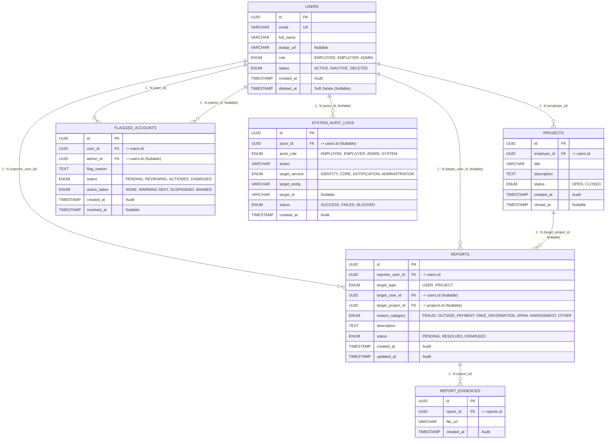

# Đặc tả Cơ sở Dữ liệu Dịch vụ Quản trị & Kiểm duyệt (Administration Service ERD)

> **Bounded Context**: **Administration** (`occupify-admin`)  
> **Cổng dịch vụ**: `8185` | **Database Name**: `occupify_admin` (PostgreSQL 16)  
> **Tài liệu tham chiếu toàn hệ thống**: Xem **[ECOSYSTEM-ERD.md](ECOSYSTEM-ERD.md)** để nắm toàn cảnh 5 Bounded Contexts của Occupify.

---

## 1. Giới thiệu Bounded Context Administration

Dịch vụ **Administration** (`occupify-admin`) chịu trách nhiệm bảo đảm tính an toàn, minh bạch, phòng chống gian lận và kiểm toán tuân thủ trên toàn bộ nền tảng Occupify:

### 1.1. Bảng Gốc (Native Domain Tables)
1. **`reports`**: Báo cáo vi phạm do người dùng gửi lên nhắm vào một người dùng khác hoặc một dự án cụ thể.
2. **`report_evidences`**: Các tệp tin bằng chứng (ảnh chụp màn hình, tài liệu vi phạm) đính kèm theo báo cáo.
3. **`flagged_accounts`**: Quản lý danh sách các tài khoản bị gắn cờ cảnh báo rủi ro hoặc áp dụng chế tài xử lý vi phạm.
4. **`system_audit_logs`**: Sổ cái nhật ký kiểm toán hệ thống ghi nhận toàn bộ các thao tác của tác nhân (User/Admin/System).

### 1.2. Bảng Sao Chép (Local Replicated Tables)
5. **`users`** *(Sao chép từ Identity)*: Thực thể người dùng nội bộ phục vụ ràng buộc khóa ngoại vật lý và đối chiếu profile khi xử lý vi phạm.
6. **`projects`** *(Sao chép từ Core)*: Thực thể dự án nội bộ phục vụ ràng buộc khóa ngoại khi xử lý báo cáo dự án vi phạm.

---

## 2. Sơ đồ Quan hệ Thực thể Nội bộ (Internal ERD)

CSDL `occupify_admin` duy trì các khóa ngoại vật lý (Physical Foreign Keys) nội bộ:

---

## 3. Đặc tả Chi tiết Các Bảng Dữ liệu

### 3.1. Bảng `reports` (Báo cáo vi phạm - Gốc)

| Tên cột | Kiểu dữ liệu | Ràng buộc | Giá trị mặc định | Mô tả nghiệp vụ |
|:---|:---|:---|:---|:---|
| `id` | `UUID` | **PK**, NOT NULL | `gen_random_uuid()` | Khóa chính của báo cáo |
| `reporter_user_id` | `UUID` | **FK** -> `users.id`, NOT NULL | None | Người dùng khởi tạo báo cáo (`users.id` nội bộ) |
| `target_type` | `ENUM('USER', 'PROJECT')` | NOT NULL | None | Đối tượng bị báo cáo (Người dùng hoặc Dự án) |
| `target_user_id` | `UUID` | **FK** -> `users.id`, NULLABLE | NULL | Người dùng bị báo cáo (nếu `target_type = USER`) |
| `target_project_id`| `UUID` | **FK** -> `projects.id`, NULLABLE | NULL | Dự án bị báo cáo (nếu `target_type = PROJECT`) |
| `reason_category` | `ENUM('FRAUD', 'OUTSIDE_PAYMENT', 'FAKE_INFORMATION', 'SPAM', 'HARASSMENT', 'OTHER')` | NOT NULL | None | Danh mục lý do vi phạm |
| `description` | `TEXT` | NOT NULL | None | Diễn giải chi tiết nội dung vi phạm |
| `status` | `ENUM('PENDING', 'RESOLVED', 'DISMISSED')` | NOT NULL | `'PENDING'` | Trạng thái xử lý báo cáo |
| `created_at` | `TIMESTAMP` | NOT NULL | `CURRENT_TIMESTAMP` | Thời điểm gửi báo cáo (Audit) |
| `updated_at` | `TIMESTAMP` | NOT NULL | `CURRENT_TIMESTAMP` | Thời điểm cập nhật trạng thái (Audit) |

---

### 3.2. Bảng `report_evidences` (Bằng chứng báo cáo - Gốc)

| Tên cột | Kiểu dữ liệu | Ràng buộc | Giá trị mặc định | Mô tả nghiệp vụ |
|:---|:---|:---|:---|:---|
| `id` | `UUID` | **PK**, NOT NULL | `gen_random_uuid()` | Khóa chính bằng chứng |
| `report_id` | `UUID` | **FK** -> `reports.id`, NOT NULL | None | Báo cáo liên quan |
| `file_url` | `VARCHAR(500)` | NOT NULL | None | Đường dẫn ảnh/tệp tin bằng chứng lưu trên Object Storage |
| `created_at` | `TIMESTAMP` | NOT NULL | `CURRENT_TIMESTAMP` | Thời điểm đính kèm bằng chứng (Audit) |

---

### 3.3. Bảng `projects` (Dự án - Local Entity sao chép từ Core)

| Tên cột | Kiểu dữ liệu | Ràng buộc | Giá trị mặc định | Mô tả nghiệp vụ |
|:---|:---|:---|:---|:---|
| `id` | `UUID` | **PK**, NOT NULL | None | Khóa chính dự án (đồng bộ từ Core) |
| `employer_id` | `UUID` | **FK** -> `users.id`, NOT NULL | None | Người dùng đăng bài tuyển dụng dự án |
| `title` | `VARCHAR(255)` | NOT NULL | None | Tiêu đề dự án |
| `description` | `TEXT` | NOT NULL | None | Mô tả chi tiết dự án |
| `status` | `ENUM('OPEN', 'CLOSED')` | NOT NULL | `'OPEN'` | Trạng thái dự án |
| `created_at` | `TIMESTAMP` | NOT NULL | `CURRENT_TIMESTAMP` | Thời điểm đăng tải (Audit) |
| `closed_at` | `TIMESTAMP` | NULLABLE | NULL | Thời điểm đóng dự án |

---

### 3.4. Bảng `users` (Người dùng - Local Entity sao chép từ Identity)

| Tên cột | Kiểu dữ liệu | Ràng buộc | Giá trị mặc định | Mô tả nghiệp vụ |
|:---|:---|:---|:---|:---|
| `id` | `UUID` | **PK**, NOT NULL | None | Khóa chính người dùng (đồng bộ từ Identity) |
| `email` | `VARCHAR(255)` | **UK**, NOT NULL | None | Email tài khoản duy nhất |
| `full_name` | `VARCHAR(150)` | NOT NULL | None | Họ và tên người dùng |
| `avatar_url` | `VARCHAR(500)` | NULLABLE | NULL | Đường dẫn ảnh đại diện |
| `role` | `ENUM('EMPLOYEE', 'EMPLOYER', 'ADMIN')` | NOT NULL | None | Vai trò chính của người dùng |
| `status` | `ENUM('ACTIVE', 'INACTIVE', 'DELETED')` | NOT NULL | `'ACTIVE'` | Trạng thái hoạt động của tài khoản |
| `created_at` | `TIMESTAMP` | NOT NULL | `CURRENT_TIMESTAMP` | Thời điểm tạo tài khoản (Audit) |
| `deleted_at` | `TIMESTAMP` | NULLABLE | NULL | Thời điểm xóa mềm tài khoản |

---

### 3.5. Bảng `flagged_accounts` (Tài khoản bị cắm cờ - Gốc)

| Tên cột | Kiểu dữ liệu | Ràng buộc | Giá trị mặc định | Mô tả nghiệp vụ |
|:---|:---|:---|:---|:---|
| `id` | `UUID` | **PK**, NOT NULL | `gen_random_uuid()` | Khóa chính bản ghi cắm cờ |
| `user_id` | `UUID` | **FK** -> `users.id`, NOT NULL | None | Người dùng bị gắn cờ vi phạm |
| `admin_id` | `UUID` | **FK** -> `users.id`, NULLABLE | NULL | Quản trị viên phụ trách xử lý hoặc gắn cờ |
| `flag_reason` | `TEXT` | NOT NULL | None | Lý do chi tiết đánh dấu tài khoản vi phạm |
| `status` | `ENUM('PENDING', 'REVIEWING', 'ACTIONED', 'DISMISSED')` | NOT NULL | `'PENDING'` | Tiến độ xử lý cờ vi phạm |
| `action_taken` | `ENUM('NONE', 'WARNING SENT', 'SUSPENDED', 'BANNED')` | NOT NULL | `'NONE'` | Biện pháp chế tài đã thực thi |
| `created_at` | `TIMESTAMP` | NOT NULL | `CURRENT_TIMESTAMP` | Thời điểm gắn cờ vi phạm (Audit) |
| `resolved_at` | `TIMESTAMP` | NULLABLE | NULL | Thời điểm hoàn tất xử lý vi phạm |

---

### 3.6. Bảng `system_audit_logs` (Nhật ký kiểm toán hệ thống - Gốc)

| Tên cột | Kiểu dữ liệu | Ràng buộc | Giá trị mặc định | Mô tả nghiệp vụ |
|:---|:---|:---|:---|:---|
| `id` | `UUID` | **PK**, NOT NULL | `gen_random_uuid()` | Khóa chính bản ghi audit |
| `actor_id` | `UUID` | **FK** -> `users.id`, NULLABLE | NULL | Tác nhân thực hiện thao tác (User hoặc Admin, NULL nếu là tác vụ ngầm hệ thống) |
| `actor_role` | `ENUM('EMPLOYEE', 'EMPLOYER', 'ADMIN', 'SYSTEM')` | NOT NULL | None | Vai trò ngữ cảnh của tác nhân lúc thực thi |
| `action` | `VARCHAR(100)` | NOT NULL | None | Tên hành động nghiệp vụ (VD: `USER_SUSPENDED`, `PROJECT_CLOSED_BY_ADMIN`) |
| `target_service` | `ENUM('IDENTITY', 'CORE', 'NOTIFICATION', 'ADMINISTRATION')` | NOT NULL | None | Microservice mục tiêu chịu tác động |
| `target_entity` | `VARCHAR(100)` | NOT NULL | None | Tên bảng/thực thể bị tác động |
| `target_id` | `VARCHAR(100)` | NULLABLE | NULL | Khóa định danh của đối tượng bị tác động |
| `status` | `ENUM('SUCCESS', 'FAILED', 'BLOCKED')` | NOT NULL | `'SUCCESS'` | Kết quả thực thi hành vi |
| `created_at` | `TIMESTAMP` | NOT NULL | `CURRENT_TIMESTAMP` | Thời điểm phát sinh thao tác (Audit) |

---

## 4. Các Mối Quan Hệ (Relationships)

Dựa trên các ràng buộc khóa ngoại vật lý (Physical Foreign Keys) nội bộ trong CSDL `occupify_admin`:
1. **`users (1) - (N) projects`**: Một người dùng (với vai trò employer) có thể tạo nhiều dự án. Liên kết qua `projects.employer_id -> users.id`.
2. **`users (1) - (N) reports` (Người báo cáo)**: Một người dùng có thể tạo nhiều báo cáo vi phạm. Liên kết qua `reports.reporter_user_id -> users.id`.
3. **`users (1) - (N) reports` (Người bị báo cáo)**: Một báo cáo có thể nhắm mục tiêu tới một người dùng cụ thể. Liên kết qua `reports.target_user_id -> users.id`.
4. **`projects (1) - (N) reports` (Dự án bị báo cáo)**: Một báo cáo có thể nhắm mục tiêu tới một dự án cụ thể. Liên kết qua `reports.target_project_id -> projects.id`.
5. **`reports (1) - (N) report_evidences`**: Một báo cáo có thể có nhiều bằng chứng đính kèm (ảnh chụp màn hình, file, v.v.). Liên kết qua `report_evidences.report_id -> reports.id`.
6. **`users (1) - (N) flagged_accounts` (Tài khoản bị cắm cờ)**: Một người dùng có thể bị đánh dấu/cắm cờ nhiều lần (lịch sử vi phạm). Liên kết qua `flagged_accounts.user_id -> users.id`.
7. **`users (1) - (N) flagged_accounts` (Quản trị viên)**: Người đánh dấu (Admin) cũng là một người dùng trong hệ thống. Liên kết qua `flagged_accounts.admin_id -> users.id`.
8. **`users (1) - (N) system_audit_logs`**: Nhật ký hệ thống ghi lại hành động của các người dùng (actor). Liên kết qua `system_audit_logs.actor_id -> users.id`.

---

## 5. Quy chuẩn Migration & Đánh Index (Flyway `V1__init_admin_schema.sql`)

- **Chỉ mục tối ưu truy vấn**:
  - `CREATE INDEX idx_reports_reporter_id ON reports(reporter_user_id);`
  - `CREATE INDEX idx_reports_target_user_id ON reports(target_user_id);`
  - `CREATE INDEX idx_reports_target_project_id ON reports(target_project_id);`
  - `CREATE INDEX idx_reports_status ON reports(status);`
  - `CREATE INDEX idx_report_evidences_report_id ON report_evidences(report_id);`
  - `CREATE INDEX idx_flagged_accounts_user_id ON flagged_accounts(user_id);`
  - `CREATE INDEX idx_audit_logs_actor_id ON system_audit_logs(actor_id);`
  - `CREATE INDEX idx_audit_logs_target ON system_audit_logs(target_service, target_entity);`
  - `CREATE INDEX idx_audit_logs_created_at ON system_audit_logs(created_at DESC);`
