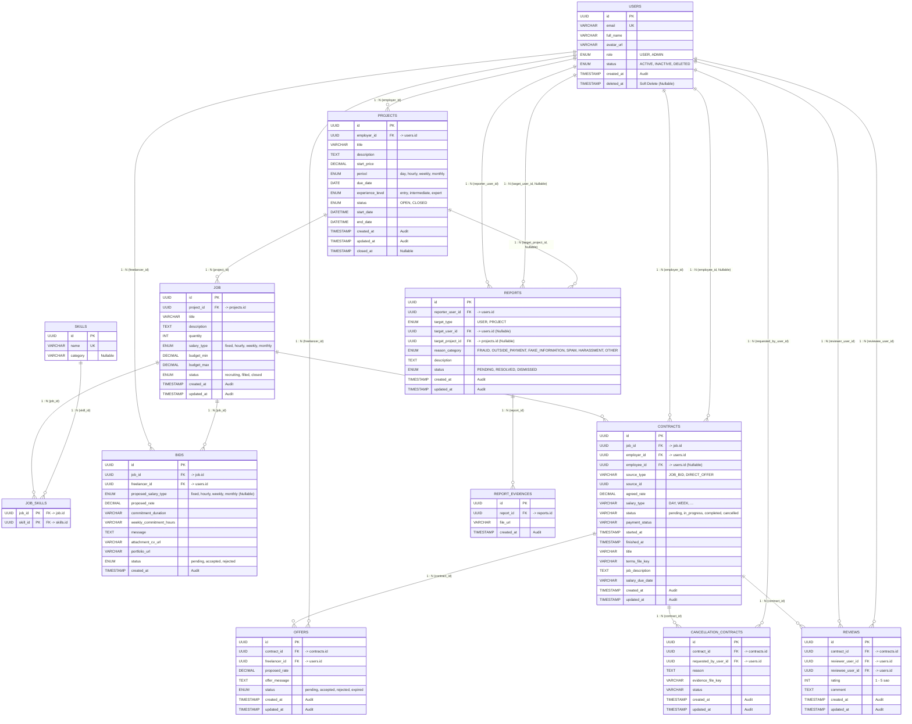

# Đặc tả Cơ sở Dữ liệu Dịch vụ Cốt lõi Thị trường (Core Service ERD)

> **Bounded Context**: **Core** (`occupify-core`)  
> **Cổng dịch vụ**: `8182` | **Database Name**: `occupify_core` (PostgreSQL 16)  
> **Tài liệu tham chiếu toàn hệ thống**: Xem **[ECOSYSTEM-ERD.md](ECOSYSTEM-ERD.md)** để nắm toàn cảnh 5 Bounded Contexts của Occupify.

---

## 1. Giới thiệu Bounded Context Core

Dịch vụ **Core** (`occupify-core`) là trung tâm vận hành thị trường việc làm tự do của Occupify, quản lý toàn bộ vòng đời từ khi dự án được khởi tạo, đăng tin tuyển vị trí, nhận chào thầu, gửi lời mời làm việc trực tiếp, ký kết hợp đồng, khiếu nại hủy hợp đồng cho đến nghiệm thu và đánh giá kết quả:

### 1.1. Bảng Gốc (Native Domain Tables)
1. **`skills`**: Danh mục kỹ năng chuẩn của sàn giao dịch.
2. **`job_skills`**: Bảng trung gian liên kết nhiều-nhiều giữa vị trí công việc và các kỹ năng yêu cầu.
3. **`projects`**: Dự án tổng thể do Employer đăng tuyển.
4. **`job`**: Vị trí công việc cụ thể thuộc một dự án (một dự án có thể tuyển nhiều vị trí/vai trò khác nhau).
5. **`bids`**: Đề xuất báo giá / chào thầu của Freelancer gửi vào một vị trí công việc.
6. **`offers`**: Lời mời nhận việc trực tiếp từ Employer gửi tới một Freelancer cụ thể.
7. **`contracts`**: Hợp đồng dịch vụ lao động chính thức giữa Employer và Employee (Domain gốc sở hữu hợp đồng).
8. **`cancellation_contracts`**: Khiếu nại, yêu cầu chấm dứt hoặc hủy hợp đồng giữa hai bên.
9. **`reviews`**: Đánh giá hai chiều sau khi hoàn thành hợp đồng.

### 1.2. Bảng Sao Chép (Local Replicated Tables)
10. **`users`** *(Sao chép từ Identity)*: Thực thể người dùng nội bộ phục vụ ràng buộc khóa ngoại vật lý và truy vấn profile tức thời.
11. **`reports`** *(Sao chép từ Administration)*: Báo cáo vi phạm liên quan đến người dùng hoặc dự án để hiển thị cảnh báo tại chỗ.
12. **`report_evidences`** *(Sao chép từ Administration)*: Bằng chứng đính kèm của các báo cáo vi phạm.

### 🚨 Mô hình Hai Vai Trò trong Core Service
- Người dùng sử dụng cùng 1 tài khoản (`users.id`):
  - Có thể đăng dự án trong vai trò Employer (`projects.employer_id`, `contracts.employer_id`).
  - Đồng thời có thể gửi báo giá chào thầu vào dự án của người khác trong vai trò Freelancer (`bids.freelancer_id`, `contracts.employee_id`).

---

## 2. Sơ đồ Quan hệ Thực thể Nội bộ (Internal ERD)

Toàn bộ 12 bảng trong CSDL `occupify_core` liên kết thông qua các khóa ngoại vật lý (Physical Foreign Keys):

---

## 3. Đặc tả Chi tiết Các Bảng Dữ liệu

### 3.1. Bảng `skills` (Danh mục kỹ năng chuẩn sàn - Gốc)

| Tên cột | Kiểu dữ liệu | Ràng buộc | Giá trị mặc định | Mô tả nghiệp vụ |
|:---|:---|:---|:---|:---|
| `id` | `UUID` | **PK**, NOT NULL | `gen_random_uuid()` | Khóa chính danh mục kỹ năng |
| `name` | `VARCHAR(100)` | **UQ**, NOT NULL | None | Tên kỹ năng duy nhất |
| `category` | `VARCHAR(50)` | NULLABLE | NULL | Danh mục phân loại kỹ năng (đồng bộ từ Identity) |

---

### 3.2. Bảng `job_skills` (Liên kết Vị trí tuyển dụng - Kỹ năng - Gốc)

| Tên cột | Kiểu dữ liệu | Ràng buộc | Giá trị mặc định | Mô tả nghiệp vụ |
|:---|:---|:---|:---|:---|
| `job_id` | `UUID` | **PK**, **FK** -> `job.id`, NOT NULL | None | Vị trí công việc tuyển dụng |
| `skill_id` | `UUID` | **PK**, **FK** -> `skills.id`, NOT NULL | None | Kỹ năng được yêu cầu |

---

### 3.3. Bảng `projects` (Dự án tuyển dụng - Gốc)

| Tên cột | Kiểu dữ liệu | Ràng buộc | Giá trị mặc định | Mô tả nghiệp vụ |
|:---|:---|:---|:---|:---|
| `id` | `UUID` | **PK**, NOT NULL | `gen_random_uuid()` | Khóa chính dự án |
| `employer_id` | `UUID` | **FK** -> `users.id`, NOT NULL | None | Khách hàng tuyển dụng đăng bài dự án |
| `title` | `VARCHAR(255)` | NOT NULL | None | Tiêu đề dự án |
| `description` | `TEXT` | NOT NULL | None | Mô tả chi tiết phạm vi dự án |
| `start_price` | `DECIMAL` | NOT NULL | None | Giá sàn khởi điểm đề xuất |
| `period` | `ENUM('day', 'hourly', 'weekly', 'monthly')` | NOT NULL | None | Chu kỳ chi trả thù lao |
| `due_date` | `DATE` | NULLABLE | NULL | Hạn chót hoàn thành dự án |
| `experience_level` | `ENUM('entry', 'intermediate', 'expert')` | NOT NULL | `'intermediate'` | Yêu cầu trình độ freelancer |
| `status` | `ENUM('OPEN', 'CLOSED')` | NOT NULL | `'OPEN'` | Trạng thái mở/đóng nhận thầu của dự án |
| `start_date` | `DATETIME` | NULLABLE | NULL | Ngày bắt đầu triển khai dự án |
| `end_date` | `DATETIME` | NULLABLE | NULL | Ngày kết thúc triển khai dự án |
| `created_at` | `TIMESTAMP` | NOT NULL | `CURRENT_TIMESTAMP` | Thời điểm đăng tải dự án (Audit) |
| `updated_at` | `TIMESTAMP` | NOT NULL | `CURRENT_TIMESTAMP` | Thời điểm chỉnh sửa dự án (Audit) |
| `closed_at` | `TIMESTAMP` | NULLABLE | NULL | Thời điểm đóng dự án |

---

### 3.4. Bảng `job` (Vị trí công việc trong dự án - Gốc)

| Tên cột | Kiểu dữ liệu | Ràng buộc | Giá trị mặc định | Mô tả nghiệp vụ |
|:---|:---|:---|:---|:---|
| `id` | `UUID` | **PK**, NOT NULL | `gen_random_uuid()` | Khóa chính vị trí công việc |
| `project_id` | `UUID` | **FK** -> `projects.id`, NOT NULL | None | Dự án chứa vị trí này |
| `title` | `VARCHAR(255)` | NOT NULL | None | Tiêu đề vị trí tuyển dụng |
| `description` | `TEXT` | NULLABLE | NULL | Chi tiết trách nhiệm và yêu cầu công việc |
| `quantity` | `INT` | NOT NULL | `1` | Số lượng nhân sự cần tuyển cho vị trí |
| `salary_type` | `ENUM('fixed', 'hourly', 'weekly', 'monthly')` | NOT NULL | None | Hình thức chi trả thù lao |
| `budget_min` | `DECIMAL` | NULLABLE | NULL | Ngân sách thù lao tối thiểu |
| `budget_max` | `DECIMAL` | NULLABLE | NULL | Ngân sách thù lao tối đa |
| `status` | `ENUM('recruiting', 'filled', 'closed')` | NOT NULL | `'recruiting'` | Trạng thái tuyển dụng |
| `created_at` | `TIMESTAMP` | NOT NULL | `CURRENT_TIMESTAMP` | Thời điểm tạo vị trí (Audit) |
| `updated_at` | `TIMESTAMP` | NOT NULL | `CURRENT_TIMESTAMP` | Thời điểm cập nhật vị trí (Audit) |

---

### 3.5. Bảng `users` (Người dùng - Local Entity sao chép từ Identity)

| Tên cột | Kiểu dữ liệu | Ràng buộc | Giá trị mặc định | Mô tả nghiệp vụ |
|:---|:---|:---|:---|:---|
| `id` | `UUID` | **PK**, NOT NULL | None | Khóa chính người dùng (đồng bộ từ Identity) |
| `email` | `VARCHAR(255)` | **UK**, NOT NULL | None | Email tài khoản |
| `full_name` | `VARCHAR(150)` | NOT NULL | None | Họ và tên người dùng |
| `avatar_url` | `VARCHAR(500)` | NULLABLE | NULL | Đường dẫn ảnh đại diện |
| `role` | `ENUM('USER', 'ADMIN')` | NOT NULL | None | Vai trò ngữ cảnh trong sàn việc làm (đồng bộ từ Identity) |
| `status` | `ENUM('ACTIVE', 'INACTIVE', 'DELETED')` | NOT NULL | `'ACTIVE'` | Trạng thái hoạt động tài khoản |
| `created_at` | `TIMESTAMP` | NOT NULL | `CURRENT_TIMESTAMP` | Thời điểm tạo tài khoản (Audit) |
| `deleted_at` | `TIMESTAMP` | NULLABLE | NULL | Thời điểm xóa mềm tài khoản |

---

### 3.6. Bảng `bids` (Chào thầu / Báo giá công việc - Gốc)

| Tên cột | Kiểu dữ liệu | Ràng buộc | Giá trị mặc định | Mô tả nghiệp vụ |
|:---|:---|:---|:---|:---|
| `id` | `UUID` | **PK**, NOT NULL | `gen_random_uuid()` | Khóa chính hồ sơ chào thầu |
| `job_id` | `UUID` | **FK** -> `job.id`, NOT NULL | None | Vị trí công việc nộp thầu |
| `freelancer_id` | `UUID` | **FK** -> `users.id`, NOT NULL | None | Freelancer nộp hồ sơ báo giá |
| `proposed_rate` | `DECIMAL` | NOT NULL | None | Mức giá chào thầu |
| `proposed_salary_type` | `ENUM('fixed', 'hourly', 'weekly', 'monthly')` | NULLABLE | NULL | Hình thức chi trả thù lao đề xuất |
| `commitment_duration` | `VARCHAR(100)` | NULLABLE | NULL | Cam kết tổng thời gian thực hiện |
| `weekly_commitment_hours` | `VARCHAR(50)` | NULLABLE | NULL | Số giờ làm việc cam kết trong tuần |
| `message` | `TEXT` | NOT NULL | None | Thư giới thiệu / đề xuất phương án |
| `attachment_cv_url` | `VARCHAR(255)` | NULLABLE | NULL | Đường dẫn CV đính kèm |
| `portfolio_url` | `VARCHAR(255)` | NULLABLE | NULL | Đường dẫn portfolio dự án mẫu |
| `status` | `ENUM('pending', 'accepted', 'rejected')` | NOT NULL | `'pending'` | Trạng thái duyệt hồ sơ nộp thầu |
| `created_at` | `TIMESTAMP` | NOT NULL | `CURRENT_TIMESTAMP` | Thời điểm nộp hồ sơ chào thầu (Audit) |

---

### 3.7. Bảng `offers` (Lời mời nhận việc trực tiếp - Gốc)

| Tên cột | Kiểu dữ liệu | Ràng buộc | Giá trị mặc định | Mô tả nghiệp vụ |
|:---|:---|:---|:---|:---|
| `id` | `UUID` | **PK**, NOT NULL | `gen_random_uuid()` | Khóa chính lời mời nhận việc |
| `contract_id` | `UUID` | **FK** -> `contracts.id`, NOT NULL | None | Hợp đồng gắn liền với lời mời |
| `freelancer_id` | `UUID` | **FK** -> `users.id`, NOT NULL | None | Freelancer được mời nhận việc |
| `proposed_rate` | `DECIMAL` | NOT NULL | None | Mức thù lao đề xuất trong lời mời |
| `offer_message` | `TEXT` | NULLABLE | NULL | Lời nhắn / điều khoản đính kèm |
| `status` | `ENUM('pending', 'accepted', 'rejected', 'expired')` | NOT NULL | `'pending'` | Trạng thái phản hồi lời mời |
| `created_at` | `TIMESTAMP` | NOT NULL | `CURRENT_TIMESTAMP` | Thời điểm gửi lời mời (Audit) |
| `updated_at` | `TIMESTAMP` | NOT NULL | `CURRENT_TIMESTAMP` | Thời điểm cập nhật trạng thái (Audit) |

---

### 3.8. Bảng `contracts` (Hợp đồng dịch vụ lao động - Gốc của Core)

Bảng hợp đồng chính thức do **Core** sở hữu gốc.

| Tên cột | Kiểu dữ liệu | Ràng buộc | Giá trị mặc định | Mô tả nghiệp vụ |
|:---|:---|:---|:---|:---|
| `id` | `UUID` | **PK**, NOT NULL | `gen_random_uuid()` | Khóa chính hợp đồng |
| `job_id` | `UUID` | **FK** -> `job.id`, NOT NULL | None | Vị trí công việc gắn liền với hợp đồng |
| `employer_id` | `UUID` | **FK** -> `users.id`, NOT NULL | None | Khách hàng tuyển dụng (Employer) |
| `employee_id` | `UUID` | **FK** -> `users.id`, NULLABLE | NULL | Freelancer nhận việc (Employee) |
| `source_type` | `VARCHAR(50)` | NULLABLE | NULL | Nguồn tạo hợp đồng: `JOB_BID`, `DIRECT_OFFER` |
| `source_id` | `UUID` | NULLABLE | NULL | Định danh bản ghi nguồn (bids hoặc offers) |
| `agreed_rate` | `DECIMAL` | NOT NULL | None | Mức thù lao thỏa thuận chi trả |
| `salary_type` | `VARCHAR(50)` | NOT NULL | None | Chu kỳ thù lao (`DAY`, `WEEK`,...) |
| `status` | `VARCHAR(50)` | NOT NULL | `'pending'` | Trạng thái hợp đồng: `pending`, `in_progress`, `completed`, `cancelled` |
| `payment_status` | `VARCHAR(50)` | NULLABLE | NULL | Trạng thái ký quỹ / thanh toán |
| `started_at` | `TIMESTAMP` | NULLABLE | NULL | Thời điểm chính thức bắt đầu công việc |
| `finished_at` | `TIMESTAMP` | NULLABLE | NULL | Thời điểm hoàn tất công việc |
| `title` | `VARCHAR(255)` | NULLABLE | NULL | Tiêu đề hợp đồng |
| `terms_file_key` | `VARCHAR(500)` | NULLABLE | NULL | Đường dẫn/Key file điều khoản hợp đồng lưu trữ trên S3 |
| `job_description` | `TEXT` | NULLABLE | NULL | Mô tả chi tiết công việc trong hợp đồng |
| `salary_due_date` | `VARCHAR(100)` | NULLABLE | NULL | Ngày thanh toán lương định kỳ |
| `created_at` | `TIMESTAMP` | NOT NULL | `CURRENT_TIMESTAMP` | Thời điểm tạo hợp đồng (Audit) |
| `updated_at` | `TIMESTAMP` | NOT NULL | `CURRENT_TIMESTAMP` | Thời điểm cập nhật hợp đồng (Audit) |

---

### 3.9. Bảng `cancellation_contracts` (Yêu cầu hủy hợp đồng - Gốc của Core)

| Tên cột | Kiểu dữ liệu | Ràng buộc | Giá trị mặc định | Mô tả nghiệp vụ |
|:---|:---|:---|:---|:---|
| `id` | `UUID` | **PK**, NOT NULL | `gen_random_uuid()` | Khóa chính yêu cầu hủy |
| `contract_id` | `UUID` | **FK** -> `contracts.id`, NOT NULL | None | Hợp đồng bị yêu cầu hủy |
| `requested_by_user_id` | `UUID` | **FK** -> `users.id`, NOT NULL | None | Người dùng khởi tạo khiếu nại hủy |
| `reason` | `TEXT` | NOT NULL | None | Lý do chi tiết yêu cầu chấm dứt hợp đồng |
| `evidence_file_key` | `VARCHAR(500)` | NULLABLE | NULL | Đường dẫn/Key tài liệu bằng chứng hủy hợp đồng lưu trên S3 |
| `status` | `VARCHAR(50)` | NOT NULL | `'ACCEPTED'` | Trạng thái xử lý khiếu nại hủy hợp đồng |
| `created_at` | `TIMESTAMP` | NOT NULL | `CURRENT_TIMESTAMP` | Thời điểm yêu cầu hủy (Audit) |
| `updated_at` | `TIMESTAMP` | NOT NULL | `CURRENT_TIMESTAMP` | Thời điểm cập nhật trạng thái hủy (Audit) |
---

### 3.10. Bảng `reviews` (Đánh giá sau hợp đồng - Gốc)

| Tên cột | Kiểu dữ liệu | Ràng buộc | Giá trị mặc định | Mô tả nghiệp vụ |
|:---|:---|:---|:---|:---|
| `id` | `UUID` | **PK**, NOT NULL | `gen_random_uuid()` | Khóa chính đánh giá |
| `contract_id` | `UUID` | **FK** -> `contracts.id`, NOT NULL | None | Hợp đồng được đánh giá nghiệm thu |
| `reviewer_user_id` | `UUID` | **FK** -> `users.id`, NOT NULL | None | Người thực hiện viết đánh giá |
| `reviewee_user_id` | `UUID` | **FK** -> `users.id`, NOT NULL | None | Người nhận đánh giá |
| `rating` | `INT` | NOT NULL, `1-5` | None | Điểm số chất lượng (1-5 sao) |
| `comment` | `TEXT` | NULLABLE | NULL | Nhận xét chi tiết về tác phong và sản phẩm |
| `created_at` | `TIMESTAMP` | NOT NULL | `CURRENT_TIMESTAMP` | Thời điểm tạo đánh giá (Audit) |
| `updated_at` | `TIMESTAMP` | NOT NULL | `CURRENT_TIMESTAMP` | Thời điểm cập nhật đánh giá (Audit) |

---

### 3.11. Bảng `reports` (Báo cáo vi phạm - Local Entity sao chép từ Administration)

| Tên cột | Kiểu dữ liệu | Ràng buộc | Giá trị mặc định | Mô tả nghiệp vụ |
|:---|:---|:---|:---|:---|
| `id` | `UUID` | **PK**, NOT NULL | None | Khóa chính báo cáo (đồng bộ từ Admin) |
| `reporter_user_id` | `UUID` | **FK** -> `users.id`, NOT NULL | None | Người tạo báo cáo |
| `target_type` | `ENUM('USER', 'PROJECT')` | NOT NULL | None | Đối tượng bị báo cáo vi phạm |
| `target_user_id` | `UUID` | **FK** -> `users.id`, NULLABLE | NULL | Người dùng bị tố cáo vi phạm |
| `target_project_id`| `UUID` | **FK** -> `projects.id`, NULLABLE | NULL | Dự án bị tố cáo vi phạm |
| `reason_category` | `ENUM('FRAUD', 'OUTSIDE_PAYMENT', 'FAKE_INFORMATION', 'SPAM', 'HARASSMENT', 'OTHER')` | NOT NULL | None | Danh mục vi phạm |
| `description` | `TEXT` | NOT NULL | None | Mô tả chi tiết sự việc vi phạm |
| `status` | `ENUM('PENDING', 'RESOLVED', 'DISMISSED')` | NOT NULL | `'PENDING'` | Trạng thái xử lý báo cáo |
| `created_at` | `TIMESTAMP` | NOT NULL | `CURRENT_TIMESTAMP` | Thời điểm tạo báo cáo (Audit) |
| `updated_at` | `TIMESTAMP` | NOT NULL | `CURRENT_TIMESTAMP` | Thời điểm cập nhật báo cáo (Audit) |

---

### 3.12. Bảng `report_evidences` (Bằng chứng báo cáo - Local Entity sao chép từ Administration)

| Tên cột | Kiểu dữ liệu | Ràng buộc | Giá trị mặc định | Mô tả nghiệp vụ |
|:---|:---|:---|:---|:---|
| `id` | `UUID` | **PK**, NOT NULL | None | Khóa chính bằng chứng (đồng bộ từ Admin) |
| `report_id` | `UUID` | **FK** -> `reports.id`, NOT NULL | None | Báo cáo liên quan |
| `file_url` | `VARCHAR(500)` | NOT NULL | None | Đường dẫn file/ảnh chụp chứng cứ vi phạm |
| `created_at` | `TIMESTAMP` | NOT NULL | `CURRENT_TIMESTAMP` | Thời điểm đính kèm chứng cứ (Audit) |

---

## 4. Các Mối Quan Hệ (16 Relationships)

Toàn bộ 16 mối quan hệ trong Core đều sử dụng Khóa ngoại vật lý (Physical Foreign Keys) nội bộ:
1. **`users (1) - (N) projects`**: Một user (employer) tạo nhiều project (`projects.employer_id -> users.id`).
2. **`projects (1) - (N) job`**: Một project có thể có nhiều job/vị trí (`job.project_id -> projects.id`).
3. **`job (N) - (M) skills`**: Quan hệ nhiều-nhiều thông qua bảng trung gian `job_skills` (`job_skills.job_id -> job.id`, `job_skills.skill_id -> skills.id`).
4. **`users (1) - (N) bids`**: User (freelancer) có thể tạo nhiều lượt đấu thầu (`bids.freelancer_id -> users.id`).
5. **`job (1) - (N) bids`**: Một job có thể nhận nhiều lượt đấu thầu (`bids.job_id -> job.id`).
6. **`job (1) - (N) contracts`**: Một job có thể dẫn tới nhiều hợp đồng (`contracts.job_id -> job.id`).
7. **`users (1) - (N) contracts`**: User tham gia hợp đồng dưới vai trò employer (`contracts.employer_id`) hoặc employee (`contracts.employee_id`).
8. **`contracts (1) - (N) offers`**: Một hợp đồng có thể có nhiều đề nghị (`offers.contract_id -> contracts.id`).
9. **`users (1) - (N) offers`**: User nhận các đề nghị (`offers.freelancer_id -> users.id`).
10. **`contracts (1) - (N) cancellation_contracts`**: Hợp đồng có thể bị hủy (`cancellation_contracts.contract_id -> contracts.id`).
11. **`users (1) - (N) cancellation_contracts`**: User yêu cầu hủy (`cancellation_contracts.requested_by_user_id -> users.id`).
12. **`contracts (1) - (N) reviews`**: Đánh giá dựa trên hợp đồng (`reviews.contract_id -> contracts.id`).
13. **`users (1) - (N) reviews`**: User viết đánh giá (`reviewer_user_id`) hoặc nhận đánh giá (`reviewee_user_id`).
14. **`users (1) - (N) reports`**: User tạo báo cáo (`reporter_user_id`) hoặc bị báo cáo (`target_user_id`).
15. **`projects (1) - (N) reports`**: Project có thể bị báo cáo (`reports.target_project_id -> projects.id`).
16. **`reports (1) - (N) report_evidences`**: Báo cáo có thể có nhiều bằng chứng đính kèm (`report_evidences.report_id -> reports.id`).

---

## 5. Đồng Bộ Thực Thể & Ma Trận Tham Chiếu Xuyên Service

- **Entity Replications**:
  - `Core.users` $\leftarrow$ Đồng bộ từ `Identity.users` qua Domain Events (`UserCreatedEvent`, `UserUpdatedEvent`).
  - `Core.reports`, `Core.report_evidences` $\leftarrow$ Đồng bộ từ `Administration.reports` qua Domain Events.
  - `Core.contracts` $\rightarrow$ Phát sự kiện đồng bộ sang `Payment.contracts` và `Identity.contracts`.
  - `Core.reviews` $\rightarrow$ Phát sự kiện đồng bộ sang `Identity.reviews`.
