# Đặc tả Kiến trúc Cơ sở Dữ liệu Toàn Hệ Sinh Thái (Occupify Ecosystem ERD)

> **Phạm vi tài liệu**: Áp dụng chung cho toàn bộ hệ thống Microservices Occupify.  
> **Mục đích**: File tài liệu chuẩn hóa dùng chung (Shared Ecosystem Documentation). Khi khởi tạo hoặc phát triển bất kỳ microservice nào trong hệ thống (`occupify-identity`, `occupify-core`, `occupify-payment`, `occupify-notification`, `occupify-admin`), chỉ cần sao chép file này sang thư mục `docs/` của service đó để nắm toàn cảnh dữ liệu và liên kết liên dịch vụ.

---

## 1. Tổng quan 5 Bounded Contexts trong Hệ Sinh Thái Occupify

Hệ thống Occupify được thiết kế theo mô hình **Microservices Architecture**, phân tách theo **5 Bounded Contexts** (theo chuẩn Domain-Driven Design - DDD):

```
+-----------------------------------------------------------------------------------------------------------------------+
|                                                  OCCUPIFY ECOSYSTEM                                                   |
+-------------------+-------------------+------------------------------+-----------------------+------------------------+
|  1. Identity      |  2. Core          |  3. Payment                  |  4. Notification      |  5. Administration     |
+-------------------+-------------------+------------------------------+-----------------------+------------------------+
|  occupify-identity|  occupify-core    |  occupify-payment            |  occupify-notification|  occupify-admin        |
|  Port: 8181       |  Port: 8182       |  Port: 8183                  |  Port: 8184           |  Port: 8185            |
|  DB: occupify_id  |  DB: occupify_core|  DB: occupify_payment        |  DB: occupify_notif   |  DB: occupify_admin    |
|                   |                   |                              |                       |                        |
|  - Users & Auth   |  - Projects & Jobs|  - Wallets (Available/Locked)|  - In-App Alerts      |  - Platform Moderation |
|  - Experiences    |  - Skills & JobSk |  - Transactions (Ledger)     |  - Event Notices      |  - Reports & Evidences |
|  - Educations     |  - Bids & Offers  |  - Contracts (Local Entity)  |  - Push Notifications |  - Flagged Accounts    |
|  - Qualifications |  - Contracts & Can|  - Users (Local Entity)      |  - Users (Local Entity)|  - System Audit Logs   |
|  - Skills & Users |  - Reviews        |  - Escrow Fund Holding       |                       |  - Users (Local Entity)|
|  - Contracts (Loc)|  - Users (Local)  |                              |                       |  - Projects (Local Ent)|
|  - Reviews (Loc)  |  - Reports (Local)|                              |                       |                        |
+-------------------+-------------------+------------------------------+-----------------------+------------------------+
```

---

## 2. Nguyên tắc Thiết kế Dữ liệu Microservices (Ecosystem Data Principles)

Mọi microservice trong Occupify đều bắt buộc tuân thủ 4 nguyên tắc dữ liệu sau:

1. **Database-per-Service**:
   - Mỗi microservice sở hữu CSDL độc lập (`occupify_identity`, `occupify_core`, `occupify_payment`, `occupify_notification`, `occupify_admin`).
   - Một service **tuyệt đối không** truy cập trực tiếp vào CSDL của service khác hoặc thực hiện cross-database SQL joins.
2. **Cơ chế Khóa Ngoại và Mô hình Entity Nội bộ / Sao chép Giữa Các Services (Local Replicated Entities)**:
   - Về nguyên tắc cross-database, các service không liên kết bằng foreign key vật lý xuyên qua database của service khác.
   - **Tuy nhiên, trong kiến trúc thực tế của Occupify**, một service **hoàn toàn có thể khai báo và lưu trữ trực tiếp các Entity / Bảng sao chép của service khác** ngay trong database nội bộ của mình để thiết lập Khóa ngoại vật lý (Physical Foreign Key) nội bộ, tăng hiệu năng SQL JOIN và độc lập truy vấn:
     - **Service Core (`occupify-core`)**: Là domain gốc sở hữu các bảng việc làm và hợp đồng lao động (`projects`, `job`, `skills`, `job_skills`, `bids`, `offers`, `contracts`, `cancellation_contracts`, `reviews`). Chứa các bảng sao chép: `users` (từ Identity), `reports` và `report_evidences` (từ Administration).
     - **Service Administration (`occupify-admin`)**: Là domain gốc sở hữu các bảng kiểm duyệt, xử lý vi phạm và kiểm toán (`reports`, `report_evidences`, `flagged_accounts`, `system_audit_logs`). Chứa các bảng sao chép: `users` (từ Identity), `projects` (từ Core).
     - **Service Payment (`occupify-payment`)**: Là domain gốc sở hữu ví tiền và sổ cái giao dịch (`wallets`, `transactions`). Chứa các bảng sao chép: `users` (từ Identity), `contracts` (sao chép từ Core phục vụ ký quỹ, thanh toán và giải ngân hợp đồng).
     - **Service Identity (`occupify-identity`)**: Là domain gốc sở hữu tài khoản và hồ sơ năng lực (`users`, `experiences`, `educations`, `qualifications`, `skills`, `skills_users`). Chứa các bảng sao chép: `contracts` (sao chép từ Core) và `reviews` (sao chép từ Core).
     - **Service Notification (`occupify-notification`)**: Là domain gốc sở hữu `notifications`. Chứa bảng sao chép: `users` (từ Identity).
   - Dữ liệu của các entity sao chép này được đồng bộ từ service nguồn gốc (`occupify-identity`, `occupify-core`, `occupify-admin`) thông qua Domain Events (Kafka) hoặc API sync.
3. **Data Projection & Asynchronous Caching**:
   - Khi một service cần hiển thị thông tin tóm tắt thuộc domain khác (ví dụ: tên, avatar của User khi hiển thị Hợp đồng hoặc Đánh giá), service đó lưu snapshot/projection nhận từ Domain Events hoặc truy vấn qua API Gateway/gRPC.
4. **Tính Nhất Quán Dữ Liệu Phân Tán (Eventual Consistency & Saga Pattern)**:
   - Các luồng nghiệp vụ xuyên service (như Chấp nhận Bid -> Ký Hợp đồng -> Khóa tiền Ký quỹ -> Gửi Thông báo) được điều phối thông qua kiến trúc hướng sự kiện (Kafka / RabbitMQ) theo mô hình **Saga Choreography Pattern**.
5. **Mô Hình Người Dùng Hai Vai Trò (Dual-Role User Model: EMPLOYEE và EMPLOYER là một người)**:
   - Trong toàn bộ hệ sinh thái, người dùng chỉ đăng ký **MỘT tài khoản duy nhất** (`users.id`).
   - Cùng trên một giao diện web/mobile, người dùng có thể sử dụng cả hai không gian làm việc (Freelancer Workspace để tìm việc, nộp thầu và Client Workspace để đăng việc, thuê freelancer).
   - Một người dùng có thể là `employer` trong hợp đồng/dự án này và là `employee` (freelancer) trong hợp đồng/dự án khác.
   - Một người dùng có thể sở hữu một hoặc nhiều ví tiền (`users (1) - (1/N) wallets`), phục vụ các mục đích quản lý số dư khả dụng, phong tỏa ký quỹ và nhận thù lao giải ngân.
---

## 3. Sơ đồ Quan hệ Dữ liệu Toàn Hệ Sinh Thái (Ecosystem Data Map)

Sơ đồ dưới đây mô tả cấu trúc thực thể của cả 5 Bounded Contexts và các liên kết logic (Logical Reference IDs) xuyên suốt hệ thống:

```mermaid
flowchart TB
    subgraph ID_SRV["1. Identity (occupify-identity)"]
        USERS["<b>users</b><br/>• id (PK)<br/>• email (UK), password_hash<br/>• full_name, headline, avatar_url<br/>• role (EMPLOYEE/EMPLOYER/ADMIN), status, bio, phone_number<br/>• created_at, updated_at, deleted_at"]
        EXP["<b>experiences</b><br/>• id (PK)<br/>• user_id (FK -> users.id)<br/>• title, location, organization<br/>• employment_type, location_type<br/>• start_date, end_date, is_current"]
        EDU["<b>educations</b><br/>• id (PK)<br/>• user_id (FK -> users.id)<br/>• institution, field_of_study, degree, grade<br/>• start_date, end_date"]
        QUAL["<b>qualifications</b><br/>• id (PK)<br/>• user_id (FK -> users.id)<br/>• title, organization, credential_id<br/>• credential_url, issue_date, expiration_date"]
        ID_SKILLS["<b>skills</b><br/>• id (PK)<br/>• name (UQ), category"]
        SKILL_USR["<b>skills_users</b><br/>• skill_id (PK/FK -> skills.id)<br/>• user_id (PK/FK -> users.id)<br/>• is_top_skill, years_of_experience, proficiency_level"]
        ID_CONTRACTS["<b>contracts</b> (Local Entity)<br/>• id (PK)<br/>• job_id (Job Ref), source_id<br/>• employer_id (FK -> users.id)<br/>• employee_id (FK -> users.id, NULL)<br/>• agreed_rate, salary_type, status, payment_status<br/>• started_at, finished_at"]
        ID_REVIEWS["<b>reviews</b> (Local Entity)<br/>• id (PK)<br/>• contract_id (FK -> contracts.id)<br/>• reviewer_user_id (FK -> users.id)<br/>• reviewee_user_id (FK -> users.id)<br/>• rating, comment, created_at, updated_at"]
    end

    subgraph CORE_SRV["2. Core (occupify-core)"]
        CORE_USERS["<b>users</b> (Local Entity)<br/>• id (PK)<br/>• email (UK), full_name, avatar_url<br/>• role (USER/ADMIN), status, created_at, deleted_at"]
        PROJECTS["<b>projects</b><br/>• id (PK)<br/>• employer_id (FK -> users.id)<br/>• title, status, start_price, period<br/>• due_date, experience_level, created_at, closed_at"]
        JOBS["<b>job</b><br/>• id (PK)<br/>• project_id (FK -> projects.id)<br/>• title, salary_type, budget_min/max<br/>• quantity, status, created_at, updated_at"]
        CORE_SKILLS["<b>skills</b><br/>• id (PK)<br/>• name (UQ), category"]
        JOB_SKILLS["<b>job_skills</b><br/>• job_id (PK/FK -> job.id)<br/>• skill_id (PK/FK -> skills.id)"]
        CORE_CONTRACTS["<b>contracts</b><br/>• id (PK)<br/>• job_id (FK -> job.id)<br/>• employer_id (FK -> users.id)<br/>• employee_id (FK -> users.id, NULL)<br/>• title, terms_file_key, job_description, salary_due_date<br/>• agreed_rate, salary_type, status, payment_status"]
        OFFERS["<b>offers</b><br/>• id (PK)<br/>• contract_id (FK -> contracts.id)<br/>• freelancer_id (FK -> users.id)<br/>• proposed_rate, status, created_at"]
        CORE_CANCELS["<b>cancellation_contracts</b><br/>• id (PK)<br/>• contract_id (FK -> contracts.id)<br/>• requested_by_user_id (FK -> users.id)<br/>• reason, evidence_file_key, status"]
        CORE_REVIEWS["<b>reviews</b><br/>• id (PK)<br/>• contract_id (FK -> contracts.id)<br/>• reviewer_user_id (FK -> users.id)<br/>• reviewee_user_id (FK -> users.id)<br/>• rating, comment, created_at"]
        CORE_REPORTS["<b>reports</b> (Local Entity)<br/>• id (PK)<br/>• reporter_user_id (FK -> users.id)<br/>• target_type (USER/PROJECT)<br/>• target_user_id (FK -> users.id, NULL)<br/>• target_project_id (FK -> projects.id, NULL)<br/>• reason_category (FRAUD/OUTSIDE_PAYMENT...), status"]
        CORE_EVIDENCES["<b>report_evidences</b> (Local Entity)<br/>• id (PK)<br/>• report_id (FK -> reports.id)<br/>• file_url, created_at"]
    end

    subgraph PAY_SRV["3. Payment (occupify-payment)"]
        PAY_USERS["<b>users</b> (Local Entity)<br/>• id (PK)<br/>• email (UQ), full_name, avatar_url"]
        CONTRACTS["<b>contracts</b> (Local Entity)<br/>• id (PK)<br/>• job_id (Job Ref), source_id<br/>• employer_id (FK -> users.id)<br/>• employee_id (FK -> users.id, NULL)<br/>• source_type, agreed_rate<br/>• salary_type, status, payment_status<br/>• started_at, finished_at"]
        TRANSACTIONS["<b>transactions</b><br/>• id (PK)<br/>• wallet_id (FK -> wallets.id)<br/>• contract_id (FK -> contracts.id)<br/>• amount, transaction_type<br/>• payment_method, status<br/>• created_at"]
    end

    subgraph NOTIF_SRV["4. Notification (occupify-notification)"]
        NOTIF_USERS["<b>users</b> (Local Entity)<br/>• id (PK)<br/>• email (UQ), full_name, avatar_url"]
        NOTIFS["<b>notifications</b><br/>• id (PK)<br/>• user_id (FK -> users.id)<br/>• category, action_type, title<br/>• content, is_read, read_at, created_at"]
    end

    subgraph ADMIN_SRV["5. Administration (occupify-admin)"]
        ADMIN_USERS["<b>users</b> (Local Entity)<br/>• id (PK)<br/>• email (UK), full_name, avatar_url<br/>• role (EMPLOYEE/EMPLOYER/ADMIN), status<br/>• created_at, deleted_at"]
        ADMIN_PROJECTS["<b>projects</b> (Local Entity)<br/>• id (PK)<br/>• employer_id (FK -> users.id)<br/>• title, description, status<br/>• created_at, closed_at"]
        REPORTS["<b>reports</b><br/>• id (PK)<br/>• reporter_user_id (FK -> users.id)<br/>• target_type (USER/PROJECT)<br/>• target_user_id (FK -> users.id, NULL)<br/>• target_project_id (FK -> projects.id, NULL)<br/>• reason_category, status, description<br/>• created_at, updated_at"]
        EVIDENCES["<b>report_evidences</b><br/>• id (PK)<br/>• report_id (FK -> reports.id)<br/>• file_url, created_at"]
        FLAGGED["<b>flagged_accounts</b><br/>• id (PK)<br/>• user_id (FK -> users.id)<br/>• admin_id (FK -> users.id, NULL)<br/>• flag_reason, status, action_taken<br/>• created_at, resolved_at"]
        AUDIT_LOGS["<b>system_audit_logs</b><br/>• id (PK)<br/>• actor_id (FK -> users.id, NULL)<br/>• actor_role, action, target_service<br/>• target_entity, target_id, status<br/>• created_at"]
    end

    %% Internal Physical Foreign Keys in Identity
    USERS -->|1:N user_id| EXP
    USERS -->|1:N user_id| EDU
    USERS -->|1:N user_id| QUAL
    USERS -->|1:N user_id| SKILL_USR
    ID_SKILLS -->|1:N skill_id| SKILL_USR
    USERS -->|1:N employer_id| ID_CONTRACTS
    USERS -->|1:N employee_id| ID_CONTRACTS
    USERS -->|1:N reviewer_user_id| ID_REVIEWS
    USERS -->|1:N reviewee_user_id| ID_REVIEWS
    ID_CONTRACTS -->|1:N contract_id| ID_REVIEWS

    %% Internal Physical Foreign Keys in Core (16 relationships)
    CORE_USERS -->|1:N employer_id| PROJECTS
    PROJECTS -->|1:N project_id| JOBS
    JOBS -->|1:N job_id| JOB_SKILLS
    CORE_SKILLS -->|1:N skill_id| JOB_SKILLS
    CORE_USERS -->|1:N freelancer_id| BIDS
    JOBS -->|1:N job_id| BIDS
    JOBS -->|1:N job_id| CORE_CONTRACTS
    CORE_USERS -->|1:N employer_id| CORE_CONTRACTS
    CORE_USERS -->|1:N employee_id| CORE_CONTRACTS
    CORE_CONTRACTS -->|1:N contract_id| OFFERS
    CORE_USERS -->|1:N freelancer_id| OFFERS
    CORE_CONTRACTS -->|1:N contract_id| CORE_CANCELS
    CORE_USERS -->|1:N requested_by_user_id| CORE_CANCELS
    CORE_CONTRACTS -->|1:N contract_id| CORE_REVIEWS
    CORE_USERS -->|1:N reviewer_user_id| CORE_REVIEWS
    CORE_USERS -->|1:N reviewee_user_id| CORE_REVIEWS
    CORE_USERS -->|1:N reporter_user_id| CORE_REPORTS
    CORE_USERS -->|1:N target_user_id| CORE_REPORTS
    PROJECTS -->|1:N target_project_id| CORE_REPORTS
    CORE_REPORTS -->|1:N report_id| CORE_EVIDENCES
    %% Internal Physical Foreign Keys in Payment (Local Entities & Core Tables)
    PAY_USERS -->|1:1/N user_id| WALLETS
    PAY_USERS -->|1:N employer_id| CONTRACTS
    PAY_USERS -->|1:N employee_id| CONTRACTS
    WALLETS -->|1:N wallet_id| TRANSACTIONS
    CONTRACTS -->|1:N contract_id| TRANSACTIONS

    %% Internal Physical Foreign Keys in Notification (Local Entities)
    NOTIF_USERS -->|1:N user_id| NOTIFS
    %% Internal Physical Foreign Keys in Administration (Local Entities)
    ADMIN_USERS -->|1:N employer_id| ADMIN_PROJECTS
    ADMIN_USERS -->|1:N reporter_user_id| REPORTS
    ADMIN_USERS -->|1:N target_user_id| REPORTS
    ADMIN_PROJECTS -->|1:N target_project_id| REPORTS
    REPORTS -->|1:N report_id| EVIDENCES
    ADMIN_USERS -->|1:N user_id| FLAGGED
    ADMIN_USERS -->|1:N admin_id| FLAGGED
    ADMIN_USERS -->|1:N actor_id| AUDIT_LOGS

    %% Cross-Service Entity Replication / Sync
    USERS -.->|Sync Entity Replication| CORE_USERS
    USERS -.->|Sync Entity Replication| PAY_USERS
    USERS -.->|Sync Entity Replication| NOTIF_USERS
    USERS -.->|Sync Entity Replication| ADMIN_USERS
    CORE_CONTRACTS -.->|Sync Entity Replication| CONTRACTS
    CORE_CONTRACTS -.->|Sync Entity Replication| ID_CONTRACTS
    REPORTS -.->|Sync Entity Replication| CORE_REPORTS
    EVIDENCES -.->|Sync Entity Replication| CORE_EVIDENCES
    CORE_REVIEWS -.->|Sync Entity Replication| ID_REVIEWS
    %% Cross-Service Logical References (Dotted lines)
    JOBS -.->|Logical Ref: job_id| CONTRACTS
    JOBS -.->|Logical Ref: job_id| ID_CONTRACTS
    BIDS -.->|Logical Ref: source_id| ID_CONTRACTS
    BIDS -.->|Logical Ref: source_id| CONTRACTS
    ID_SKILLS -.->|Sync Catalog| CORE_SKILLS
```



---

## 4. Ma trận Tham chiếu Khóa Ngoại Toàn Hệ Thống

### 4.1. Ma trận Tham chiếu Khóa Ngoại Logic Xuyên Service (Cross-Service Logical References)

| Bounded Context Chứa Khóa Ngoại | Bảng Nguồn | Cột Khóa Ngoại Logic | Bounded Context Đích | Bảng Đích | Khóa Chính Đích | Diễn Giải Nghiệp Vụ |
|:---|:---|:---|:---|:---|:---|:---|
| **Identity** | `contracts` | `job_id` | **Core** | `job` | `id` | Vị trí công việc tuyển dụng gắn liền hợp đồng |
| **Identity** | `contracts` | `source_id` | **Core** | `bids` / `offers` | `id` | Bản chào giá (Bid) hoặc Lời mời (Offer) tạo ra hợp đồng |
| **Payment** | `contracts` | `job_id` | **Core** | `job` | `id` | Vị trí công việc tuyển dụng liên kết hợp đồng |
| **Payment** | `contracts` | `source_id` | **Core** | `bids` / `offers` | `id` | Bản chào giá (Bid) hoặc Lời mời (Offer) tạo ra hợp đồng |

### 4.2. Khóa Ngoại Nội Bộ & Thực Thể Sao Chép trong Bounded Context Identity (`occupify-identity`)

Service `occupify-identity` quản lý hồ sơ người dùng, kỹ năng chuyên môn và lưu trữ trực tiếp các entity sao chép (`contracts`, `reviews`) ngay trong database nội bộ để tạo các khóa ngoại vật lý (Physical Foreign Keys):

| Bảng Nguồn (Identity DB) | Cột Khóa Ngoại | Bảng Đích (Identity DB) | Khóa Chính Đích | Loại Khóa Ngoại | Diễn Giải Nghiệp Vụ |
|:---|:---|:---|:---|:---|:---|
| `experiences` | `user_id` | `users` | `id` | Physical FK | Một người dùng có thể có nhiều bản ghi kinh nghiệm làm việc |
| `educations` | `user_id` | `users` | `id` | Physical FK | Một người dùng có thể có nhiều bản ghi học vấn |
| `qualifications` | `user_id` | `users` | `id` | Physical FK | Một người dùng có thể có nhiều chứng chỉ/bằng cấp |
| `skills_users` | `user_id` | `users` | `id` | Physical FK | Người dùng sở hữu kỹ năng chuyên môn |
| `skills_users` | `skill_id` | `skills` | `id` | Physical FK | Kỹ năng được liên kết gán cho người dùng |
| `contracts` | `employer_id` | `users` | `id` | Physical FK | Người dùng tham gia hợp đồng dưới vai trò người thuê (employer) |
| `contracts` | `employee_id` | `users` | `id` | Physical FK (Nullable) | Người dùng tham gia hợp đồng dưới vai trò người làm thuê (employee) |
| `reviews` | `contract_id` | `contracts` | `id` | Physical FK | Một hợp đồng có thể liên kết với nhiều đánh giá |
| `reviews` | `reviewer_user_id` | `users` | `id` | Physical FK | Người dùng viết đánh giá (reviewer) |
| `reviews` | `reviewee_user_id` | `users` | `id` | Physical FK | Người dùng nhận đánh giá (reviewee) |
*Cơ chế đồng bộ dữ liệu cho các entity sao chép trong `occupify-identity`:*
- `contracts` (Identity) $\leftarrow$ Đồng bộ từ `Core.contracts` (qua Domain Events / Kafka: `ContractCreatedEvent`, `ContractStatusUpdatedEvent`).
- `reviews` (Identity) $\leftarrow$ Đồng bộ từ `Core.reviews` (qua Domain Events / Kafka: `ReviewCreatedEvent`).
### 4.3. Khóa Ngoại Nội Bộ & Thực Thể Sao Chép trong Bounded Context Core (`occupify-core`)

Service `occupify-core` là domain gốc sở hữu các bảng việc làm và hợp đồng lao động (`projects`, `job`, `skills`, `job_skills`, `bids`, `contracts`, `cancellation_contracts`, `offers`, `reviews`), đồng thời chứa trực tiếp các entity sao chép (`users` từ Identity, `reports` và `report_evidences` từ Administration) ngay trong database nội bộ để tạo 16 mối quan hệ khóa ngoại vật lý (Physical Foreign Keys):

| Bảng Nguồn (Core DB) | Cột Khóa Ngoại | Bảng Đích (Core DB) | Khóa Chính Đích | Loại Khóa Ngoại | Diễn Giải Nghiệp Vụ |
|:---|:---|:---|:---|:---|:---|
| `projects` | `employer_id` | `users` | `id` | Physical FK | Một user (employer) tạo nhiều project |
| `job` | `project_id` | `projects` | `id` | Physical FK | Một project có thể có nhiều job/vị trí |
| `job_skills` | `job_id` | `job` | `id` | Physical FK | Vị trí công việc yêu cầu kỹ năng |
| `job_skills` | `skill_id` | `skills` | `id` | Physical FK | Kỹ năng được yêu cầu bởi job |
| `bids` | `freelancer_id` | `users` | `id` | Physical FK | User (freelancer) có thể tạo nhiều lượt đấu thầu |
| `bids` | `job_id` | `job` | `id` | Physical FK | Một job có thể nhận nhiều lượt đấu thầu |
| `contracts` | `job_id` | `job` | `id` | Physical FK | Một job có thể dẫn tới nhiều hợp đồng |
| `contracts` | `employer_id` | `users` | `id` | Physical FK | User tham gia hợp đồng dưới vai trò employer |
| `contracts` | `employee_id` | `users` | `id` | Physical FK (Nullable) | User tham gia hợp đồng dưới vai trò employee |
| `offers` | `contract_id` | `contracts` | `id` | Physical FK | Một hợp đồng có thể có nhiều đề nghị (offers) |
| `offers` | `freelancer_id` | `users` | `id` | Physical FK | User nhận các đề nghị (freelancer) |
| `cancellation_contracts` | `contract_id` | `contracts` | `id` | Physical FK | Hợp đồng có thể bị hủy |
| `cancellation_contracts` | `requested_by_user_id` | `users` | `id` | Physical FK | User yêu cầu hủy hợp đồng |
| `reviews` | `contract_id` | `contracts` | `id` | Physical FK | Đánh giá dựa trên hợp đồng |
| `reviews` | `reviewer_user_id` | `users` | `id` | Physical FK | User viết đánh giá |
| `reviews` | `reviewee_user_id` | `users` | `id` | Physical FK | User nhận đánh giá |
| `reports` | `reporter_user_id` | `users` | `id` | Physical FK | User tạo báo cáo vi phạm |
| `reports` | `target_user_id` | `users` | `id` | Physical FK (Nullable) | User bị báo cáo vi phạm |
| `reports` | `target_project_id`| `projects` | `id` | Physical FK (Nullable) | Project bị báo cáo vi phạm |
| `report_evidences` | `report_id` | `reports` | `id` | Physical FK | Báo cáo có thể có nhiều bằng chứng đính kèm |
*Cơ chế đồng bộ dữ liệu cho các entity sao chép trong `occupify-core`:*
- `users` (Core) $\leftarrow$ Đồng bộ từ `Identity.users` (qua Domain Events / Kafka: `UserCreatedEvent`, `UserUpdatedEvent`, `UserStatusChangedEvent`).
- `reports`, `report_evidences` (Core) $\leftarrow$ Đồng bộ từ `Administration.reports` (qua Domain Events / Kafka: `ReportCreatedEvent`, `ReportStatusUpdatedEvent`).


### 4.4. Khóa Ngoại Nội Bộ & Thực Thể Sao Chép trong Bounded Context Payment (`occupify-payment`)
Service `occupify-payment` sở hữu gốc các bảng ví và sổ cái giao dịch (`wallets`, `transactions`), đồng thời chứa trực tiếp các entity sao chép từ Identity (`users`) và Core (`contracts`) ngay trong database nội bộ để tạo khóa ngoại vật lý (Physical Foreign Keys):

| Bảng Nguồn (Payment DB) | Cột Khóa Ngoại | Bảng Đích (Payment DB) | Khóa Chính Đích | Loại Khóa Ngoại | Diễn Giải Nghiệp Vụ |
|:---|:---|:---|:---|:---|:---|
| `wallets` | `user_id` | `users` | `id` | Physical FK | Một người dùng (User) sở hữu một hoặc nhiều ví (Wallets) |
| `transactions` | `wallet_id` | `wallets` | `id` | Physical FK | Một ví (Wallet) có thể có nhiều giao dịch (Transactions) |
| `contracts` | `employer_id` | `users` | `id` | Physical FK | Người dùng tham gia hợp đồng dưới vai trò bên thuê (employer) |
| `contracts` | `employee_id` | `users` | `id` | Physical FK (Nullable) | Người dùng tham gia hợp đồng dưới vai trò người làm thuê (employee) |
| `transactions` | `contract_id` | `contracts` | `id` | Physical FK | Một hợp đồng có thể liên quan đến nhiều giao dịch thanh toán |

*Cơ chế đồng bộ dữ liệu cho entity sao chép trong `occupify-payment`:*
- `users` (Payment) $\leftarrow$ Đồng bộ từ `Identity.users` (qua Domain Events / Kafka: `UserCreatedEvent`, `UserUpdatedEvent`).
- `contracts` (Payment) $\leftarrow$ Đồng bộ từ `Core.contracts` (qua Domain Events / Kafka: `ContractCreatedEvent`, `ContractUpdatedEvent`).

### 4.5. Khóa Ngoại Nội Bộ & Thực Thể Sao Chép trong Bounded Context Notification (`occupify-notification`)

Service `occupify-notification` chứa trực tiếp entity sao chép từ Identity (`users`) ngay trong database nội bộ để tạo khóa ngoại vật lý (Physical Foreign Keys):

| Bảng Nguồn (Notification DB) | Cột Khóa Ngoại | Bảng Đích (Notification DB) | Khóa Chính Đích | Loại Khóa Ngoại | Diễn Giải Nghiệp Vụ |
|:---|:---|:---|:---|:---|:---|
| `notifications` | `user_id` | `users` | `id` | Physical FK | Một người dùng (User) có thể nhận nhiều thông báo |

*Cơ chế đồng bộ dữ liệu cho entity sao chép trong `occupify-notification`:*
- `users` (Notification) $\leftarrow$ Đồng bộ từ `Identity.users` (qua Domain Events / Kafka: `UserCreatedEvent`, `UserUpdatedEvent`).

### 4.6. Khóa Ngoại Nội Bộ & Thực Thể Sao Chép trong Bounded Context Administration (`occupify-admin`)

Service `occupify-admin` là domain gốc sở hữu các bảng kiểm duyệt, xử lý vi phạm và kiểm toán (`reports`, `report_evidences`, `flagged_accounts`, `system_audit_logs`), đồng thời chứa trực tiếp các entity sao chép từ Identity (`users`) và Core (`projects`) ngay trong database nội bộ để tạo các khóa ngoại vật lý (Physical Foreign Keys):

| Bảng Nguồn (Admin DB) | Cột Khóa Ngoại | Bảng Đích (Admin DB) | Khóa Chính Đích | Loại Khóa Ngoại | Diễn Giải Nghiệp Vụ |
|:---|:---|:---|:---|:---|:---|
| `projects` | `employer_id` | `users` | `id` | Physical FK | Một người dùng (employer) có thể tạo nhiều dự án |
| `reports` | `reporter_user_id` | `users` | `id` | Physical FK | Một người dùng có thể tạo nhiều báo cáo vi phạm |
| `reports` | `target_user_id` | `users` | `id` | Physical FK (Nullable) | Báo cáo nhắm mục tiêu tới một người dùng cụ thể |
| `reports` | `target_project_id`| `projects` | `id` | Physical FK (Nullable) | Báo cáo nhắm mục tiêu tới một dự án cụ thể |
| `report_evidences` | `report_id` | `reports` | `id` | Physical FK | Một báo cáo có nhiều bằng chứng (ảnh, file) đính kèm |
| `flagged_accounts` | `user_id` | `users` | `id` | Physical FK | Một người dùng có thể bị đánh dấu/cắm cờ nhiều lần |
| `flagged_accounts` | `admin_id` | `users` | `id` | Physical FK (Nullable) | Quản trị viên (Admin) xử lý cắm cờ cũng là một người dùng |
| `system_audit_logs`| `actor_id` | `users` | `id` | Physical FK (Nullable) | Nhật ký hệ thống ghi lại hành động của người dùng (actor) |

*Cơ chế đồng bộ dữ liệu cho các entity sao chép trong `occupify-admin`:*
- `users` (Admin) $\leftarrow$ Đồng bộ từ `Identity.users` (qua Domain Events / Kafka: `UserCreatedEvent`, `UserUpdatedEvent`, `UserStatusChangedEvent`).
- `projects` (Admin) $\leftarrow$ Đồng bộ từ `Core.projects` (qua Domain Events / Kafka: `ProjectCreatedEvent`, `ProjectStatusChangedEvent`).
---

## 5. Danh Mục Schema Toàn Hệ Sinh Thái (Theo Từng Bounded Context)

### 5.1. Bounded Context: Identity (`occupify-identity` — Port 8181)

Quản lý danh tính người dùng, xác thực tài khoản, hồ sơ năng lực chuyên sâu của freelancer (experiences, educations, qualifications, skills) và các thực thể hợp đồng, đánh giá phục vụ hiển thị profile.

#### 5.1.1. Danh Sách Các Bảng Dữ Liệu (8 Tables)

1. **`users`** *(Người dùng cốt lõi)*:
   - `id`: `UUID [PK]` — Định danh duy nhất người dùng.
   - `email`: `VARCHAR(255) [UQ]` — Email tài khoản (duy nhất).
   - `password_hash`: `VARCHAR(255)` — Mật khẩu mã hóa BCrypt.
   - `full_name`: `VARCHAR(150)` — Họ và tên người dùng.
   - `headline`: `VARCHAR(255)` — Tiêu đề chuyên môn / chức danh tóm tắt.
   - `avatar_url`: `VARCHAR(500)` — Đường dẫn ảnh đại diện.
   - `bio`: `TEXT` — Tiểu sử / giới thiệu bản thân.
   - `phone_number`: `VARCHAR(30)` — Số điện thoại liên hệ.
   - `role`: `ENUM('EMPLOYEE', 'EMPLOYER', 'ADMIN')` — Vai trò chính của người dùng.
   - `status`: `ENUM('ACTIVE', 'INACTIVE', 'DELETED')` — Trạng thái hoạt động của tài khoản.
   - `created_at`: `TIMESTAMP` — Thời điểm tạo tài khoản.
   - `updated_at`: `TIMESTAMP` — Thời điểm cập nhật tài khoản.
   - `deleted_at`: `TIMESTAMP [NULL]` — Thời điểm xóa mềm tài khoản.

2. **`experiences`** *(Kinh nghiệm làm việc)*:
   - `id`: `UUID [PK]` — Định danh kinh nghiệm.
   - `user_id`: `UUID [FK -> users.id]` — Người dùng sở hữu kinh nghiệm.
   - `title`: `VARCHAR(150)` — Chức danh / vị trí công việc.
   - `location`: `VARCHAR(150)` — Địa điểm làm việc.
   - `organization`: `VARCHAR(200) [NOT NULL]` — Tên công ty / tổ chức.
   - `employment_type`: `VARCHAR(50)` — Hình thức làm việc (`FREELANCE`, `CONTRACT`, `FULL_TIME`, `PART_TIME`, `INTERNSHIP`).
   - `location_type`: `VARCHAR(50)` — Địa điểm làm việc (`REMOTE`, `HYBRID`, `ON_SITE`).
   - `start_date`: `DATE` — Ngày bắt đầu làm việc.
   - `end_date`: `DATE [NULL]` — Ngày kết thúc (NULL nếu hiện vẫn đang làm).
   - `is_current`: `BOOLEAN` — Đang làm việc tại đây hay không.
   - `description`: `TEXT` — Mô tả chi tiết trách nhiệm và thành tích.

3. **`educations`** *(Học vấn)*:
   - `id`: `UUID [PK]` — Định danh học vấn.
   - `user_id`: `UUID [FK -> users.id]` — Người dùng sở hữu bản ghi học vấn.
   - `institution`: `VARCHAR(200)` — Trường học / cơ sở đào tạo.
   - `field_of_study`: `VARCHAR(150)` — Ngành học / chuyên ngành.
   - `degree`: `VARCHAR(150)` — Bằng cấp (Cử nhân, Kỹ sư, Thạc sĩ,...).
   - `grade`: `VARCHAR(150)` — Xếp loại / điểm số tốt nghiệp.
   - `description`: `TEXT` — Hoạt động, thành tích trong quá trình học.
   - `start_date`: `DATE` — Ngày bắt đầu học.
   - `end_date`: `DATE [NULL]` — Ngày tốt nghiệp (NULL nếu đang học).

4. **`qualifications`** *(Chứng chỉ / Bằng cấp chuyên môn)*:
   - `id`: `UUID [PK]` — Định danh chứng chỉ.
   - `user_id`: `UUID [FK -> users.id]` — Người dùng sở hữu chứng chỉ.
   - `title`: `VARCHAR(200)` — Tên chứng chỉ / văn bằng.
   - `organization`: `VARCHAR(200)` — Tổ chức / đơn vị cấp chứng chỉ.
   - `issue_date`: `DATE` — Ngày cấp.
   - `expiration_date`: `DATE [NULL]` — Ngày hết hạn (NULL nếu vĩnh viễn).
   - `credential_id`: `VARCHAR(100)` — Mã số chứng chỉ.
   - `credential_url`: `VARCHAR(500)` — Đường dẫn tra cứu / xác thực chứng chỉ.

5. **`skills`** *(Danh mục kỹ năng chuyên môn)*:
   - `id`: `UUID [PK]` — Định danh kỹ năng.
   - `name`: `VARCHAR(100) [UQ]` — Tên kỹ năng (duy nhất).
   - `category`: `VARCHAR(50)` — Phân loại nhóm kỹ năng (Backend, Frontend, Mobile, AI/ML, Design,...).

6. **`skills_users`** *(Bảng trung gian liên kết Kỹ năng - Người dùng)*:
   - `skill_id`: `UUID [PK/FK -> skills.id]` — Kỹ năng được gán.
   - `user_id`: `UUID [PK/FK -> users.id]` — Người dùng sở hữu kỹ năng.
   - `is_top_skill`: `BOOLEAN DEFAULT FALSE` — Kỹ năng nổi bật hàng đầu của hồ sơ.
   - `years_of_experience`: `INT` — Số năm kinh nghiệm với kỹ năng này.
   - `proficiency_level`: `VARCHAR(50)` — Mức độ thành thạo (`BEGINNER`, `INTERMEDIATE`, `ADVANCED`, `EXPERT`).

7. **`contracts`** *(Local Entity - Sao chép từ Core)*:
   - `id`: `UUID [PK]` — Định danh hợp đồng.
   - `job_id`: `UUID [FK -> Core.job]` — Khóa ngoại logic trỏ tới vị trí tuyển dụng (`Core.job.id`).
   - `employer_id`: `UUID [FK -> users.id]` — Người dùng bên thuê (Client).
   - `employee_id`: `UUID [FK -> users.id, NULLABLE]` — Người dùng bên nhận việc (Freelancer, NULL khi khởi tạo).
   - `source_type`: `VARCHAR(50)` — Nguồn gốc hợp đồng (`JOB_BID`, `DIRECT_OFFER`,...).
   - `source_id`: `UUID` — Định danh bản ghi nguồn (`Core.bids.id` hoặc `Core.offers.id`).
   - `agreed_rate`: `DECIMAL` — Mức thù lao thống nhất.
   - `salary_type`: `VARCHAR(50)` — Hình thức thù lao (`DAY`, `WEEK`,...).
   - `status`: `VARCHAR(50)` — Trạng thái hợp đồng (`pending`, `in_progress`, `completed`, `cancelled`).
   - `payment_status`: `VARCHAR(50)` — Trạng thái ký quỹ / thanh toán.
   - `started_at`: `TIMESTAMP` — Thời điểm bắt đầu công việc.
   - `finished_at`: `TIMESTAMP` — Thời điểm hoàn thành / tất toán.

8. **`reviews`** *(Local Entity - Sao chép từ Core)*:
   - `id`: `UUID [PK]` — Định danh đánh giá.
   - `contract_id`: `UUID [FK -> contracts.id]` — Hợp đồng gắn liền với đánh giá.
   - `reviewer_user_id`: `UUID [FK -> users.id]` — Người dùng viết đánh giá.
   - `reviewee_user_id`: `UUID [FK -> users.id]` — Người dùng nhận đánh giá.
   - `rating`: `INT` — Điểm số đánh giá (thang điểm 1-5).
   - `comment`: `TEXT` — Nhận xét chi tiết.
   - `created_at`: `TIMESTAMP` — Thời điểm tạo đánh giá.
   - `updated_at`: `TIMESTAMP` — Thời điểm chỉnh sửa đánh giá.

#### 5.1.2. Các Mối Quan Hệ (Relationships)

1. **`users (1) - (N) experiences`**: Một người dùng có thể có nhiều bản ghi kinh nghiệm làm việc (`experiences.user_id -> users.id`).
2. **`users (1) - (N) educations`**: Một người dùng có thể có nhiều bản ghi học vấn (`educations.user_id -> users.id`).
3. **`users (1) - (N) qualifications`**: Một người dùng có thể có nhiều chứng chỉ/bằng cấp (`qualifications.user_id -> users.id`).
4. **`users (N) - (M) skills`**: Quan hệ nhiều-nhiều được thể hiện qua bảng trung gian `skills_users`. Một người dùng có nhiều kỹ năng (`skills_users.user_id`) và một kỹ năng thuộc về nhiều người dùng (`skills_users.skill_id`).
5. **`users (1) - (N) contracts`**: Người dùng có thể tham gia nhiều hợp đồng dưới vai trò người thuê (`employer_id`) hoặc người làm thuê (`employee_id`).
6. **`users (1) - (N) reviews`**: Người dùng có thể viết nhiều đánh giá (`reviewer_user_id`) và nhận nhiều đánh giá (`reviewee_user_id`).
7. **`contracts (1) - (N) reviews`**: Một hợp đồng có thể liên kết với nhiều đánh giá (`reviews.contract_id -> contracts.id`).
8. **Tham chiếu liên dịch vụ từ `contracts` (Không nối trực tiếp trong sơ đồ nội bộ)**:
   - `contracts.project_role_id`: Khóa ngoại tham chiếu đến bảng `job` trong service **Core**.
   - `contracts.source_id`: Khóa ngoại tham chiếu đến bản ghi chào thầu (`bids`) hoặc lời mời (`offers`) trong service **Core**.
---

### 5.2. Bounded Context: Core (`occupify-core` — Port 8182)

Đóng vai trò trung tâm thị trường việc làm của sàn Occupify: Quản lý đăng tin dự án, vị trí tuyển dụng (job), danh mục kỹ năng, quy trình đấu thầu chào giá (bids), lời mời nhận việc (offers), hợp đồng và khiếu nại hủy hợp đồng, hệ thống đánh giá (reviews) và báo cáo vi phạm nội bộ.

#### 5.2.1. Danh Sách Các Bảng Dữ Liệu (12 Tables / Entities)

1. **`skills`** *(Danh mục kỹ năng chuẩn sàn)*:
   - `id`: `UUID [PK]` — Định danh kỹ năng.
   - `name`: `VARCHAR(100) [UQ]` — Tên kỹ năng duy nhất.
   - `category`: `VARCHAR(50) [NULLABLE]` — Danh mục phân loại kỹ năng (đồng bộ từ Identity).

2. **`job_skills`** *(Bảng trung gian liên kết Vị trí tuyển dụng - Kỹ năng)*:
   - `job_id`: `UUID [PK] [FK -> job.id]` — Vị trí công việc tuyển dụng.
   - `skill_id`: `UUID [PK] [FK -> skills.id]` — Kỹ năng được yêu cầu.

3. **`projects`** *(Dự án đăng tuyển)*:
   - `id`: `UUID [PK]` — Định danh duy nhất dự án.
   - `employer_id`: `UUID [FK -> users.id]` — Khách hàng/Nhà tuyển dụng đăng bài dự án.
   - `title`: `VARCHAR(255)` — Tiêu đề dự án.
   - `description`: `TEXT` — Mô tả chi tiết phạm vi dự án.
   - `start_price`: `DECIMAL` — Giá sàn khởi điểm đề xuất.
   - `period`: `ENUM('day', 'hourly', 'weekly', 'monthly')` — Chu kỳ thanh toán dự kiến.
   - `due_date`: `DATE` — Hạn chót hoàn thành dự án.
   - `experience_level`: `ENUM('entry', 'intermediate', 'expert')` — Yêu cầu trình độ freelancer.
   - `status`: `ENUM('OPEN', 'CLOSED')` — Trạng thái đóng/mở nhận thầu của dự án.
   - `start_date`: `DATETIME` — Ngày bắt đầu triển khai dự án.
   - `end_date`: `DATETIME` — Ngày kết thúc triển khai dự án.
   - `created_at`: `TIMESTAMP` — Thời điểm đăng tải dự án.
   - `updated_at`: `TIMESTAMP` — Thời điểm chỉnh sửa dự án.
   - `closed_at`: `TIMESTAMP` — Thời điểm đóng dự án.

4. **`job`** *(Vị trí tuyển dụng chi tiết trong dự án)*:
   - `id`: `UUID [PK]` — Định danh vị trí công việc.
   - `project_id`: `UUID [FK -> projects.id]` — Dự án chứa vị trí này.
   - `title`: `VARCHAR(255)` — Tiêu đề vị trí tuyển dụng.
   - `description`: `TEXT` — Chi tiết trách nhiệm và yêu cầu công việc.
   - `quantity`: `INT` — Số lượng nhân sự cần tuyển cho vị trí.
   - `salary_type`: `ENUM('fixed', 'hourly', 'weekly', 'monthly')` — Hình thức chi trả thù lao.
   - `budget_min`: `DECIMAL` — Ngân sách thù lao tối thiểu.
   - `budget_max`: `DECIMAL` — Ngân sách thù lao tối đa.
   - `status`: `ENUM('recruiting', 'filled', 'closed')` — Trạng thái tuyển dụng.
   - `created_at`: `TIMESTAMP` — Thời điểm tạo vị trí.
   - `updated_at`: `TIMESTAMP` — Thời điểm cập nhật vị trí.

5. **`users`** *(Local Entity - Sao chép từ Identity)*:
   - `id`: `UUID [PK]` — Khóa chính người dùng.
   - `email`: `VARCHAR(255) [UQ]` — Email tài khoản.
   - `full_name`: `VARCHAR(150)` — Họ và tên người dùng.
   - `avatar_url`: `VARCHAR(500)` — Đường dẫn ảnh đại diện.
   - `role`: `ENUM('USER', 'ADMIN')` — Vai trò chính của người dùng (đồng bộ từ Identity).
   - `status`: `ENUM('ACTIVE', 'INACTIVE', 'DELETED')` — Trạng thái hoạt động tài khoản.
   - `created_at`: `TIMESTAMP` — Thời điểm tạo tài khoản.
   - `deleted_at`: `TIMESTAMP [NULL]` — Thời điểm xóa tài khoản.

6. **`bids`** *(Hồ sơ đấu thầu / Chào giá công việc)*:
   - `id`: `UUID [PK]` — Định danh bản ghi đấu thầu.
   - `job_id`: `UUID [FK -> job.id]` — Vị trí công việc nộp thầu.
   - `freelancer_id`: `UUID [FK -> users.id]` — Freelancer nộp hồ sơ báo giá.
   - `proposed_rate`: `DECIMAL` — Mức giá chào thầu.
   - `proposed_salary_type`: `ENUM('fixed', 'hourly', 'weekly', 'monthly') [NULLABLE]` — Hình thức chi trả thù lao đề xuất.
   - `commitment_duration`: `VARCHAR(100)` — Cam kết tổng thời gian thực hiện.
   - `weekly_commitment_hours`: `VARCHAR(50)` — Số giờ làm việc cam kết trong tuần.
   - `message`: `TEXT` — Thư giới thiệu / đề xuất phương án của freelancer.
   - `attachment_cv_url`: `VARCHAR(255)` — Đường dẫn CV đính kèm.
   - `portfolio_url`: `VARCHAR(255)` — Đường dẫn portfolio dự án mẫu.
   - `status`: `ENUM('pending', 'accepted', 'rejected')` — Trạng thái duyệt hồ sơ nộp thầu.
   - `created_at`: `TIMESTAMP` — Thời điểm nộp hồ sơ chào thầu.

7. **`offers`** *(Đề nghị / Lời mời nhận việc)*:
   - `id`: `UUID [PK]` — Định danh lời mời nhận việc.
   - `contract_id`: `UUID [FK -> contracts.id]` — Hợp đồng gắn liền với lời mời.
   - `freelancer_id`: `UUID [FK -> users.id]` — Freelancer được mời nhận việc.
   - `proposed_rate`: `DECIMAL` — Mức thù lao đề xuất trong lời mời.
   - `offer_message`: `TEXT` — Lời nhắn / điều khoản đính kèm trong lời mời.
   - `status`: `ENUM('pending', 'accepted', 'rejected', 'expired')` — Trạng thái phản hồi lời mời.
   - `created_at`: `TIMESTAMP` — Thời điểm gửi lời mời.
   - `updated_at`: `TIMESTAMP` — Thời điểm cập nhật trạng thái lời mời.

8. **`contracts`** *(Hợp đồng dịch vụ lao động - Domain gốc của Core)*:
   - `id`: `UUID [PK]` — Định danh hợp đồng.
   - `job_id`: `UUID [FK -> job.id]` — Vị trí công việc gắn liền với hợp đồng.
   - `employer_id`: `UUID [FK -> users.id]` — Khách hàng tuyển dụng (Employer).
   - `employee_id`: `UUID [FK -> users.id, NULLABLE]` — Freelancer nhận việc (Employee).
   - `title`: `VARCHAR(255)` — Tiêu đề hợp đồng.
   - `terms_file_key`: `VARCHAR(500)` — Khóa/đường dẫn file điều khoản hợp đồng trên S3.
   - `job_description`: `TEXT` — Bản mô tả công việc trong hợp đồng.
   - `salary_due_date`: `VARCHAR(100)` — Ngày đến hạn thanh toán lương.
   - `source_type`: `VARCHAR(50)` — Nguồn tạo hợp đồng (`JOB_BID`, `DIRECT_OFFER`).
   - `source_id`: `UUID` — Định danh bản ghi nguồn (bids hoặc offers).
   - `agreed_rate`: `DECIMAL` — Mức thù lao thỏa thuận chi trả.
   - `salary_type`: `VARCHAR(50)` — Chu kỳ thù lao (`DAY`, `WEEK`,...).
   - `status`: `VARCHAR(50)` — Trạng thái hợp đồng (`pending`, `in_progress`, `completed`, `cancelled`).
   - `payment_status`: `VARCHAR(50)` — Trạng thái ký quỹ / thanh toán.
   - `started_at`: `TIMESTAMP` — Thời điểm chính thức bắt đầu công việc.
   - `finished_at`: `TIMESTAMP` — Thời điểm hoàn tất công việc.
   - `created_at`: `TIMESTAMP` — Thời điểm tạo hợp đồng (Audit).
   - `updated_at`: `TIMESTAMP` — Thời điểm cập nhật hợp đồng (Audit).

9. **`cancellation_contracts`** *(Yêu cầu hủy hợp đồng - Domain gốc của Core)*:
   - `id`: `UUID [PK]` — Định danh yêu cầu hủy hợp đồng.
   - `contract_id`: `UUID [FK -> contracts.id]` — Hợp đồng bị yêu cầu hủy.
   - `requested_by_user_id`: `UUID [FK -> users.id]` — Người dùng khởi tạo khiếu nại hủy.
   - `reason`: `TEXT` — Lý do chi tiết yêu cầu chấm dứt hợp đồng.
   - `evidence_file_key`: `VARCHAR(500)` — Khóa/đường dẫn file chứng cứ hủy hợp đồng trên S3.
   - `status`: `VARCHAR(50)` — Trạng thái xử lý khiếu nại hủy hợp đồng (`ACCEPTED`, `REJECTED`,...).
   - `created_at`: `TIMESTAMP` — Thời điểm yêu cầu hủy (Audit).
   - `updated_at`: `TIMESTAMP` — Thời điểm cập nhật yêu cầu hủy (Audit).
10. **`reviews`** *(Đánh giá năng lực sau hợp đồng)*:
    - `id`: `UUID [PK]` — Định danh đánh giá.
    - `contract_id`: `UUID [FK -> contracts.id]` — Hợp đồng được đánh giá nghiệm thu.
    - `reviewer_user_id`: `UUID [FK -> users.id]` — Người thực hiện viết đánh giá.
    - `reviewee_user_id`: `UUID [FK -> users.id]` — Người nhận đánh giá.
    - `rating`: `INT` — Điểm số chất lượng (1-5 sao).
    - `comment`: `TEXT` — Nhận xét chi tiết về tác phong và sản phẩm.
    - `created_at`: `TIMESTAMP` — Thời điểm tạo đánh giá.
    - `updated_at`: `TIMESTAMP` — Thời điểm cập nhật đánh giá.

11. **`reports`** *(Local Entity - Sao chép từ Administration)*:
    - `id`: `UUID [PK]` — Định danh báo cáo vi phạm.
    - `reporter_user_id`: `UUID [FK -> users.id]` — Người tạo báo cáo.
    - `target_type`: `ENUM('USER', 'PROJECT')` — Đối tượng bị báo cáo vi phạm.
    - `target_user_id`: `UUID [FK -> users.id, NULLABLE]` — Người dùng bị tố cáo vi phạm.
    - `target_project_id`: `UUID [FK -> projects.id, NULLABLE]` — Dự án bị tố cáo vi phạm.
    - `reason_category`: `ENUM('FRAUD', 'OUTSIDE_PAYMENT', 'FAKE_INFORMATION', 'SPAM', 'HARASSMENT', 'OTHER')` — Danh mục vi phạm.
    - `description`: `TEXT` — Mô tả chi tiết sự việc vi phạm.
    - `status`: `ENUM('PENDING', 'RESOLVED', 'DISMISSED')` — Trạng thái xử lý báo cáo.
    - `created_at`: `TIMESTAMP` — Thời điểm tạo báo cáo.
    - `updated_at`: `TIMESTAMP` — Thời điểm cập nhật báo cáo.

12. **`report_evidences`** *(Local Entity - Sao chép từ Administration)*:
    - `id`: `UUID [PK]` — Định danh bằng chứng.
    - `report_id`: `UUID [FK -> reports.id]` — Báo cáo liên quan.
    - `file_url`: `VARCHAR(500)` — Đường dẫn file/ảnh chụp chứng cứ vi phạm.
    - `created_at`: `TIMESTAMP` — Thời điểm đính kèm chứng cứ.

#### 5.2.2. Các Mối Quan Hệ (16 Relationships)

1. **`users (1) - (N) projects`**: Một user (employer) tạo nhiều project (`projects.employer_id -> users.id`).
2. **`projects (1) - (N) job`**: Một project có thể có nhiều job/vị trí (`job.project_id -> projects.id`).
3. **`job (N) - (M) skills`**: Quan hệ nhiều-nhiều thông qua bảng trung gian `job_skills` (`job_skills.job_id -> job.id`, `job_skills.skill_id -> skills.id`).
4. **`users (1) - (N) bids`**: User (freelancer) có thể tạo nhiều lượt đấu thầu (`bids.freelancer_id -> users.id`).
5. **`job (1) - (N) bids`**: Một job có thể nhận nhiều lượt đấu thầu (`bids.job_id -> job.id`).
6. **`job (1) - (N) contracts`**: Một job có thể dẫn tới nhiều hợp đồng (`contracts.job_id -> job.id`).
7. **`users (1) - (N) contracts`**: User tham gia hợp đồng dưới vai trò employer (`contracts.employer_id`) hoặc employee (`contracts.employee_id`).
8. **`contracts (1) - (N) offers`**: Một hợp đồng có thể có nhiều đề nghị (`offers.contract_id -> contracts.id`).
9. **`users (1) - (N) offers`**: User nhận các đề nghị (`offers.freelancer_id -> users.id`).
10. **`contracts (1) - (N) cancellation_contracts`**: Hợp đồng có thể bị hủy (`cancellation_contracts.contract_id -> contracts.id`).
11. **`users (1) - (N) cancellation_contracts`**: User yêu cầu hủy (`cancellation_contracts.requested_by_user_id -> users.id`).
12. **`contracts (1) - (N) reviews`**: Đánh giá dựa trên hợp đồng (`reviews.contract_id -> contracts.id`).
13. **`users (1) - (N) reviews`**: User viết đánh giá (`reviewer_user_id`) hoặc nhận đánh giá (`reviewee_user_id`).
14. **`users (1) - (N) reports`**: User tạo báo cáo (`reporter_user_id`) hoặc bị báo cáo (`target_user_id`).
15. **`projects (1) - (N) reports`**: Project có thể bị báo cáo (`reports.target_project_id -> projects.id`).
16. **`reports (1) - (N) report_evidences`**: Báo cáo có thể có nhiều bằng chứng đính kèm (`report_evidences.report_id -> reports.id`).
---

### 5.3. Bounded Context: Payment (`occupify-payment` — Port 8183)

Chịu trách nhiệm quản lý ví tài khoản, xử lý nạp/rút tiền, lưu trữ hợp đồng dịch vụ việc làm và sổ cái giao dịch tài chính.

#### 5.3.1. Danh Sách Các Bảng Dữ Liệu (4 Tables)

1. **`wallets`** *(Ví tiền)*:
   - `id`: `UUID [PK]` — Khóa chính của ví.
   - `user_id`: `UUID [FK -> users.id]` — Tham chiếu đến người dùng sở hữu ví (`users.id` nội bộ).
   - `available_balance`: `DECIMAL` — Số dư khả dụng.
   - `locked_balance`: `DECIMAL` — Số dư phong tỏa / ký quỹ (Escrow).
   - `created_at`: `TIMESTAMP WITH TIME ZONE` — Thời điểm tạo ví.
   - `updated_at`: `TIMESTAMP WITH TIME ZONE` — Thời điểm cập nhật số dư ví.

2. **`transactions`** *(Giao dịch)*:
   - `id`: `UUID [PK]` — Khóa chính của giao dịch.
   - `wallet_id`: `UUID [FK -> wallets.id]` — Ví phát sinh giao dịch.
   - `contract_id`: `UUID [FK -> contracts.id]` — Hợp đồng liên quan đến giao dịch.
   - `amount`: `DECIMAL` — Số tiền giao dịch.
   - `transaction_type`: `VARCHAR(50)` — Loại giao dịch (ví dụ: `DEPOSIT`, `WITHDRAWAL`, `ESCROW_HOLD`, `ESCROW_RELEASE`, `ESCROW_REFUND`, `PLATFORM_FEE`).
   - `payment_method`: `VARCHAR(50)` — Phương thức thanh toán (ví dụ: `INTERNAL_WALLET`, `VNPAY`, `STRIPE`, `BANK_TRANSFER`, `MOMO`).
   - `status`: `VARCHAR(50)` — Trạng thái giao dịch (`PENDING`, `SUCCESS`, `FAILED`, `CANCELLED`).
   - `created_at`: `TIMESTAMP WITH TIME ZONE` — Thời điểm phát sinh giao dịch.

3. **`users`** *(Local Entity - Sao chép từ Identity)*:
   - `id`: `UUID [PK]` — Khóa chính người dùng.
   - `email`: `VARCHAR(255) [UQ]` — Email duy nhất.
   - `full_name`: `VARCHAR(150)` — Họ và tên người dùng.
   - `avatar_url`: `VARCHAR(500)` — Đường dẫn ảnh đại diện.

4. **`contracts`** *(Local Entity - Sao chép nguyên mẫu từ Core phục vụ thanh toán)*:
   - `id`: `UUID [PK]` — Khóa chính của hợp đồng.
   - `job_id`: `UUID [FK -> Core.job]` — Khóa ngoại logic trỏ tới vị trí công việc bên service **Core** (`job.id`).
   - `employer_id`: `UUID [FK -> users.id]` — Người dùng bên thuê (Client) ký quỹ/thanh toán.
   - `employee_id`: `UUID [FK -> users.id, NULLABLE]` — Freelancer nhận việc nhận giải ngân.
   - `source_type`: `VARCHAR(50)` — Nguồn tạo hợp đồng (`JOB_BID`, `DIRECT_OFFER`).
   - `source_id`: `UUID` — Định danh bản ghi nguồn (`Core.bids.id` hoặc `Core.offers.id`).
   - `agreed_rate`: `DECIMAL` — Mức thù lao thỏa thuận chi trả / giá trị hợp đồng.
   - `salary_type`: `VARCHAR(50)` — Chu kỳ thù lao (`DAY`, `WEEK`,...).
   - `status`: `VARCHAR(50)` — Trạng thái hợp đồng (`pending`, `in_progress`, `completed`, `cancelled`).
   - `payment_status`: `VARCHAR(50)` — Trạng thái ký quỹ / thanh toán.
   - `started_at`: `TIMESTAMP` — Thời điểm chính thức bắt đầu công việc.
   - `finished_at`: `TIMESTAMP` — Thời điểm hoàn tất công việc.

#### 5.3.2. Các Mối Quan Hệ (Relationships)

1. **`users (1) - (1/N) wallets`**: Một người dùng (User) sở hữu một hoặc nhiều ví (Wallets). Liên kết thông qua trường `user_id` trong bảng `wallets` tham chiếu đến `id` của bảng `users`.
2. **`users (1) - (N) contracts` (Bên thuê)**: Người dùng tham gia hợp đồng dưới vai trò bên thuê (Employer/Client). Liên kết thông qua `contracts.employer_id -> users.id`.
3. **`users (1) - (N) contracts` (Bên nhận việc)**: Người dùng tham gia hợp đồng dưới vai trò bên làm việc (Employee/Freelancer). Liên kết thông qua `contracts.employee_id -> users.id`.
4. **`wallets (1) - (N) transactions`**: Một ví (Wallet) có thể có nhiều giao dịch (Transactions). Liên kết thông qua trường `wallet_id` trong bảng `transactions` tham chiếu đến `id` của bảng `wallets`.
5. **`contracts (1) - (N) transactions`**: Một hợp đồng (Contract) có thể có liên quan đến nhiều giao dịch thanh toán. Liên kết thông qua trường `contract_id` trong bảng `transactions` tham chiếu đến `id` của bảng `contracts`.
6. **Tham chiếu liên dịch vụ từ `contracts` (Không nối trực tiếp trong sơ đồ nội bộ)**:
   - `contracts.job_id`: Khóa ngoại tham chiếu tới bảng `job` trong service **Core**.
   - `contracts.source_id`: Khóa ngoại tham chiếu tới bản ghi chào thầu (`bids`) hoặc lời mời (`offers`) trong service **Core**.

### 5.4. Bounded Context: Notification (`occupify-notification` — Port 8184)

Hệ thống thông báo thời gian thực và cảnh báo người dùng.

#### 5.4.1. Danh Sách Các Bảng Dữ Liệu (2 Tables)

1. **`users`** *(Local Entity - Sao chép từ Identity)*:
   - `id`: `UUID [PK]` — Định danh duy nhất người dùng.
   - `email`: `VARCHAR(255) [UQ]` — Email tài khoản.
   - `full_name`: `VARCHAR(150)` — Họ và tên người dùng.
   - `avatar_url`: `VARCHAR(500)` — Đường dẫn ảnh đại diện.

2. **`notifications`** *(Thông báo hệ thống / sự kiện)*:
   - `id`: `UUID [PK]` — Định danh duy nhất thông báo.
   - `user_id`: `UUID [FK -> users.id]` — Người dùng nhận thông báo (`users.id` nội bộ).
   - `category`: `ENUM('CONTRACT', 'JOB')` — Phân loại nghiệp vụ của thông báo.
   - `action_type`: `ENUM('PROPOSAL_VIEWED', 'PROPOSAL_SUBMITTED', 'PROPOSAL_ACCEPTED', 'POST_LIKED', 'POST_COMMENTED', 'POST_SHARED', 'JOB_MATCH_POSTED')` — Hành vi kích hoạt thông báo.
   - `title`: `VARCHAR(255)` — Tiêu đề thông báo.
   - `content`: `TEXT` — Nội dung chi tiết thông báo.
   - `is_read`: `BOOLEAN [DEFAULT FALSE]` — Trạng thái đã xem/đọc hay chưa.
   - `read_at`: `TIMESTAMP [NULL]` — Thời điểm đọc thông báo.
   - `created_at`: `TIMESTAMP` — Thời điểm tạo thông báo.

#### 5.4.2. Các Mối Quan Hệ (Relationships)

1. **`users (1) - (N) notifications`**: Một người dùng (User) có thể nhận nhiều thông báo, thể hiện qua trường khóa ngoại `user_id` trong bảng `notifications` tham chiếu đến `id` của bảng `users`.
2. **Cơ chế đồng bộ thực thể**:
   - `Notification.users` được đồng bộ từ `Identity.users` thông qua message broker/Domain Events (`UserCreatedEvent`, `UserUpdatedEvent`).

---

### 5.5. Bounded Context: Administration (`occupify-admin` — Port 8185)

Chịu trách nhiệm kiểm duyệt nội dung, xử lý báo cáo vi phạm, gắn cờ cảnh báo/khóa tài khoản và ghi nhận nhật ký kiểm toán (audit trail) toàn hệ sinh thái.

> **Đặc thù Kiến trúc Dữ liệu**: Để phục vụ truy vấn kiểm duyệt, đối chiếu bằng chứng, xử lý vi phạm tức thời và duy trì tính toàn vẹn khóa ngoại vật lý trong nội bộ service, CSDL `occupify_admin` chứa trực tiếp 2 bảng thực thể sao chép (`users` và `projects`) bên cạnh 4 bảng nghiệp vụ quản trị (`reports`, `report_evidences`, `flagged_accounts`, `system_audit_logs`).

#### 5.5.1. Danh Sách Các Bảng Dữ Liệu (6 Tables)

1. **`users`** *(Local Entity - Sao chép từ Identity)*:
   - `id`: `UUID [PK]` — Định danh duy nhất người dùng.
   - `email`: `VARCHAR(255) [UQ]` — Địa chỉ email.
   - `full_name`: `VARCHAR(150)` — Họ và tên người dùng.
   - `avatar_url`: `VARCHAR(500) [NULL]` — Đường dẫn ảnh đại diện.
   - `role`: `ENUM('EMPLOYEE', 'EMPLOYER', 'ADMIN')` — Vai trò chính của người dùng.
   - `status`: `ENUM('ACTIVE', 'INACTIVE', 'DELETED')` — Trạng thái hoạt động của tài khoản.
   - `created_at`: `TIMESTAMP` — Thời điểm tạo tài khoản.
   - `deleted_at`: `TIMESTAMP [NULL]` — Thời điểm xóa mềm tài khoản.

2. **`projects`** *(Local Entity - Sao chép từ Core)*:
   - `id`: `UUID [PK]` — Định danh duy nhất dự án.
   - `employer_id`: `UUID [FK -> users.id]` — Người dùng đăng bài tuyển dụng dự án.
   - `title`: `VARCHAR(255)` — Tiêu đề dự án.
   - `description`: `TEXT` — Mô tả chi tiết dự án.
   - `status`: `ENUM('OPEN', 'CLOSED')` — Trạng thái dự án.
   - `created_at`: `TIMESTAMP` — Thời điểm đăng tải.
   - `closed_at`: `TIMESTAMP [NULL]` — Thời điểm đóng dự án.

3. **`reports`** *(Báo cáo vi phạm - Domain gốc của Administration)*:
   - `id`: `UUID [PK]` — Định danh duy nhất báo cáo.
   - `reporter_user_id`: `UUID [FK -> users.id]` — Người dùng khởi tạo báo cáo.
   - `target_type`: `ENUM('USER', 'PROJECT')` — Đối tượng bị báo cáo (Người dùng hoặc Dự án).
   - `target_user_id`: `UUID [FK -> users.id, NULL]` — Người dùng bị báo cáo (nếu `target_type = USER`).
   - `target_project_id`: `UUID [FK -> projects.id, NULL]` — Dự án bị báo cáo (nếu `target_type = PROJECT`).
   - `reason_category`: `ENUM('FRAUD', 'OUTSIDE_PAYMENT', 'FAKE_INFORMATION', 'SPAM', 'HARASSMENT', 'OTHER')` — Danh mục lý do báo cáo vi phạm.
   - `description`: `TEXT` — Chi tiết nội dung phản ánh vi phạm.
   - `status`: `ENUM('PENDING', 'RESOLVED', 'DISMISSED')` — Trạng thái xử lý báo cáo.
   - `created_at`: `TIMESTAMP` — Thời điểm gửi báo cáo.
   - `updated_at`: `TIMESTAMP` — Thời điểm cập nhật trạng thái xử lý.

4. **`report_evidences`** *(Bằng chứng báo cáo vi phạm - Domain gốc của Administration)*:
   - `id`: `UUID [PK]` — Định danh bằng chứng.
   - `report_id`: `UUID [FK -> reports.id]` — Báo cáo liên quan.
   - `file_url`: `VARCHAR(500)` — Đường dẫn file/ảnh chụp chứng cứ vi phạm.
   - `created_at`: `TIMESTAMP` — Thời điểm đính kèm bằng chứng.

5. **`flagged_accounts`** *(Tài khoản bị cắm cờ cảnh báo / xử lý vi phạm)*:
   - `id`: `UUID [PK]` — Định danh bản ghi gắn cờ.
   - `user_id`: `UUID [FK -> users.id]` — Người dùng bị gắn cờ vi phạm.
   - `admin_id`: `UUID [FK -> users.id, NULL]` — Quản trị viên xử lý hoặc gắn cờ.
   - `flag_reason`: `TEXT` — Lý do chi tiết đánh dấu tài khoản vi phạm.
   - `status`: `ENUM('PENDING', 'REVIEWING', 'ACTIONED', 'DISMISSED')` — Tiến độ xử lý cờ vi phạm.
   - `action_taken`: `ENUM('NONE', 'WARNING SENT', 'SUSPENDED', 'BANNED')` — Biện pháp chế tài đã thực thi.
   - `created_at`: `TIMESTAMP` — Thời điểm gắn cờ vi phạm.
   - `resolved_at`: `TIMESTAMP [NULL]` — Thời điểm hoàn tất xử lý vi phạm.

6. **`system_audit_logs`** *(Nhật ký kiểm toán hệ thống)*:
   - `id`: `UUID [PK]` — Định danh bản ghi audit log.
   - `actor_id`: `UUID [FK -> users.id, NULL]` — Tác nhân thực hiện thao tác (User hoặc Admin, NULL nếu là tác vụ ngầm hệ thống).
   - `actor_role`: `ENUM('EMPLOYEE', 'EMPLOYER', 'ADMIN', 'SYSTEM')` — Vai trò ngữ cảnh của tác nhân lúc thực thi.
   - `action`: `VARCHAR(100)` — Tên hành động nghiệp vụ (ví dụ: `USER_SUSPENDED`, `PROJECT_CLOSED_BY_ADMIN`, `ESCROW_RELEASED`, v.v.).
   - `target_service`: `ENUM('IDENTITY', 'CORE', 'NOTIFICATION', 'ADMINISTRATION')` — Microservice mục tiêu chịu tác động.
   - `target_entity`: `VARCHAR(100)` — Tên bảng/thực thể bị tác động.
   - `target_id`: `VARCHAR(100) [NULL]` — Khóa định danh của đối tượng bị tác động.
   - `status`: `ENUM('SUCCESS', 'FAILED', 'BLOCKED')` — Kết quả thực thi hành vi.
   - `created_at`: `TIMESTAMP` — Thời điểm phát sinh thao tác.

#### 5.5.2. Các Mối Quan Hệ Nội Bộ (Internal Physical Relationships)

Dựa trên các ràng buộc khóa ngoại vật lý nội bộ trong CSDL `occupify_admin`:
1. **`users (1) - (N) projects`**: Một người dùng (với vai trò employer) có thể tạo nhiều dự án. Liên kết qua `projects.employer_id -> users.id`.
2. **`users (1) - (N) reports` (Người báo cáo)**: Một người dùng có thể tạo nhiều báo cáo vi phạm. Liên kết qua `reports.reporter_user_id -> users.id`.
3. **`users (1) - (N) reports` (Người bị báo cáo)**: Một báo cáo có thể nhắm mục tiêu tới một người dùng cụ thể. Liên kết qua `reports.target_user_id -> users.id`.
4. **`projects (1) - (N) reports` (Dự án bị báo cáo)**: Một báo cáo có thể nhắm mục tiêu tới một dự án cụ thể. Liên kết qua `reports.target_project_id -> projects.id`.
5. **`reports (1) - (N) report_evidences`**: Một báo cáo có thể đính kèm nhiều chứng cứ (ảnh chụp màn hình, tài liệu vi phạm). Liên kết qua `report_evidences.report_id -> reports.id`.
6. **`users (1) - (N) flagged_accounts` (Tài khoản bị cắm cờ)**: Một người dùng có thể bị đánh dấu/cắm cờ nhiều lần (lịch sử vi phạm). Liên kết qua `flagged_accounts.user_id -> users.id`.
7. **`users (1) - (N) flagged_accounts` (Quản trị viên xử lý)**: Người đánh dấu (Admin) cũng là một người dùng trong hệ thống. Liên kết qua `flagged_accounts.admin_id -> users.id`.
8. **`users (1) - (N) system_audit_logs`**: Nhật ký hệ thống ghi lại hành động của các người dùng/tác nhân. Liên kết qua `system_audit_logs.actor_id -> users.id`.
---

## 6. Quy chuẩn Dữ liệu Kỹ thuật Toàn Hệ Thống

1. **Khóa Chính (Primary Keys)**: Luôn luôn là kiểu dữ liệu `UUID` ngẫu nhiên chuẩn phiên bản 4/7 (`gen_random_uuid()` trong PostgreSQL).
2. **Tiền Tệ (Monetary Values)**: Luôn sử dụng `DECIMAL(19, 4)` trong PostgreSQL và `BigDecimal` trong Java để tránh sai số dấu phẩy động.
3. **Thời Gian & Kiểm Toán (Audit Timestamps)**: Mọi bảng nghiệp vụ bắt buộc có `created_at` và `updated_at` kiểu `TIMESTAMP WITH TIME ZONE` (UTC) được tự động gán bởi Spring Data JPA Auditing.
4. **Trạng Thái (Status Fields)**: Sử dụng `VARCHAR(50)` hoặc PostgreSQL `ENUM` được ánh xạ thông qua Java Enum có định nghĩa rõ ràng.
