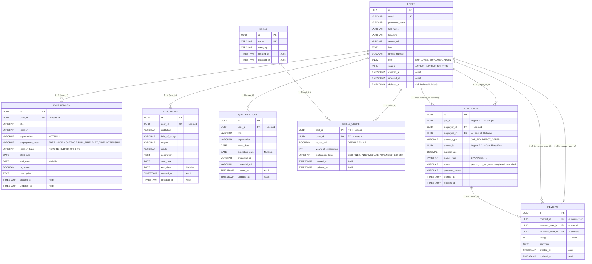

# Đặc tả Cơ sở Dữ liệu Dịch vụ Định danh & Hồ sơ (Identity Service ERD)

> **Bounded Context**: **Identity** (`occupify-identity`)  
> **Cổng dịch vụ**: `8181` | **Database Name**: `occupify_id` (PostgreSQL 16)  
> **Tài liệu tham chiếu toàn hệ thống**: Xem **[ECOSYSTEM-ERD.md](ECOSYSTEM-ERD.md)** để nắm toàn cảnh 5 Bounded Contexts của Occupify.

---

## 1. Giới thiệu Bounded Context Identity

Dịch vụ **Identity** (`occupify-identity`) chịu trách nhiệm quản lý danh tính tài khoản, xác thực bảo mật và toàn bộ hồ sơ năng lực chuyên sâu của người dùng trong hệ sinh thái Occupify:

### 1.1. Bảng Gốc (Native Domain Tables)
1. **`users`**: Thực thể trung tâm lưu thông tin tài khoản, mật khẩu băm, thông tin cá nhân và vai trò hệ thống.
2. **`experiences`**: Lịch sử kinh nghiệm làm việc, vị trí, tổ chức và hình thức làm việc.
3. **`educations`**: Trình độ học vấn, trường đào tạo, chuyên ngành và bằng cấp.
4. **`qualifications`**: Chứng chỉ chuyên môn, tổ chức cấp và thời hạn hiệu lực.
5. **`skills`**: Danh mục kỹ năng chuyên môn của hệ thống.
6. **`skills_users`**: Kỹ năng chuyên môn của người dùng, số năm kinh nghiệm và mức độ thành thạo.

### 1.2. Bảng Sao Chép (Local Replicated Tables)
7. **`contracts`** *(Sao chép từ Core)*: Lưu trữ thông tin hợp đồng để phục vụ hiển thị lịch sử làm việc trên hồ sơ và gắn kết đánh giá.
8. **`reviews`** *(Sao chép từ Core)*: Đánh giá hai chiều sau khi hoàn thành hợp đồng, dùng để tính điểm uy tín và hiển thị phản hồi trên profile freelancer/client.

### 🚨 Mô hình Người dùng Hai vai trò (Dual-Role User Model)
- Trong Occupify, **EMPLOYEE và EMPLOYER là cùng một người**:
  - Người dùng chỉ đăng ký **MỘT tài khoản duy nhất** (`users.id`).
  - Cùng trên một giao diện web/mobile, người dùng có thể chuyển đổi linh hoạt giữa:
    - *Freelancer Workspace (vai trò EMPLOYEE)*: Quản lý hồ sơ, kinh nghiệm, học vấn, chứng chỉ, kỹ năng để đi tìm việc và làm dự án.
    - *Client Workspace (vai trò EMPLOYER)*: Tìm kiếm chuyên gia, xem hồ sơ freelancer khác, đăng tin tuyển dụng và ký hợp đồng.

---

## 2. Sơ đồ Quan hệ Thực thể Nội bộ (Internal ERD)

Toàn bộ các bảng nội bộ trong CSDL `occupify_id` liên kết chặt chẽ thông qua các khóa ngoại vật lý (Physical Foreign Keys):

---

## 3. Đặc tả Chi tiết Các Bảng Dữ liệu

### 3.1. Bảng `users` (Tài khoản người dùng - Gốc)

| Tên cột | Kiểu dữ liệu | Ràng buộc | Giá trị mặc định | Mô tả nghiệp vụ |
|:---|:---|:---|:---|:---|
| `id` | `UUID` | **PK**, NOT NULL | `gen_random_uuid()` | Khóa chính duy nhất của người dùng |
| `email` | `VARCHAR(255)` | **UQ**, NOT NULL | None | Email đăng nhập, định danh duy nhất |
| `password_hash` | `VARCHAR(255)` | NOT NULL | None | Mật khẩu mã hóa BCrypt / Argon2 |
| `full_name` | `VARCHAR(150)` | NOT NULL | None | Họ và tên hiển thị |
| `headline` | `VARCHAR(255)` | NULLABLE | NULL | Tiêu đề chuyên môn (VD: Senior Fullstack Engineer) |
| `avatar_url` | `VARCHAR(500)` | NULLABLE | NULL | Đường dẫn ảnh đại diện |
| `bio` | `TEXT` | NULLABLE | NULL | Đoạn giới thiệu bản thân chi tiết |
| `phone_number` | `VARCHAR(30)` | NULLABLE | NULL | Số điện thoại liên hệ |
| `role` | `ENUM('EMPLOYEE', 'EMPLOYER', 'ADMIN')` | NOT NULL | `'EMPLOYEE'` | Vai trò tài khoản: `EMPLOYEE`, `EMPLOYER`, `ADMIN` |
| `status` | `ENUM('ACTIVE', 'INACTIVE', 'DELETED')` | NOT NULL | `'ACTIVE'` | Trạng thái tài khoản: `ACTIVE`, `INACTIVE`, `DELETED` |
| `created_at` | `TIMESTAMP` | NOT NULL | `CURRENT_TIMESTAMP` | Thời điểm tạo tài khoản (Audit) |
| `updated_at` | `TIMESTAMP` | NOT NULL | `CURRENT_TIMESTAMP` | Thời điểm cập nhật hồ sơ (Audit) |
| `deleted_at` | `TIMESTAMP` | NULLABLE | NULL | Thời điểm xóa mềm tài khoản |

---

### 3.2. Bảng `experiences` (Kinh nghiệm làm việc - Gốc)

| Tên cột | Kiểu dữ liệu | Ràng buộc | Giá trị mặc định | Mô tả nghiệp vụ |
|:---|:---|:---|:---|:---|
| `id` | `UUID` | **PK**, NOT NULL | `gen_random_uuid()` | Khóa chính kinh nghiệm làm việc |
| `user_id` | `UUID` | **FK** -> `users.id`, NOT NULL | None | Khóa ngoại vật lý trỏ về User |
| `title` | `VARCHAR(150)` | NOT NULL | None | Chức danh công việc (VD: Frontend Developer) |
| `location` | `VARCHAR(150)` | NULLABLE | NULL | Địa điểm làm việc (VD: Ho Chi Minh City) |
| `organization` | `VARCHAR(200)` | NOT NULL | None | Tên công ty / tổ chức / khách hàng |
| `employment_type` | `VARCHAR(50)` | NOT NULL | None | Hình thức: `FREELANCE`, `CONTRACT`, `FULL_TIME`, `PART_TIME`, `INTERNSHIP` |
| `location_type` | `VARCHAR(50)` | NOT NULL | `'REMOTE'` | Hình thức làm việc: `REMOTE`, `HYBRID`, `ON_SITE` |
| `start_date` | `DATE` | NOT NULL | None | Ngày bắt đầu làm việc |
| `end_date` | `DATE` | NULLABLE | NULL | Ngày kết thúc (NULL nếu đang làm việc) |
| `is_current` | `BOOLEAN` | NOT NULL | `FALSE` | Đang làm việc tại vị trí này |
| `description` | `TEXT` | NULLABLE | NULL | Mô tả chi tiết trách nhiệm và thành tựu |
| `created_at` | `TIMESTAMP` | NOT NULL | `CURRENT_TIMESTAMP` | Thời điểm tạo (Audit) |
| `updated_at` | `TIMESTAMP` | NOT NULL | `CURRENT_TIMESTAMP` | Thời điểm cập nhật (Audit) |

---

### 3.3. Bảng `educations` (Học vấn - Gốc)

| Tên cột | Kiểu dữ liệu | Ràng buộc | Giá trị mặc định | Mô tả nghiệp vụ |
|:---|:---|:---|:---|:---|
| `id` | `UUID` | **PK**, NOT NULL | `gen_random_uuid()` | Khóa chính học vấn |
| `user_id` | `UUID` | **FK** -> `users.id`, NOT NULL | None | Khóa ngoại vật lý trỏ về User |
| `institution` | `VARCHAR(200)` | NOT NULL | None | Trường đại học / cơ sở đào tạo |
| `field_of_study` | `VARCHAR(150)` | NULLABLE | NULL | Chuyên ngành học (VD: Computer Science) |
| `degree` | `VARCHAR(150)` | NULLABLE | NULL | Bằng cấp (VD: Bachelor, Master) |
| `grade` | `VARCHAR(150)` | NULLABLE | NULL | Xếp loại / GPA |
| `description` | `TEXT` | NULLABLE | NULL | Mô tả thêm về hoạt động / đề tài |
| `start_date` | `DATE` | NOT NULL | None | Thời gian bắt đầu |
| `end_date` | `DATE` | NULLABLE | NULL | Thời gian tốt nghiệp |
| `created_at` | `TIMESTAMP` | NOT NULL | `CURRENT_TIMESTAMP` | Thời điểm tạo (Audit) |
| `updated_at` | `TIMESTAMP` | NOT NULL | `CURRENT_TIMESTAMP` | Thời điểm cập nhật (Audit) |

---

### 3.4. Bảng `qualifications` (Chứng chỉ chuyên môn - Gốc)

| Tên cột | Kiểu dữ liệu | Ràng buộc | Giá trị mặc định | Mô tả nghiệp vụ |
|:---|:---|:---|:---|:---|
| `id` | `UUID` | **PK**, NOT NULL | `gen_random_uuid()` | Khóa chính chứng chỉ |
| `user_id` | `UUID` | **FK** -> `users.id`, NOT NULL | None | Khóa ngoại vật lý trỏ về User |
| `title` | `VARCHAR(200)` | NOT NULL | None | Tên chứng chỉ (VD: AWS Certified Solutions Architect) |
| `organization` | `VARCHAR(200)` | NOT NULL | None | Tổ chức cấp chứng chỉ (VD: Amazon Web Services) |
| `issue_date` | `DATE` | NOT NULL | None | Ngày cấp |
| `expiration_date` | `DATE` | NULLABLE | NULL | Ngày hết hạn (NULL nếu vĩnh viễn) |
| `credential_id` | `VARCHAR(100)` | NULLABLE | NULL | Mã định danh chứng chỉ |
| `credential_url` | `VARCHAR(500)` | NULLABLE | NULL | Đường dẫn xác thực chứng chỉ trực tuyến |
| `created_at` | `TIMESTAMP` | NOT NULL | `CURRENT_TIMESTAMP` | Thời điểm tạo (Audit) |
| `updated_at` | `TIMESTAMP` | NOT NULL | `CURRENT_TIMESTAMP` | Thời điểm cập nhật (Audit) |

---

### 3.5. Bảng `skills` (Danh mục kỹ năng chuyên môn - Gốc)

| Tên cột | Kiểu dữ liệu | Ràng buộc | Giá trị mặc định | Mô tả nghiệp vụ |
|:---|:---|:---|:---|:---|
| `id` | `UUID` | **PK**, NOT NULL | `gen_random_uuid()` | Khóa chính danh mục kỹ năng |
| `name` | `VARCHAR(100)` | **UQ**, NOT NULL | None | Tên kỹ năng duy nhất (VD: Java, Spring Boot, React) |
| `category` | `VARCHAR(50)` | NULLABLE | NULL | Nhóm phân loại kỹ năng (Backend, Frontend, Mobile,...) |
| `created_at` | `TIMESTAMP` | NOT NULL | `CURRENT_TIMESTAMP` | Thời điểm tạo (Audit) |
| `updated_at` | `TIMESTAMP` | NOT NULL | `CURRENT_TIMESTAMP` | Thời điểm cập nhật (Audit) |

---

### 3.6. Bảng `skills_users` (Kỹ năng của người dùng - Gốc)

| Tên cột | Kiểu dữ liệu | Ràng buộc | Giá trị mặc định | Mô tả nghiệp vụ |
|:---|:---|:---|:---|:---|
| `skill_id` | `UUID` | **PK**, **FK** -> `skills.id`, NOT NULL | None | Khóa chính kết hợp / Khóa ngoại trỏ về Skills |
| `user_id` | `UUID` | **PK**, **FK** -> `users.id`, NOT NULL | None | Khóa chính kết hợp / Khóa ngoại trỏ về User |
| `is_top_skill` | `BOOLEAN` | NOT NULL | `FALSE` | Đánh dấu kỹ năng nổi bật hàng đầu (Top skill) |
| `years_of_experience` | `INT` | NOT NULL | `0` | Số năm kinh nghiệm thực tế với kỹ năng |
| `proficiency_level` | `VARCHAR(50)` | NOT NULL | `'INTERMEDIATE'` | Mức độ thành thạo: `BEGINNER`, `INTERMEDIATE`, `ADVANCED`, `EXPERT` |
| `created_at` | `TIMESTAMP` | NOT NULL | `CURRENT_TIMESTAMP` | Thời điểm gắn kỹ năng (Audit) |
| `updated_at` | `TIMESTAMP` | NOT NULL | `CURRENT_TIMESTAMP` | Thời điểm cập nhật kỹ năng (Audit) |

---

### 3.7. Bảng `contracts` (Hợp đồng - Local Entity sao chép từ Core)

Bảng sao chép từ service **Core** phục vụ truy vấn lịch sử làm việc trên hồ sơ của freelancer và khách hàng.

| Tên cột | Kiểu dữ liệu | Ràng buộc | Giá trị mặc định | Mô tả nghiệp vụ |
|:---|:---|:---|:---|:---|
| `id` | `UUID` | **PK**, NOT NULL | None | Khóa chính định danh hợp đồng (đồng bộ từ Core) |
| `job_id` | `UUID` | **FK (Logical)** -> `Core.job.id` | None | Vị trí công việc tuyển dụng gắn liền hợp đồng |
| `employer_id` | `UUID` | **FK** -> `users.id`, NOT NULL | None | Người dùng bên thuê (Client) |
| `employee_id` | `UUID` | **FK** -> `users.id`, NULLABLE | NULL | Người dùng bên nhận việc (Freelancer, NULL khi khởi tạo) |
| `source_type` | `VARCHAR(50)` | NULLABLE | NULL | Nguồn gốc hợp đồng: `JOB_BID`, `DIRECT_OFFER` |
| `source_id` | `UUID` | NULLABLE | NULL | Khóa ngoại logic trỏ tới bản ghi nguồn (`Core.bids.id` hoặc `Core.offers.id`) |
| `agreed_rate` | `DECIMAL` | NOT NULL | None | Mức thù lao thống nhất |
| `salary_type` | `VARCHAR(50)` | NOT NULL | None | Hình thức thù lao (`DAY`, `WEEK`,...) |
| `status` | `VARCHAR(50)` | NOT NULL | `'pending'` | Trạng thái hợp đồng: `pending`, `in_progress`, `completed`, `cancelled` |
| `payment_status` | `VARCHAR(50)` | NULLABLE | NULL | Trạng thái ký quỹ / thanh toán |
| `started_at` | `TIMESTAMP` | NULLABLE | NULL | Thời điểm bắt đầu công việc |
| `finished_at` | `TIMESTAMP` | NULLABLE | NULL | Thời điểm hoàn thành / tất toán |

---

### 3.8. Bảng `reviews` (Đánh giá - Local Entity sao chép từ Core)

Bảng sao chép từ service **Core** phục vụ hiển thị đánh giá nhận xét và chấm sao trên hồ sơ cá nhân.

| Tên cột | Kiểu dữ liệu | Ràng buộc | Giá trị mặc định | Mô tả nghiệp vụ |
|:---|:---|:---|:---|:---|
| `id` | `UUID` | **PK**, NOT NULL | None | Khóa chính đánh giá (đồng bộ từ Core) |
| `contract_id` | `UUID` | **FK** -> `contracts.id`, NOT NULL | None | Hợp đồng gắn liền với đánh giá |
| `reviewer_user_id` | `UUID` | **FK** -> `users.id`, NOT NULL | None | Người dùng viết đánh giá (Client hoặc Freelancer) |
| `reviewee_user_id` | `UUID` | **FK** -> `users.id`, NOT NULL | None | Người dùng nhận đánh giá |
| `rating` | `INT` | NOT NULL, `1-5` | None | Điểm số đánh giá (thang điểm 1-5 sao) |
| `comment` | `TEXT` | NULLABLE | NULL | Nhận xét chi tiết |
| `created_at` | `TIMESTAMP` | NOT NULL | `CURRENT_TIMESTAMP` | Thời điểm tạo đánh giá (Audit) |
| `updated_at` | `TIMESTAMP` | NOT NULL | `CURRENT_TIMESTAMP` | Thời điểm chỉnh sửa đánh giá (Audit) |

---

## 4. Các Mối Quan Hệ (Relationships)

### 4.1. Quan hệ Nội bộ Service Identity (Physical Foreign Keys)
1. **`users (1) - (N) experiences`**: Một người dùng có thể có nhiều bản ghi kinh nghiệm làm việc (`experiences.user_id -> users.id`).
2. **`users (1) - (N) educations`**: Một người dùng có thể có nhiều bản ghi học vấn (`educations.user_id -> users.id`).
3. **`users (1) - (N) qualifications`**: Một người dùng có thể có nhiều chứng chỉ/bằng cấp (`qualifications.user_id -> users.id`).
4. **`users (N) - (M) skills`**: Quan hệ nhiều-nhiều được thể hiện qua bảng trung gian `skills_users` (`skills_users.user_id -> users.id`, `skills_users.skill_id -> skills.id`).
5. **`users (1) - (N) contracts`**: Người dùng có thể tham gia nhiều hợp đồng dưới vai trò người thuê (`employer_id`) hoặc người làm thuê (`employee_id`).
6. **`users (1) - (N) reviews`**: Người dùng có thể viết nhiều đánh giá (`reviewer_user_id`) và nhận nhiều đánh giá (`reviewee_user_id`).
7. **`contracts (1) - (N) reviews`**: Một hợp đồng có thể liên kết với nhiều đánh giá (`reviews.contract_id -> contracts.id`).

### 4.2. Khóa Ngoại Logic & Tích Hợp Liên Bounded Context
| Cột trong `occupify_id` | Bảng nội bộ | Bounded Context Đích | Bảng Đích | Ý nghĩa nghiệp vụ |
|:---|:---|:---|:---|:---|
| `job_id` | `contracts` | **Core** | `job.id` | Vị trí công việc tuyển dụng liên kết hợp đồng |
| `source_id` | `contracts` | **Core** | `bids.id` / `offers.id` | Bản chào thầu hoặc lời mời làm việc tạo ra hợp đồng |
| *Được tham chiếu bởi* | *Bảng bên ngoài* | *Bounded Context nguồn* | *Cột tham chiếu* | *Ý nghĩa nghiệp vụ* |
| `users.id` | `wallets` | **Payment** | `user_id` | Một User có thể sở hữu 1 hoặc nhiều ví tiền (1 : 1/N Wallets) |
| `users.id` | `projects` | **Core** | `employer_id` | Chủ dự án |
| `users.id` | `bids` | **Core** | `freelancer_id` | Freelancer nộp báo giá chào thầu |
| `users.id` | `notifications`| **Notification** | `user_id` | Người nhận thông báo |
| `users.id` | `reports` | **Administration**| `reporter_user_id` / `target_user_id` | Người báo cáo hoặc bị báo cáo vi phạm |

---

## 5. Quy chuẩn Migration & Đánh Index (Flyway `V1__init_identity_schema.sql`)

- **Bắt buộc Unique Index**: `CREATE UNIQUE INDEX uq_users_email ON users(LOWER(email));`
- **Chỉ mục truy vấn**:
  - `CREATE INDEX idx_experiences_user_id ON experiences(user_id);`
  - `CREATE INDEX idx_educations_user_id ON educations(user_id);`
  - `CREATE INDEX idx_qualifications_user_id ON qualifications(user_id);`
  - `CREATE INDEX idx_skills_users_user_id ON skills_users(user_id);`
  - `CREATE INDEX idx_skills_users_skill_id ON skills_users(skill_id);`
  - `CREATE INDEX idx_contracts_employer_id ON contracts(employer_id);`
  - `CREATE INDEX idx_contracts_employee_id ON contracts(employee_id);`
  - `CREATE INDEX idx_reviews_contract_id ON reviews(contract_id);`
  - `CREATE INDEX idx_reviews_reviewee_id ON reviews(reviewee_user_id);`
