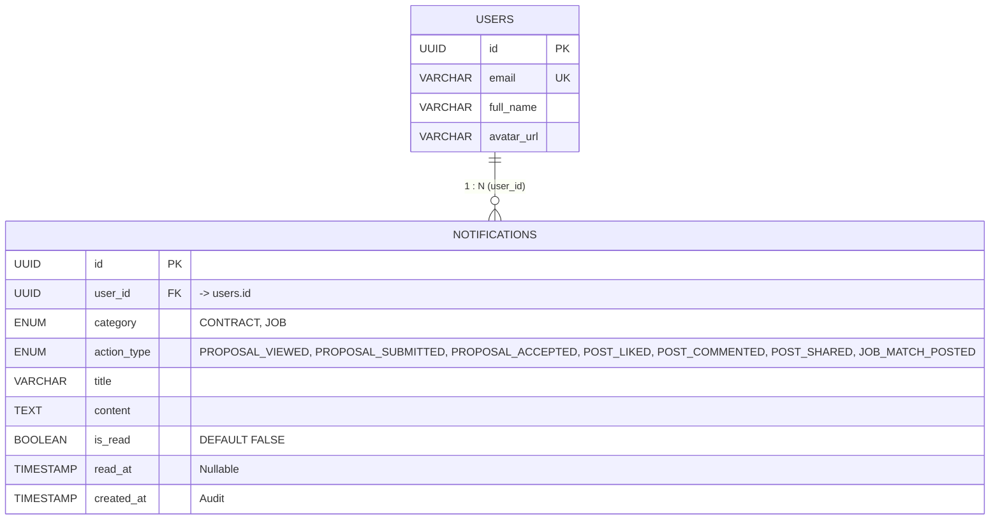

# Đặc tả Cơ sở Dữ liệu Dịch vụ Thông báo (Notification Service ERD)

> **Bounded Context**: **Notification** (`occupify-notification`)  
> **Cổng dịch vụ**: `8184` | **Database Name**: `occupify_notif` (PostgreSQL 16)  
> **Tài liệu tham chiếu toàn hệ thống**: Xem **[ECOSYSTEM-ERD.md](ECOSYSTEM-ERD.md)** để nắm toàn cảnh 5 Bounded Contexts của Occupify.

---

## 1. Giới thiệu Bounded Context Notification

Dịch vụ **Notification** (`occupify-notification`) quản lý toàn bộ hệ thống thông báo sự kiện theo thời gian thực (In-App alerts, Push notifications) cho người dùng trong nền tảng Occupify:

### 1.1. Bảng Gốc (Native Domain Table)
1. **`notifications`**: Lưu trữ toàn bộ thông báo hệ thống, biến động hợp đồng, công việc và tương tác cộng đồng.

### 1.2. Bảng Sao Chép (Local Replicated Table)
2. **`users`** *(Sao chép từ Identity)*: Thực thể người dùng nội bộ phục vụ ràng buộc khóa ngoại vật lý (`Physical FK`) và truy vấn thông tin cơ bản (tên, avatar, email) khi gửi thông báo.

### 🚨 Mô hình Người dùng Hai vai trò (Dual-Role User Model)
- Vì người dùng sử dụng cùng 1 tài khoản (`users.id`) cho cả vai trò Freelancer (EMPLOYEE) và Client (EMPLOYER), bảng `notifications` quản lý thông báo cho cả hai vai trò:
  - Khi ở vai trò Freelancer: Thông báo chào thầu được xem/chấp thuận, hợp đồng kích hoạt, thông báo việc làm mới phù hợp kỹ năng.
  - Khi ở vai trò Client: Thông báo có freelancer nộp chào thầu mới, freelancer nộp bài nghiệm thu, v.v.

---

## 2. Sơ đồ Quan hệ Thực thể Nội bộ (Internal ERD)

CSDL `occupify_notif` duy trì ràng buộc khóa ngoại vật lý nội bộ giữa `users` và `notifications`:

---

## 3. Đặc tả Chi tiết Các Bảng Dữ liệu

### 3.1. Bảng `users` (Người dùng - Local Entity sao chép từ Identity)

| Tên cột | Kiểu dữ liệu | Ràng buộc | Giá trị mặc định | Mô tả nghiệp vụ |
|:---|:---|:---|:---|:---|
| `id` | `UUID` | **PK**, NOT NULL | None | Khóa chính định danh người dùng (đồng bộ từ Identity) |
| `email` | `VARCHAR(255)` | **UQ**, NOT NULL | None | Email tài khoản người dùng |
| `full_name` | `VARCHAR(150)` | NOT NULL | None | Họ và tên người dùng |
| `avatar_url` | `VARCHAR(500)` | NULLABLE | NULL | Đường dẫn ảnh đại diện |

---

### 3.2. Bảng `notifications` (Thông báo - Gốc)

| Tên cột | Kiểu dữ liệu | Ràng buộc | Giá trị mặc định | Mô tả nghiệp vụ |
|:---|:---|:---|:---|:---|
| `id` | `UUID` | **PK**, NOT NULL | `gen_random_uuid()` | Khóa chính duy nhất của thông báo |
| `user_id` | `UUID` | **FK** -> `users.id`, NOT NULL | None | Người dùng nhận thông báo (`users.id` nội bộ) |
| `category` | `ENUM('CONTRACT', 'JOB')` | NOT NULL | None | Phân loại nghiệp vụ của thông báo |
| `action_type` | `ENUM('PROPOSAL_VIEWED', 'PROPOSAL_SUBMITTED', 'PROPOSAL_ACCEPTED', 'POST_LIKED', 'POST_COMMENTED', 'POST_SHARED', 'JOB_MATCH_POSTED')` | NOT NULL | None | Hành vi kích hoạt thông báo |
| `title` | `VARCHAR(255)` | NOT NULL | None | Tiêu đề thông báo |
| `content` | `TEXT` | NOT NULL | None | Nội dung chi tiết thông báo |
| `is_read` | `BOOLEAN` | NOT NULL | `FALSE` | Trạng thái đã xem/đọc hay chưa |
| `read_at` | `TIMESTAMP` | NULLABLE | NULL | Thời điểm đọc thông báo |
| `created_at` | `TIMESTAMP` | NOT NULL | `CURRENT_TIMESTAMP` | Thời điểm tạo thông báo (Audit) |

---

## 4. Các Mối Quan Hệ (Relationships)

1. **`users (1) - (N) notifications`**: Một người dùng có thể nhận nhiều thông báo, thể hiện qua trường khóa ngoại `user_id` trong bảng `notifications` tham chiếu đến `id` của bảng `users`.
2. **Cơ chế Đồng Bộ Thực Thể**:
   - `Notification.users` được đồng bộ từ `Identity.users` thông qua message broker/Domain Events (`UserCreatedEvent`, `UserUpdatedEvent`).
   - Nhận Domain Events từ các service khác (Core, Payment, Admin) để tự động sinh bản ghi trong `notifications`.

---

## 5. Quy chuẩn Migration & Đánh Index (Flyway `V1__init_notification_schema.sql`)

- **Chỉ mục tối ưu truy vấn**:
  - `CREATE INDEX idx_notifications_user_id ON notifications(user_id);`
  - `CREATE INDEX idx_notifications_user_unread ON notifications(user_id, is_read) WHERE is_read = FALSE;`
  - `CREATE INDEX idx_notifications_created_at ON notifications(created_at DESC);`
