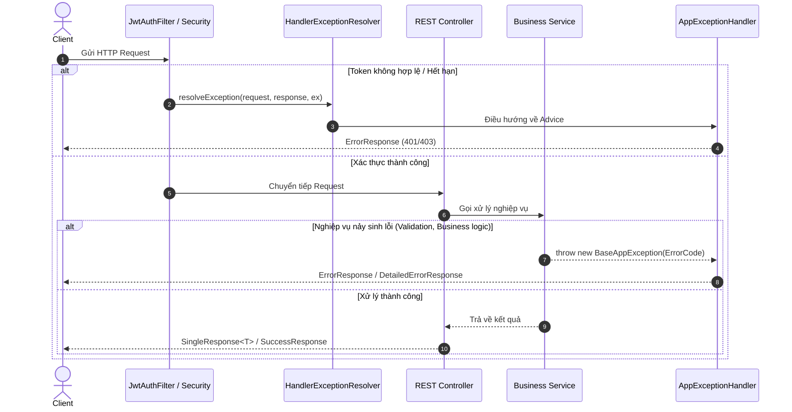

# Kiến Trúc Chuẩn Hóa Phản Hồi (Response) &amp; Xử Lý Ngoại Lệ (Exception Handling) Chuẩn Cho Spring Boot

---

## 1. Tổng quan Kiến trúc (Architecture Overview)

Hệ thống được thiết kế theo tiêu chuẩn **Envelope Pattern** (đóng gói payload và metadata thống nhất) kết hợp với **Centralized Exception Handling** (xử lý ngoại lệ tập trung), đảm bảo:

- **Tính nhất quán**: Client (Web/Mobile) nhận cùng một cấu trúc JSON cho mọi API (thành công hoặc lỗi).
- **Định danh lỗi (Domain-driven Error Codes)**: Phân tách mã lỗi theo domain (`AUTH_xxx`, `BOOKING_xxx`, `SYS_xxx`) giúp việc hiển thị lỗi, đa ngôn ngữ (i18n) và tracing trở nên dễ dàng.
- **Xuyên suốt tầng Security**: Toàn bộ lỗi từ Spring Security Filter Chain (xảy ra trước Controller) đều được chuyển hướng về `@RestControllerAdvice` thông qua `HandlerExceptionResolver`.
- **Sạch sẽ và dễ bảo trì**: Phân tách rõ ràng giữa Business Logic và HTTP Transport; hạn chế ô nhiễm log (Log Pollution) trên môi trường Production.

### Sơ đồ Luồng Hoạt động (Sequence Diagram)



---

## 2. Chuẩn hóa Response (Response Standardization)

### 2.1. Cấu trúc Response DTOs

Tất cả các response DTO được đặt tại package `com.yourcompany.project.dtos.response.base`:

#### 1. `AbstractBaseResponse.java` (Lớp cơ sở)

```java
package com.yourcompany.project.dtos.response.base;

import com.fasterxml.jackson.annotation.JsonIgnoreProperties;
import com.fasterxml.jackson.annotation.JsonInclude;
import lombok.AllArgsConstructor;
import lombok.Getter;
import lombok.NoArgsConstructor;
import lombok.Setter;
import lombok.experimental.SuperBuilder;

@Getter
@Setter
@JsonInclude(JsonInclude.Include.NON_NULL)
@JsonIgnoreProperties(ignoreUnknown = true)
@SuperBuilder
@NoArgsConstructor
@AllArgsConstructor
public abstract class AbstractBaseResponse {
  protected int httpStatus;
  protected String message;
}
```

#### 2. `SingleResponse.java` (Phản hồi kèm dữ liệu)

```java
package com.yourcompany.project.dtos.response.base;

import com.fasterxml.jackson.annotation.JsonPropertyOrder;
import lombok.AllArgsConstructor;
import lombok.Getter;
import lombok.NoArgsConstructor;
import lombok.Setter;
import lombok.experimental.SuperBuilder;

@Getter
@Setter
@NoArgsConstructor
@AllArgsConstructor
@SuperBuilder
@JsonPropertyOrder({"httpStatus", "message", "data"})
public class SingleResponse[[ORCA_RICH_MD:900d4b6056bcec86014dbdaf681b04fa:inline-html:%3CT%3E]] extends AbstractBaseResponse {
  private T data;
}
```

#### 3. `SuccessResponse.java` (Phản hồi không mang dữ liệu)

Áp dụng cho các API dạng Command (ví dụ: `logout`, `delete`, `verify-otp`, `change-password`):

```java
package com.yourcompany.project.dtos.response.base;

import com.fasterxml.jackson.annotation.JsonPropertyOrder;
import lombok.AllArgsConstructor;
import lombok.Getter;
import lombok.Setter;
import lombok.experimental.SuperBuilder;

@Getter
@Setter
@AllArgsConstructor
@SuperBuilder
@JsonPropertyOrder({"httpStatus", "message"})
public class SuccessResponse extends AbstractBaseResponse {}
```

#### 4. `PageResponse.java` (Chuẩn hóa phân trang - Đã khắc phục rò rỉ metadata Spring Data)

*Lưu ý cải tiến:* Không nên bọc trực tiếp `Page<T>` của Spring Data vào `SingleResponse` vì sẽ làm lộ các thuộc tính nội bộ của `PageImpl` (`sort.empty`, `paged`, `unpaged`). Dưới đây là DTO chuẩn hóa:

```java
package com.yourcompany.project.dtos.response.base;

import com.fasterxml.jackson.annotation.JsonPropertyOrder;
import java.util.List;
import lombok.AllArgsConstructor;
import lombok.Builder;
import lombok.Getter;
import lombok.NoArgsConstructor;
import lombok.Setter;
import org.springframework.data.domain.Page;

@Getter
@Setter
@Builder
@NoArgsConstructor
@AllArgsConstructor
@JsonPropertyOrder({"items", "page", "size", "totalElements", "totalPages", "last"})
public class PageResponse<T> {
  private List<T> items;
  private int page;
  private int size;
  private long totalElements;
  private int totalPages;
  private boolean last;

  public static <T> PageResponse<T> from(Page<T> pageData) {
    return PageResponse.<T>builder()
        .items(pageData.getContent())
        .page(pageData.getNumber())
        .size(pageData.getSize())
        .totalElements(pageData.getTotalElements())
        .totalPages(pageData.getTotalPages())
        .last(pageData.isLast())
        .build();
  }
}
```

---

### 2.2. `ResponseFactory.java` (Component tạo Response)

```java
package com.yourcompany.project.dtos.response;

import com.yourcompany.project.dtos.response.base.DetailedErrorResponse;
import com.yourcompany.project.dtos.response.base.ErrorResponse;
import com.yourcompany.project.dtos.response.base.PageResponse;
import com.yourcompany.project.dtos.response.base.SingleResponse;
import com.yourcompany.project.dtos.response.base.SuccessResponse;
import java.time.Instant;
import java.util.List;
import java.util.Map;
import org.springframework.data.domain.Page;
import org.springframework.http.HttpStatus;
import org.springframework.http.ResponseEntity;
import org.springframework.stereotype.Component;

@Component
public class ResponseFactory {

  public ResponseEntity<SuccessResponse> success(HttpStatus httpStatus, String message) {
    SuccessResponse response =
        SuccessResponse.builder().httpStatus(httpStatus.value()).message(message).build();
    return ResponseEntity.status(httpStatus).body(response);
  }

  public ResponseEntity<SuccessResponse> success(String message) {
    return success(HttpStatus.OK, message);
  }

  public <T> ResponseEntity<SingleResponse<T>> success(
      HttpStatus httpStatus, T data, String message) {
    SingleResponse<T> response =
        SingleResponse.<T>builder()
            .httpStatus(httpStatus.value())
            .message(message)
            .data(data)
            .build();
    return ResponseEntity.status(httpStatus).body(response);
  }

  public <T> ResponseEntity<SingleResponse<T>> success(T data, String message) {
    return success(HttpStatus.OK, data, message);
  }

  public <T> ResponseEntity<SingleResponse<PageResponse<T>>> successPage(
      Page<T> pageData, String message) {
    return success(HttpStatus.OK, PageResponse.from(pageData), message);
  }

  public ErrorResponse createErrorResponse(
      HttpStatus httpStatus, String errorCode, String message, String path) {
    return ErrorResponse.builder()
        .httpStatus(httpStatus.value())
        .errorCode(errorCode)
        .message(message)
        .timestamp(Instant.now())
        .path(path)
        .build();
  }

  public DetailedErrorResponse createDetailedErrorResponse(
      HttpStatus httpStatus,
      String errorCode,
      String message,
      String path,
      Map<String, List<String>> items) {
    return DetailedErrorResponse.builder()
        .httpStatus(httpStatus.value())
        .errorCode(errorCode)
        .message(message)
        .path(path)
        .timestamp(Instant.now())
        .items(items)
        .build();
  }
}
```

---

### 2.3. Tích hợp tầng Controller (`AbstractBaseController.java`)

*Lưu ý cải tiến:* Tránh sử dụng Field Injection (`@Autowired`). Sử dụng Setter Injection hoặc Constructor Injection để Controller dễ viết Unit Test độc lập.

```java
package com.yourcompany.project.controllers;

import com.yourcompany.project.dtos.response.ResponseFactory;
import com.yourcompany.project.dtos.response.base.PageResponse;
import com.yourcompany.project.dtos.response.base.SingleResponse;
import com.yourcompany.project.dtos.response.base.SuccessResponse;
import org.springframework.beans.factory.annotation.Autowired;
import org.springframework.data.domain.Page;
import org.springframework.http.HttpStatus;
import org.springframework.http.ResponseEntity;

public abstract class AbstractBaseController {

  protected ResponseFactory responseFactory;

  @Autowired
  public void setResponseFactory(ResponseFactory responseFactory) {
    this.responseFactory = responseFactory;
  }

  protected <T> ResponseEntity<SingleResponse<T>> created(T data, String message) {
    return responseFactory.success(HttpStatus.CREATED, data, message);
  }

  protected <T> ResponseEntity<SingleResponse<T>> success(T data, String message) {
    return responseFactory.success(data, message);
  }

  protected ResponseEntity<SuccessResponse> success(String message) {
    return responseFactory.success(message);
  }

  protected <T> ResponseEntity<SingleResponse<PageResponse<T>>> successPage(
      Page<T> pageData, String message) {
    return responseFactory.successPage(pageData, message);
  }
}
```

---

## 3. Kiến trúc Xử lý Ngoại lệ (Exception Handling)

### 3.1. `ErrorResponse` &amp; `DetailedErrorResponse`

#### 1. `ErrorResponse.java`

```java
package com.yourcompany.project.dtos.response.base;

import com.fasterxml.jackson.annotation.JsonPropertyOrder;
import java.time.Instant;
import lombok.AllArgsConstructor;
import lombok.Getter;
import lombok.NoArgsConstructor;
import lombok.Setter;
import lombok.experimental.SuperBuilder;

@Getter
@Setter
@NoArgsConstructor
@AllArgsConstructor
@SuperBuilder
@JsonPropertyOrder({"httpStatus", "message", "errorCode", "timestamp", "path"})
public class ErrorResponse extends AbstractBaseResponse {
  private String errorCode;
  private Instant timestamp;
  private String path;
}
```

#### 2. `DetailedErrorResponse.java`

*Lưu ý cải tiến:* Sử dụng `Map<String, List<String>> items` thay vì `Map<String, String>` để không bị ghi đè thông báo khi một field có từ 2 lỗi vi phạm trở lên.

```java
package com.yourcompany.project.dtos.response.base;

import com.fasterxml.jackson.annotation.JsonPropertyOrder;
import java.util.List;
import java.util.Map;
import lombok.AllArgsConstructor;
import lombok.Getter;
import lombok.NoArgsConstructor;
import lombok.Setter;
import lombok.experimental.SuperBuilder;

@Getter
@Setter
@NoArgsConstructor
@AllArgsConstructor
@SuperBuilder
@JsonPropertyOrder({"httpStatus", "message", "errorCode", "timestamp", "path", "items"})
public class DetailedErrorResponse extends ErrorResponse {
  private Map<String, List[[ORCA_RICH_MD:900d4b6056bcec86014dbdaf681b04fa:inline-html:%3CString%3E]]> items;
}
```

---

### 3.2. Error Code Architecture

#### 1. Interface `AppErrorCode.java`

```java
package com.yourcompany.project.exception;

import org.springframework.http.HttpStatus;

public interface AppErrorCode {
  String getErrorCode();
  String getMessage();
  HttpStatus getHttpStatus();
}
```

#### 2. Mẫu Enum Mã Lỗi theo Domain (Ví dụ `UserErrorCode.java`)

*Lưu ý cải tiến:* Không nên để placeholder `%s` trong message mặc định nếu thường xuyên gọi constructor không tham số. Hãy dùng message chuẩn và hỗ trợ format an toàn.

```java
package com.yourcompany.project.exception.error;

import com.yourcompany.project.exception.AppErrorCode;
import lombok.Getter;
import lombok.RequiredArgsConstructor;
import org.springframework.http.HttpStatus;

@Getter
@RequiredArgsConstructor
public enum UserErrorCode implements AppErrorCode {
  USER_NOT_FOUND("USER_101", "User not found", HttpStatus.NOT_FOUND),
  USER_EXISTED("USER_102", "Email already registered", HttpStatus.CONFLICT),
  USER_ALREADY_ACTIVE("USER_103", "User is already active", HttpStatus.BAD_REQUEST),
  USER_BANNED("USER_104", "User account is banned", HttpStatus.FORBIDDEN),
  UNAUTHORIZED_ROLE("USER_105", "Cannot perform action on user with this role", HttpStatus.FORBIDDEN);

  private final String errorCode;
  private final String message;
  private final HttpStatus httpStatus;
}
```

#### 3. Mẫu `WebErrorCode.java` (Lỗi HTTP Web &amp; Validation)

*Lưu ý cải tiến:* Dùng `WEB_400` cho validation thay vì `WEB_406` để tránh hiểu lầm với mã `406 Not Acceptable`.

```java
package com.yourcompany.project.exception.error;

import com.yourcompany.project.exception.AppErrorCode;
import lombok.Getter;
import lombok.RequiredArgsConstructor;
import org.springframework.http.HttpStatus;

@Getter
@RequiredArgsConstructor
public enum WebErrorCode implements AppErrorCode {
  BAD_REQUEST("WEB_400", "Bad Request: The request is invalid", HttpStatus.BAD_REQUEST),
  VALIDATION_FAILED("WEB_400_VAL", "Validation error: Invalid input data", HttpStatus.BAD_REQUEST),
  UNAUTHORIZED("WEB_401", "Unauthorized: Authentication required", HttpStatus.UNAUTHORIZED),
  FORBIDDEN("WEB_403", "Access Denied: You do not have permission", HttpStatus.FORBIDDEN),
  NOT_FOUND("WEB_404", "Not Found: The requested resource was not found", HttpStatus.NOT_FOUND),
  METHOD_NOT_ALLOWED("WEB_405", "Method Not Allowed", HttpStatus.METHOD_NOT_ALLOWED),
  UNSUPPORTED_MEDIA_TYPE("WEB_415", "Unsupported Media Type", HttpStatus.UNSUPPORTED_MEDIA_TYPE),
  TOO_MANY_REQUESTS("WEB_429", "Too Many Requests: Rate limit exceeded", HttpStatus.TOO_MANY_REQUESTS),
  INTERNAL_SERVER_ERROR("WEB_500", "Internal Server Error", HttpStatus.INTERNAL_SERVER_ERROR);

  private final String errorCode;
  private final String message;
  private final HttpStatus httpStatus;
}
```

---

### 3.3. `BaseAppException.java` (Runtime Exception Chuẩn)

*Lưu ý cải tiến:* Constructor xử lý format chuỗi an toàn, nếu số lượng `args` không khớp với `%s` thì không làm crash ứng dụng:

```java
package com.yourcompany.project.exception;

import lombok.Getter;

@Getter
public class BaseAppException extends RuntimeException {
  private final AppErrorCode errorCode;

  public BaseAppException(AppErrorCode errorCode) {
    super(errorCode.getMessage());
    this.errorCode = errorCode;
  }

  public BaseAppException(AppErrorCode errorCode, String customMessage) {
    super(customMessage);
    this.errorCode = errorCode;
  }

  public BaseAppException(AppErrorCode errorCode, Object... args) {
    super(formatSafely(errorCode.getMessage(), args));
    this.errorCode = errorCode;
  }

  private static String formatSafely(String template, Object... args) {
    if (args == null || args.length == 0 || !template.contains("%")) {
      return template;
    }
    try {
      return String.format(template, args);
    } catch (Exception ex) {
      return template;
    }
  }
}
```

---

### 3.4. `AppExceptionHandler.java` (Bộ Xử Lý Ngoại Lệ Toàn Cục)

*Lưu ý cải tiến quan trọng đã áp dụng:*

1. **Phân cấp Log:** Lỗi 4xx (Client errors) chỉ log ở mức `WARN` (không stack trace). Lỗi 5xx (Server/System errors) log ở mức `ERROR` kèm full stack trace để tránh Log Pollution.
2. **Bắt đầy đủ** `EntityNotFoundException`**:** Trả về `404 Not Found` thay vì để lọt xuống 500.
3. **Bắt** `ConstraintViolationException` **&amp;** `HandlerMethodValidationException`**:** Đảm bảo validate `@RequestParam`, `@PathVariable` trả về 400 chuẩn JSON.
4. **Hỗ trợ** `GlobalErrors`**:** Thu thập cả lỗi cấp đối tượng (Object/Class-level validation) bên cạnh field-level errors.

```java
package com.yourcompany.project.exception;

import com.yourcompany.project.dtos.response.ResponseFactory;
import com.yourcompany.project.dtos.response.base.DetailedErrorResponse;
import com.yourcompany.project.dtos.response.base.ErrorResponse;
import com.yourcompany.project.exception.error.SystemErrorCode;
import com.yourcompany.project.exception.error.WebErrorCode;
import jakarta.persistence.EntityNotFoundException;
import jakarta.servlet.http.HttpServletRequest;
import jakarta.validation.ConstraintViolation;
import jakarta.validation.ConstraintViolationException;
import java.util.ArrayList;
import java.util.HashMap;
import java.util.List;
import java.util.Map;
import lombok.RequiredArgsConstructor;
import lombok.extern.slf4j.Slf4j;
import org.springframework.core.Ordered;
import org.springframework.core.annotation.Order;
import org.springframework.dao.DataIntegrityViolationException;
import org.springframework.http.HttpStatus;
import org.springframework.http.ResponseEntity;
import org.springframework.http.converter.HttpMessageNotReadableException;
import org.springframework.security.access.AccessDeniedException;
import org.springframework.security.authentication.BadCredentialsException;
import org.springframework.security.authentication.InsufficientAuthenticationException;
import org.springframework.validation.BindException;
import org.springframework.validation.BindingResult;
import org.springframework.validation.FieldError;
import org.springframework.validation.ObjectError;
import org.springframework.web.HttpMediaTypeNotSupportedException;
import org.springframework.web.HttpRequestMethodNotSupportedException;
import org.springframework.web.bind.MethodArgumentNotValidException;
import org.springframework.web.bind.MissingRequestHeaderException;
import org.springframework.web.bind.MissingServletRequestParameterException;
import org.springframework.web.bind.annotation.ExceptionHandler;
import org.springframework.web.bind.annotation.RestControllerAdvice;
import org.springframework.web.method.annotation.HandlerMethodValidationException;
import org.springframework.web.method.annotation.MethodArgumentTypeMismatchException;
import org.springframework.web.multipart.MaxUploadSizeExceededException;
import org.springframework.web.servlet.resource.NoResourceFoundException;

@Order(Ordered.HIGHEST_PRECEDENCE)
@RestControllerAdvice
@RequiredArgsConstructor
@Slf4j
public class AppExceptionHandler {

  private final ResponseFactory responseFactory;

  // 1. Business Logic Exceptions
  @ExceptionHandler(BaseAppException.class)
  public ResponseEntity<ErrorResponse> handleBaseAppException(
      BaseAppException e, HttpServletRequest request) {
    AppErrorCode errorCode = e.getErrorCode();
    
    // Log thông minh: 4xx chỉ log WARN (tránh rác log), 5xx log ERROR kèm stack trace
    if (errorCode.getHttpStatus().is4xxClientError()) {
      log.warn("Business Exception [{}] at {}: {}", errorCode.getErrorCode(), request.getRequestURI(), e.getMessage());
    } else {
      log.error("Internal Business Error [{}] at {}: {}", errorCode.getErrorCode(), request.getRequestURI(), e.getMessage(), e);
    }

    ErrorResponse response =
        responseFactory.createErrorResponse(
            errorCode.getHttpStatus(),
            errorCode.getErrorCode(),
            e.getMessage(),
            request.getRequestURI());
    return ResponseEntity.status(errorCode.getHttpStatus()).body(response);
  }

  // 2. DTO Validation Exceptions (RequestBody, ModelAttribute)
  @ExceptionHandler({BindException.class, MethodArgumentNotValidException.class})
  public ResponseEntity<DetailedErrorResponse> handleValidationException(
      Exception e, HttpServletRequest request) {
    log.warn("Validation failed at: {}", request.getRequestURI());
    Map<String, List<String>> errors = new HashMap<>();

    BindingResult bindingResult = (e instanceof BindException be) ? be.getBindingResult() : null;

    if (bindingResult != null) {
      // Field-level errors
      for (FieldError fieldError : bindingResult.getFieldErrors()) {
        errors.computeIfAbsent(fieldError.getField(), k -> new ArrayList<>())
              .add(fieldError.getDefaultMessage());
      }
      // Object-level (Global) errors (e.g. @ValidDateRange)
      for (ObjectError globalError : bindingResult.getGlobalErrors()) {
        errors.computeIfAbsent(globalError.getObjectName(), k -> new ArrayList<>())
              .add(globalError.getDefaultMessage());
      }
    }

    DetailedErrorResponse response =
        responseFactory.createDetailedErrorResponse(
            WebErrorCode.VALIDATION_FAILED.getHttpStatus(),
            WebErrorCode.VALIDATION_FAILED.getErrorCode(),
            WebErrorCode.VALIDATION_FAILED.getMessage(),
            request.getRequestURI(),
            errors);
    return ResponseEntity.status(HttpStatus.BAD_REQUEST).body(response);
  }

  // 3. Param & PathVariable Validation Exceptions (Spring Boot 3)
  @ExceptionHandler(ConstraintViolationException.class)
  public ResponseEntity<DetailedErrorResponse> handleConstraintViolation(
      ConstraintViolationException e, HttpServletRequest request) {
    log.warn("Constraint violation at: {}", request.getRequestURI());
    Map<String, List<String>> errors = new HashMap<>();

    for (ConstraintViolation<?> violation : e.getConstraintViolations()) {
      String propertyPath = violation.getPropertyPath().toString();
      errors.computeIfAbsent(propertyPath, k -> new ArrayList<>())
            .add(violation.getMessage());
    }

    DetailedErrorResponse response =
        responseFactory.createDetailedErrorResponse(
            WebErrorCode.VALIDATION_FAILED.getHttpStatus(),
            WebErrorCode.VALIDATION_FAILED.getErrorCode(),
            "Constraint violation error",
            request.getRequestURI(),
            errors);
    return ResponseEntity.status(HttpStatus.BAD_REQUEST).body(response);
  }

  @ExceptionHandler(HandlerMethodValidationException.class)
  public ResponseEntity<DetailedErrorResponse> handleHandlerMethodValidation(
      HandlerMethodValidationException e, HttpServletRequest request) {
    log.warn("Handler method validation failed at: {}", request.getRequestURI());
    Map<String, List<String>> errors = new HashMap<>();

    e.getAllValidationResults().forEach(result -> {
      String paramName = result.getMethodParameter().getParameterName();
      List<String> messages = result.getResolvableErrors().stream()
          .map(org.springframework.context.MessageSourceResolvable::getDefaultMessage)
          .toList();
      errors.computeIfAbsent(paramName != null ? paramName : "parameter", k -> new ArrayList<>())
            .addAll(messages);
    });

    DetailedErrorResponse response =
        responseFactory.createDetailedErrorResponse(
            WebErrorCode.VALIDATION_FAILED.getHttpStatus(),
            WebErrorCode.VALIDATION_FAILED.getErrorCode(),
            "Request parameter validation failed",
            request.getRequestURI(),
            errors);
    return ResponseEntity.status(HttpStatus.BAD_REQUEST).body(response);
  }

  // 4. Persistence / Entity Not Found Exception
  @ExceptionHandler(EntityNotFoundException.class)
  public ResponseEntity<ErrorResponse> handleEntityNotFound(
      EntityNotFoundException e, HttpServletRequest request) {
    log.warn("Entity not found at {}: {}", request.getRequestURI(), e.getMessage());
    return buildFromAppErrorCode(
        WebErrorCode.NOT_FOUND, request.getRequestURI(), e.getMessage());
  }

  // 5. Database Constraint Conflict
  @ExceptionHandler(DataIntegrityViolationException.class)
  public ResponseEntity<ErrorResponse> handleDataIntegrityViolation(
      DataIntegrityViolationException e, HttpServletRequest request) {
    log.error("Database conflict at {}: {}", request.getRequestURI(), e.getMessage());
    return buildFromAppErrorCode(
        WebErrorCode.BAD_REQUEST, request.getRequestURI(), "Data integrity violation or conflict");
  }

  // 6. Security Exceptions (Authentication & Authorization)
  @ExceptionHandler(BadCredentialsException.class)
  public ResponseEntity<ErrorResponse> handleBadCredentials(
      BadCredentialsException e, HttpServletRequest request) {
    log.warn("Bad credentials at: {}", request.getRequestURI());
    return buildFromAppErrorCode(WebErrorCode.UNAUTHORIZED, request.getRequestURI(), "Invalid username or password");
  }

  @ExceptionHandler(InsufficientAuthenticationException.class)
  public ResponseEntity<ErrorResponse> handleInsufficientAuth(
      InsufficientAuthenticationException e, HttpServletRequest request) {
    log.warn("Unauthorized access at: {}", request.getRequestURI());
    return buildFromAppErrorCode(WebErrorCode.UNAUTHORIZED, request.getRequestURI());
  }

  @ExceptionHandler(AccessDeniedException.class)
  public ResponseEntity<ErrorResponse> handleAccessDenied(
      AccessDeniedException e, HttpServletRequest request) {
    log.warn("Access denied at: {}", request.getRequestURI());
    return buildFromAppErrorCode(WebErrorCode.FORBIDDEN, request.getRequestURI());
  }

  // 7. Request Payload & Format Errors
  @ExceptionHandler({
      HttpRequestMethodNotSupportedException.class,
      HttpMessageNotReadableException.class,
      HttpMediaTypeNotSupportedException.class,
      MissingRequestHeaderException.class,
      MissingServletRequestParameterException.class,
      MethodArgumentTypeMismatchException.class
  })
  public ResponseEntity<ErrorResponse> handleBadRequestTypes(
      Exception e, HttpServletRequest request) {
    log.warn("Malformed request at {}: {}", request.getRequestURI(), e.getMessage());
    return buildFromAppErrorCode(
        WebErrorCode.BAD_REQUEST,
        request.getRequestURI(),
        "Invalid request: " + e.getClass().getSimpleName());
  }

  @ExceptionHandler(MaxUploadSizeExceededException.class)
  public ResponseEntity<ErrorResponse> handleMaxUploadSize(
      MaxUploadSizeExceededException e, HttpServletRequest request) {
    log.warn("File size exceeded at: {}", request.getRequestURI());
    return buildFromAppErrorCode(
        WebErrorCode.BAD_REQUEST, request.getRequestURI(), "Uploaded file exceeds maximum limit");
  }

  @ExceptionHandler(NoResourceFoundException.class)
  public ResponseEntity<ErrorResponse> handleNoResourceFound(
      NoResourceFoundException e, HttpServletRequest request) {
    return buildFromAppErrorCode(WebErrorCode.NOT_FOUND, request.getRequestURI());
  }

  // 8. Catch-all: Unexpected Unhandled Exceptions
  @ExceptionHandler(Exception.class)
  public ResponseEntity<ErrorResponse> handleUnknownException(
      Exception e, HttpServletRequest request) {
    log.error("Unhandled Server Exception at: {}", request.getRequestURI(), e);
    return buildFromAppErrorCode(SystemErrorCode.INTERNAL_SERVER_ERROR, request.getRequestURI());
  }

  private ResponseEntity<ErrorResponse> buildFromAppErrorCode(AppErrorCode errorCode, String path) {
    return buildFromAppErrorCode(errorCode, path, errorCode.getMessage());
  }

  private ResponseEntity<ErrorResponse> buildFromAppErrorCode(
      AppErrorCode errorCode, String path, String customMessage) {
    ErrorResponse response =
        responseFactory.createErrorResponse(
            errorCode.getHttpStatus(), errorCode.getErrorCode(), customMessage, path);
    return ResponseEntity.status(errorCode.getHttpStatus()).body(response);
  }
}
```

---

## 4. Tích hợp Xuyên Suốt với Spring Security (Security Filter Integration)

Để lỗi ở các Filter (ví dụ: Token JWT hết hạn, sai chữ ký, không có quyền) trả về đúng chuẩn `ErrorResponse` của `AppExceptionHandler`, bắt buộc phải cấu hình cầu nối qua `HandlerExceptionResolver`.

### 4.1. `CustomAuthenticationEntryPoint.java` (Xử lý 401 Unauthorized)

```java
package com.yourcompany.project.security;

import jakarta.servlet.http.HttpServletRequest;
import jakarta.servlet.http.HttpServletResponse;
import org.springframework.beans.factory.annotation.Qualifier;
import org.springframework.security.core.AuthenticationException;
import org.springframework.security.web.AuthenticationEntryPoint;
import org.springframework.stereotype.Component;
import org.springframework.web.servlet.HandlerExceptionResolver;

@Component
public class CustomAuthenticationEntryPoint implements AuthenticationEntryPoint {

  private final HandlerExceptionResolver resolver;

  public CustomAuthenticationEntryPoint(
      @Qualifier("handlerExceptionResolver") HandlerExceptionResolver resolver) {
    this.resolver = resolver;
  }

  @Override
  public void commence(
      HttpServletRequest request,
      HttpServletResponse response,
      AuthenticationException authException) {
    // Ủy quyền ngoại lệ về cho AppExceptionHandler xử lý thành JSON ErrorResponse
    resolver.resolveException(request, response, null, authException);
  }
}
```

### 4.2. `CustomAccessDeniedHandler.java` (Xử lý 403 Forbidden - Khắc phục điểm thiếu)

```java
package com.yourcompany.project.security;

import jakarta.servlet.http.HttpServletRequest;
import jakarta.servlet.http.HttpServletResponse;
import org.springframework.beans.factory.annotation.Qualifier;
import org.springframework.security.access.AccessDeniedException;
import org.springframework.security.web.access.AccessDeniedHandler;
import org.springframework.stereotype.Component;
import org.springframework.web.servlet.HandlerExceptionResolver;

@Component
public class CustomAccessDeniedHandler implements AccessDeniedHandler {

  private final HandlerExceptionResolver resolver;

  public CustomAccessDeniedHandler(
      @Qualifier("handlerExceptionResolver") HandlerExceptionResolver resolver) {
    this.resolver = resolver;
  }

  @Override
  public void handle(
      HttpServletRequest request,
      HttpServletResponse response,
      AccessDeniedException accessDeniedException) {
    // Chuyển tiếp AccessDeniedException ở filter chain về AppExceptionHandler
    resolver.resolveException(request, response, null, accessDeniedException);
  }
}
```

### 4.3. `JwtAuthenticationFilter.java` (Xử lý Token Ngoại Lệ)

```java
package com.yourcompany.project.security;

import jakarta.servlet.FilterChain;
import jakarta.servlet.ServletException;
import jakarta.servlet.http.HttpServletRequest;
import jakarta.servlet.http.HttpServletResponse;
import java.io.IOException;
import org.springframework.beans.factory.annotation.Qualifier;
import org.springframework.stereotype.Component;
import org.springframework.web.filter.OncePerRequestFilter;
import org.springframework.web.servlet.HandlerExceptionResolver;

@Component
public class JwtAuthenticationFilter extends OncePerRequestFilter {

  private final HandlerExceptionResolver resolver;

  public JwtAuthenticationFilter(
      @Qualifier("handlerExceptionResolver") HandlerExceptionResolver resolver) {
    this.resolver = resolver;
  }

  @Override
  protected void doFilterInternal(
      HttpServletRequest request,
      HttpServletResponse response,
      FilterChain filterChain) throws ServletException, IOException {
    try {
      // 1. Trích xuất và validate JWT token...
      // 2. Thiết lập Authentication vào SecurityContextHolder...
      filterChain.doFilter(request, response);
    } catch (Exception ex) {
      // Mọi lỗi parsing token, expired token, blacklist token đều đẩy về AppExceptionHandler
      resolver.resolveException(request, response, null, ex);
    }
  }
}
```

### 4.4. Đăng ký trong `SecurityConfig.java`

```java
@Bean
public SecurityFilterChain securityFilterChain(
    HttpSecurity http,
    JwtAuthenticationFilter jwtAuthFilter,
    CustomAuthenticationEntryPoint authEntryPoint,
    CustomAccessDeniedHandler accessDeniedHandler) throws Exception {

  http
      .csrf(AbstractHttpConfigurer::disable)
      .sessionManagement(s -> s.sessionCreationPolicy(SessionCreationPolicy.STATELESS))
      .exceptionHandling(ex -> ex
          .authenticationEntryPoint(authEntryPoint) // 401
          .accessDeniedHandler(accessDeniedHandler)  // 403
      )
      .authorizeHttpRequests(auth -> auth
          .requestMatchers("/api/v1/public/**").permitAll()
          .anyRequest().authenticated()
      )
      .addFilterBefore(jwtAuthFilter, UsernamePasswordAuthenticationFilter.class);

  return http.build();
}
```

---

## 5. Hướng dẫn Lập trình viên Thực tế (Developer Cheatsheet)

### 5.1. Ném Ngoại Lệ Nghiệp Vụ Trong Service

Luôn ném `BaseAppException` với `ErrorCode` tương ứng:

```java
// 1. Dùng message mặc định của ErrorCode
User user = userRepository.findById(id)
    .orElseThrow(() -> new BaseAppException(UserErrorCode.USER_NOT_FOUND));

// 2. Dùng message có tham số an toàn
User user = userRepository.findById(id)
    .orElseThrow(() -> new BaseAppException(UserErrorCode.USER_NOT_FOUND, "User ID " + id + " does not exist"));

// 3. Kiểm tra điều kiện nghiệp vụ
if (booking.getStatus() == BookingStatus.CANCELLED) {
  throw new BaseAppException(BookingErrorCode.BOOKING_ALREADY_CANCELLED);
}
```

### 5.2. Trả Dữ Liệu Trong Controller

Controller kế thừa `AbstractBaseController`:

```java
@RestController
@RequestMapping("/api/v1/users")
@RequiredArgsConstructor
public class UserController extends AbstractBaseController {

  private final UserService userService;

  // Lấy chi tiết (200 OK + Data)
  @GetMapping("/{id}")
  public ResponseEntity<SingleResponse<UserResponse>> getUser(@PathVariable UUID id) {
    UserResponse data = userService.getUserById(id);
    return success(data, "Fetched user successfully");
  }

  // Tạo mới (201 Created + Data)
  @PostMapping
  public ResponseEntity<SingleResponse<UserResponse>> createUser(@Valid @RequestBody CreateUserRequest req) {
    UserResponse data = userService.createUser(req);
    return created(data, "User created successfully");
  }

  // Tác vụ không cần payload (200 OK)
  @PostMapping("/{id}/deactivate")
  public ResponseEntity<SuccessResponse> deactivate(@PathVariable UUID id) {
    userService.deactivate(id);
    return success("User deactivated successfully");
  }

  // Phân trang (200 OK + Chuẩn hóa PageResponse)
  @GetMapping
  public ResponseEntity<SingleResponse<PageResponse<UserResponse>>> listUsers(Pageable pageable) {
    Page<UserResponse> page = userService.listUsers(pageable);
    return successPage(page, "Users retrieved successfully");
  }
}
```

---

## 6. Quy Ước Đặt Mã Lỗi (Error Code Convention)


| Prefix                                                                        | Domain / Mục đích                           | Ví dụ                                                |
| :----------------------------------------------------------------------------- | :------------------------------------------- | :---------------------------------------------------- |
| `SYS_`                                                                        | Lỗi tầng hệ thống chung, server hạ tầng     | `SYS_100` (Internal Server Error)                    |
| `WEB_`                                                                        | Lỗi HTTP giao thức, validation, bad request | `WEB_400_VAL`, `WEB_404`                             |
| `AUTH_`                                                                       | Xác thực, JWT, OTP, thông tin đăng nhập     | `AUTH_101` (Invalid Token), `AUTH_201` (Invalid OTP) |
| `USER_`                                                                       | Tài khoản, người dùng, hồ sơ                | `USER_101` (User Not Found)                          |
| `[[ORCA_RICH_MD:900d4b6056bcec86014dbdaf681b04fa:inline-html:%3CDOMAIN%3E]]_` | Nghiệp vụ theo từng tính năng cụ thể        | `BOOKING_101`, `COACH_101`, `HOTEL_101`, `TOUR_101`  |


Mỗi domain mới cần tạo riêng một Enum triển khai `AppErrorCode` (ví dụ `HotelErrorCode.java`, `PaymentErrorCode.java`), tránh lạm dụng `WEB_400` với raw String.