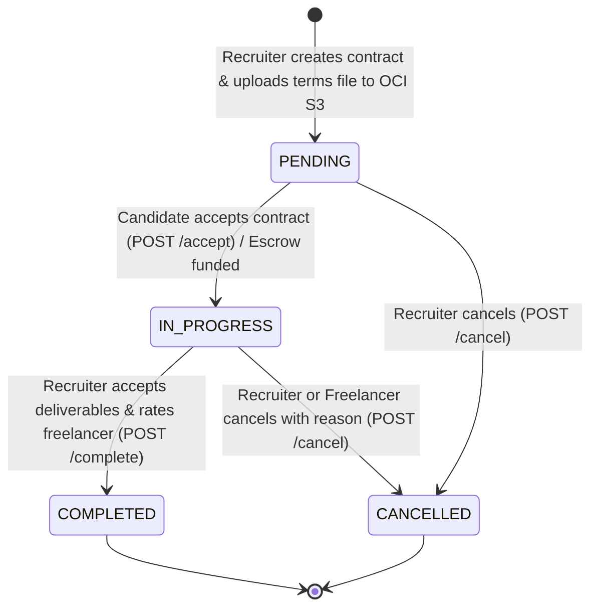

# Design Specification: Recruiter Contract CRUD, Oracle S3 Presigned Terms Storage & ERD Sync

- **Feature Key:** `OC-76`
- **Topic:** Recruiter Contract Lifecycle Management & Private Terms File Storage with Oracle S3 Presigned URLs
- **Target Repository:** `occupify-core`
- **Frontend Target:** `occupify-web` (Workspace / Project Detail view)
- **Reference Implementation:** `occupify-identity` (`com.occupify.identity.service.storage.impl.S3StorageServiceImpl`)
- **Author:** Antigravity / Gem
- **Date:** 2026-10-25
- **Status:** DRAFT (Reviewed & Updated with Builder Invariants)

---

## 1. Intent & Context

### 1.1. The "Why"
Occupify connects employers/recruiters with freelancers. Currently, recruiters can post projects, create job roles, and receive bids from applicants. However, recruiters have no backend mechanism to:
1. Formally establish an employment contract (`Contract`) with a candidate from a job role or an accepted bid.
2. Directly attach/upload private agreement terms documents (`.pdf`, `.docx`) upon contract creation or modification.
3. Review, modify, cancel, or complete contracts with reason tracking and rating feedback.

In `occupify-web`, these interactions exist as UI prototypes with in-memory mocks. Task `OC-76` implements the complete backend lifecycle for contracts, synchronizes database schemas with architecture docs, and delivers private document storage using **Oracle Cloud Infrastructure (OCI) Object Storage** with **S3 Presigned URLs**.

### 1.2. Direct User Decisions
- **Cloud Storage:** Use Oracle Cloud Infrastructure (OCI) Object Storage via S3-compatible API, adopting the pattern and dependencies (`software.amazon.awssdk:s3:2.25.40`) from `occupify-identity`.
- **Private Legal Documents:** Contract terms are confidential documents, NOT public assets like avatars. They MUST NOT have permanent public URLs. Backend stores the private **S3 Object Key** in the database (`terms_file_key`) and generates temporary **Presigned GET URLs** (TTL: 15 minutes) only for authenticated parties to the contract.
- **Direct Multipart Attachment:** File upload MUST NOT be a detached endpoint. The terms file is attached directly during contract creation (`POST /api/v1/contracts`) or update (`PUT /api/v1/contracts/{id}`) via `multipart/form-data`.
- **ERD & Code Sync:** The database schema (`contracts`, `cancellation_contracts`) and documentation (`docs/CORE-ERD.md`, `docs/ECOSYSTEM-ERD.md`) MUST be updated and synchronized simultaneously.

---

## 2. Goals, Non-Goals & Anti-Goals

### 2.1. Goals
1. **Schema & Doc Synchronization:**
   - Add missing columns to `contracts`: `title VARCHAR(255)`, `terms_file_key VARCHAR(500)`, `job_description TEXT`, `salary_due_date VARCHAR(100)`.
   - Create table `cancellation_contracts` with constraints and foreign keys (`contract_id`, `requested_by_user_id`, `reason`, `status`).
   - Synchronize `docs/CORE-ERD.md` and `docs/ECOSYSTEM-ERD.md`.
2. **Oracle S3 Storage & Presigner Integration:**
   - Add `software.amazon.awssdk:s3:2.25.40` dependency to `pom.xml`.
   - Implement `S3Properties` and `S3Config` supporting OCI Object Storage auto-derived endpoints (`https://{namespace}.compat.objectstorage.{region}.oraclecloud.com`), credentials, and path-style access.
   - Configure `S3Client` for private upload (`putObject`) and `S3Presigner` for time-limited signed URLs (`presignGetObject` with 15-minute TTL).
   - Create `StorageService` interface handling `uploadPrivateDocument(directory, file)` and `generatePresignedDownloadUrl(objectKey, duration)`.
   - Provide default system terms template key fallback (`templates/DieuKhoan_HopDong_Mau.pdf`) when no custom file is uploaded.
3. **Recruiter Contract RESTful API:**
   - `POST /api/v1/contracts` (`multipart/form-data`): Create contract, upload terms to S3 (or fallback to template), cascade update referenced Bid to `ACCEPTED`, generate corresponding `Offer`, return response with presigned terms URL.
   - `GET /api/v1/contracts`: Paginated list of contracts strictly scoped to current user (`employer_id == currentUser` or `employee_id == currentUser`, unless Admin), with filters (`projectId`, `jobId`, `status`).
   - `GET /api/v1/contracts/{id}`: Detailed contract response including employer, employee, job, project, and fresh presigned terms download URL.
   - `PUT /api/v1/contracts/{id}` (`multipart/form-data`): Edit contract details and optional terms file replacement (STRICT: allowed ONLY when `status == PENDING`).
   - `POST /api/v1/contracts/{id}/cancel`: Cancel contract unilaterally with required reason ($\ge 10$ chars), insert row into `cancellation_contracts` (`status = 'ACCEPTED'`), update status to `CANCELLED`, cascade `Offer.status = 'EXPIRED'`.
   - `POST /api/v1/contracts/{id}/accept`: Endpoint for candidate to accept the contract/offer, transitioning status from `PENDING` to `IN_PROGRESS` and setting `started_at = CURRENT_TIMESTAMP`.
   - `POST /api/v1/contracts/{id}/complete`: Complete contract upon deliverable acceptance with 1-5 star rating and review.

### 2.2. Non-Goals
- **Payment Escrow & Wallet Integration:** Payment ledger and wallet balance locks belong to `occupify-payment`. Contract status reflects `payment_status` locally without driving monetary transactions.
- **Hard Deleting Contracts:** Contracts must never be deleted with SQL `DELETE`. Once created, they transition through state changes.

### 2.3. Anti-Goals
- **Permanent Public URLs for Contracts:** Never expose public URLs for confidential contract files.
- **Separate Standalone Upload Endpoint:** Rejecting detached upload endpoints. File attachment is atomic with contract payload.
- **Unrestricted In-Progress Editing:** Never allow arbitrary rate/deadline modifications when status is `IN_PROGRESS`.

---

## 3. Domain Model & State Lifecycle

### 3.1. Contract State Machine



### 3.2. Business Invariants
1. **Role Binding:** Every contract MUST bind to a valid `job_id` (`NOT NULL`).
2. **Candidate Assignment & Cascades:**
   - If `employeeId` is provided: Must be an existing active user in `users`.
   - If `freelancerEmail` is provided without ID: Resolve user by email; if user does not exist, reject with `USER_NOT_FOUND`.
   - If `sourceType == 'JOB_BID'`: Validate that `sourceId` refers to an existing `bids` record belonging to the same `job_id`, and automatically set `bids.status = 'ACCEPTED'`.
   - Automatically insert an associated `offers` record with `proposed_rate = agreedRate`, `status = 'PENDING'`.
3. **Private Security & Authorization:**
   - Generating a presigned download URL for a contract terms file requires that the requesting user is the Employer, the Employee, or an ADMIN.
   - Presigned URLs expire after 15 minutes.
4. **Edit Lock:** Once a contract is `IN_PROGRESS`, `COMPLETED`, or `CANCELLED`, updating agreed rate, salary type, or dates via `PUT /contracts/{id}` is forbidden (`CONTRACT_ALREADY_ACTIVE`).
5. **Cancellation Record:** Cancelling a contract requires `reason` ($\ge 10$ characters), records a row in `cancellation_contracts` with `status = 'ACCEPTED'`, and updates `contracts.status = CANCELLED`.

---

## 4. Technical Architecture

### 4.1. Oracle S3 Storage Service Architecture

Adopted directly from `occupify-identity`'s `S3Config` and `S3StorageServiceImpl`:

```
[Create / Update Contract Request (multipart/form-data)]
                     │
                     ▼
             [ContractService]
                     │
         Upload terms file (PutObject)
                     │
                     ▼
             [StorageService]
                     │
                     ▼
       [Oracle OCI S3-Compatible Bucket]
          Object Key: contracts/{contractId}/{timestamp}_{filename}.pdf
                     │
         Key saved in DB: contracts.terms_file_key
```

When contract details are queried (`GET /api/v1/contracts/{id}`):
```
[Client GET /api/v1/contracts/{id}]
                     │
                     ▼
             [ContractService]
                     │
          Generate Presigned GET URL (TTL: 15m)
                     │
                     ▼
             [S3Presigner] ───> Returns signed temporary URL
                     │
                     ▼
  Response DTO includes `termsFileUrl` = "https://{namespace}.compat.objectstorage...&X-Amz-Signature=..."
```

**Interface Definition:**
```java
public interface StorageService {
  String uploadPrivateDocument(String directory, MultipartFile file);
  String generatePresignedDownloadUrl(String objectKey, Duration duration);
  void deleteFile(String objectKey);
  String getDefaultTermsKey();
}
```

**Configuration Properties (`S3Properties.java`):**
```yaml
app:
  storage:
    s3:
      bucket-namespace: ${S3_BUCKET_NAMESPACE:}
      region: ${S3_REGION:ap-singapore-1}
      endpoint: ${S3_ENDPOINT:}
      bucket-name: ${S3_BUCKET_NAME:occupify-storage}
      access-key: ${S3_ACCESS_KEY:}
      secret-key: ${S3_SECRET_KEY:}
      path-style-access-enabled: ${S3_PATH_STYLE_ACCESS_ENABLED:true}
      default-terms-key: ${S3_DEFAULT_TERMS_KEY:templates/DieuKhoan_HopDong_Mau.pdf}
      presigned-url-duration-minutes: ${S3_PRESIGNED_DURATION_MINUTES:15}
```

---

### 4.2. Database Migration (`V5__create_cancellation_contracts_and_alter_contracts.sql`)

```sql
-- 1. Alter contracts table with UI-aligned attributes
ALTER TABLE contracts
    ADD COLUMN IF NOT EXISTS title VARCHAR(255),
    ADD COLUMN IF NOT EXISTS terms_file_key VARCHAR(500),
    ADD COLUMN IF NOT EXISTS job_description TEXT,
    ADD COLUMN IF NOT EXISTS salary_due_date VARCHAR(100);

-- 2. Create cancellation_contracts table
CREATE TABLE IF NOT EXISTS cancellation_contracts (
    id UUID PRIMARY KEY DEFAULT gen_random_uuid(),
    contract_id UUID NOT NULL REFERENCES contracts(id) ON DELETE CASCADE,
    requested_by_user_id UUID NOT NULL REFERENCES users(id) ON DELETE CASCADE,
    reason TEXT NOT NULL,
    status VARCHAR(50) NOT NULL DEFAULT 'ACCEPTED' CHECK (UPPER(status) IN ('PENDING', 'ACCEPTED', 'REJECTED')),
    created_at TIMESTAMP WITH TIME ZONE NOT NULL DEFAULT CURRENT_TIMESTAMP,
    updated_at TIMESTAMP WITH TIME ZONE NOT NULL DEFAULT CURRENT_TIMESTAMP
);

CREATE INDEX IF NOT EXISTS idx_cancellation_contracts_contract_id ON cancellation_contracts(contract_id);
CREATE INDEX IF NOT EXISTS idx_cancellation_contracts_user_id ON cancellation_contracts(requested_by_user_id);
CREATE INDEX IF NOT EXISTS idx_cancellation_contracts_status ON cancellation_contracts(status);
```

---

### 4.3. API Specifications

#### Endpoint 1: Create Contract (`POST /api/v1/contracts`)
- **Content-Type:** `multipart/form-data`
- **Request Parts:**
  - `data` (`application/json`): `CreateContractRequest`
  - `file` (`MultipartFile`, optional): Contract terms file (.pdf, .doc, .docx, $\le 10$MB).
- **Request DTO:**
  ```json
  {
    "jobId": "3fa85f64-5717-4562-b3fc-2c963f66afa6",
    "employeeId": "3fa85f64-5717-4562-b3fc-2c963f66afa7",
    "freelancerEmail": "freelancer@gmail.com",
    "sourceType": "JOB_BID",
    "sourceId": "3fa85f64-5717-4562-b3fc-2c963f66afa8",
    "title": "Hợp đồng Backend Developer — Redesign Mobile App",
    "agreedRate": 38000000.00,
    "salaryType": "MONTHLY",
    "salaryDueDate": "Ngày 05 hàng tháng",
    "startedAt": "2026-11-01T00:00:00",
    "finishedAt": "2027-04-30T00:00:00",
    "jobDescription": "Đảm nhiệm vị trí Backend Developer cho dự án...",
    "invitationMessage": "Chào bạn, chúng tôi gửi dự thảo hợp đồng..."
  }
  ```
- **Response:** `ApiResponse<ContractDetailResponse>` (`201 CREATED`). `termsFileUrl` in response contains the freshly generated Presigned GET URL.

#### Endpoint 2: Get Contract List (`GET /api/v1/contracts`)
- **Query Params:** `projectId`, `jobId`, `status`, `page` (default 0), `size` (default 10), `sort` (default `createdAt,desc`).
- **Scoping:** Results are automatically restricted to contracts where `employer_id == currentUser.id` or `employee_id == currentUser.id` (unless Admin).
- **Response:** `ApiResponse<PageResponse<ContractSummaryResponse>>` (`200 OK`).

#### Endpoint 3: Get Contract Detail (`GET /api/v1/contracts/{id}`)
- **Authorization:** Only the contract's employer, employee, or Admin can access.
- **Response:** `ApiResponse<ContractDetailResponse>` (`200 OK`).
  Includes:
  - Contract fields (id, title, agreedRate, salaryType, status, dates, `termsFileUrl` with valid 15-minute Presigned URL).
  - Employer summary (id, fullName, email, avatarUrl).
  - Employee summary (id, fullName, email, avatarUrl).
  - Job & Project summary (jobId, jobTitle, projectId, projectName).
  - Latest cancellation request (if any).

#### Endpoint 4: Update Contract (`PUT /api/v1/contracts/{id}`)
- **Content-Type:** `multipart/form-data`
- **Request Parts:**
  - `data` (`application/json`): `UpdateContractRequest`
  - `file` (`MultipartFile`, optional): Replacement terms file.
- **Condition:** Allowed ONLY if `status == ContractStatus.PENDING`.
- **Response:** `ApiResponse<ContractDetailResponse>` (`200 OK`).

#### Endpoint 5: Cancel Contract (`POST /api/v1/contracts/{id}/cancel`)
- **Content-Type:** `application/json`
- **Request Body:**
  ```json
  {
    "reason": "Freelancer không phản hồi thỏa thuận sau 7 ngày làm việc."
  }
  ```
- **Behavior:**
  - Inserts row into `cancellation_contracts` with `status = 'ACCEPTED'`.
  - Sets `contracts.status = 'CANCELLED'`.
  - Cascades `offers.status = 'EXPIRED'`.
- **Response:** `ApiResponse<ContractDetailResponse>` (`200 OK`).

#### Endpoint 6: Candidate Accept Contract (`POST /api/v1/contracts/{id}/accept`)
- **Authorization:** Only the designated employee can accept.
- **Behavior:**
  - Sets `contracts.status = 'IN_PROGRESS'`.
  - Sets `contracts.started_at = CURRENT_TIMESTAMP`.
  - Sets `offers.status = 'ACCEPTED'`.
- **Response:** `ApiResponse<ContractDetailResponse>` (`200 OK`).

#### Endpoint 7: Complete Contract (`POST /api/v1/contracts/{id}/complete`)
- **Authorization:** Only the employer can complete.
- **Content-Type:** `application/json`
- **Request Body:**
  ```json
  {
    "rating": 5,
    "comment": "Chất lượng bàn giao xuất sắc, giao diện chuẩn chỉ đúng hạn."
  }
  ```
- **Behavior:**
  - Sets `contracts.status = 'COMPLETED'`.
  - Sets `contracts.finished_at = CURRENT_TIMESTAMP`.
  - Creates review record in `reviews` table (`rating`, `comment`, `reviewer_user_id = employer.id`, `reviewee_user_id = employee.id`, `contract_id = contract.id`).
- **Response:** `ApiResponse<ContractDetailResponse>` (`200 OK`).

---

## 5. Error Codes & Boundaries

| Code | HTTP Status | Description |
|---|---|---|
| `CONTRACT_001` | 404 NOT_FOUND | Contract not found with the given ID. |
| `CONTRACT_002` | 400 BAD_REQUEST | Cannot modify an active or completed contract (`status != PENDING`). |
| `CONTRACT_003` | 400 BAD_REQUEST | Contract job does not belong to the employer's project. |
| `CONTRACT_004` | 400 BAD_REQUEST | Freelancer user not found with provided ID or email. |
| `CONTRACT_005` | 400 BAD_REQUEST | Cancellation reason is required (min 10 characters). |
| `CONTRACT_006` | 400 BAD_REQUEST | Contract already completed or cancelled. |
| `STORAGE_001`  | 400 BAD_REQUEST | Invalid file type. Allowed: PDF, DOC, DOCX, PNG, JPG. |
| `STORAGE_002`  | 400 BAD_REQUEST | File size exceeds limit (10MB). |
| `STORAGE_003`  | 500 INTERNAL_ERROR | Failed to upload or presign object on Oracle S3. |

---

## 6. What's Left to the Builder
- Unit and integration tests with Mockito mocking `S3Client` and `S3Presigner`.
- MapStruct mapping configurations between `Contract`, DTOs, and Presigned URL generation.
- Graceful fallback for local development if S3 credentials are not configured (dummy presigned URL generation).
